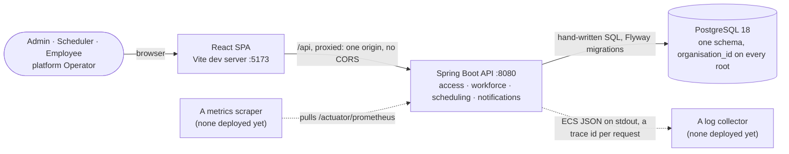
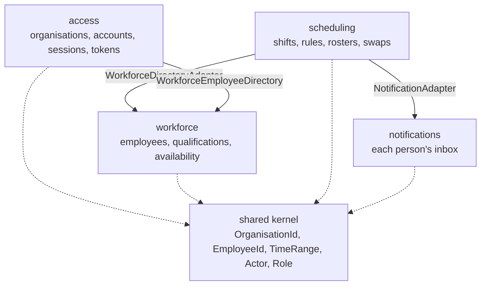

<div align="center">

# HrSched

**Staff rostering for many organisations at once: it turns shifts that need covering and people
with constraints into a roster that is legal to work, and refuses to publish one that is not.**

[](https://github.com/NaimElijah/HrSched/actions/workflows/ci.yml) [](backend/pom.xml) [](backend/pom.xml) [](frontend/package.json) [](LICENSE)

[Requirements](docs/requirements/requirements.md) · [Architecture](docs/architecture/architecture.md) · [Decisions](docs/ADRs/README.md) · [API](docs/api.md) · [Roadmap](https://github.com/NaimElijah/HrSched/milestones)

</div>

---



**Contents:** [What and why](#what-and-why) · [Features](#features) · [Architecture](#architecture)
· [Tech stack](#tech-stack) · [Quick start](#quick-start) · [Configuration](#configuration) ·
[Usage](#usage) · [Development](#development) · [Testing](#testing) ·
[Operations](#deployment-and-operations) · [Structure](#project-structure) ·
[Decisions](#design-decisions) · [Status](#status-and-limitations)

## What and why

Rostering shift work by hand collapses under its own constraints. A scheduler balancing
availability, qualifications, rest periods and contracted hours across a few dozen people produces
a roster that looks finished and is quietly illegal, and the mistake surfaces on the shop floor at
04:00 rather than in the spreadsheet. HrSched generates a roster from the shifts that need covering
and the people who can cover them, refuses to publish any roster that breaks a rule, and keeps the
published one correct as swaps arrive. One deployment serves many organisations, and every record
belongs to exactly one of them.

It deliberately ships no country's working-time law: a rest period or an hours cap is a value each
organisation configures, never a number in the code. Its wider non-goals are an open question the
owner has chosen to leave open for now ([Q15](docs/requirements/requirements.md#open-questions)).

## Features

- **Run many organisations on one deployment.** A platform Operator onboards each one with its
  first Admin, and is then refused everything inside it.
- **Provision accounts from the top down.** Each account is an Admin, a Scheduler or an Employee.
  A temporary password grants nothing until it is replaced, and nobody signs themselves up.
- **Describe your people.** Record their qualifications, when they cannot work, their soft
  preferences and their weekly contracted hours. A mistaken absence or preference can be withdrawn.
- **Configure the rules, and read back any version.** Set minimum rest, maximum daily and weekly
  working time, and maximum consecutive days. Each limit is optional, and none has a default.
- **Define shifts in their own time zone.** A shift has a headcount, the qualifications it
  requires, and an IANA zone. Its days are counted in that zone, across daylight saving changes.
- **Generate, adjust and publish a roster.** Generation leaves a shift short rather than fill it
  illegally, and a Scheduler can change the draft by hand, seeing every rule it breaks and every
  shift it leaves short as they go. Publishing is refused with every violation listed; a roster
  that passes supersedes whatever it overlaps.
- **Swap a shift.** An employee asks a colleague to cover, and a Scheduler decides. Approving
  publishes a replacement roster, judged by the same rules. An assignment can have one pending
  request at most, and it lapses with its roster. Both people see every outcome in their inbox.
- **See your own work.** An employee sees their assignments on published rosters only, and reads
  back the absences and preferences they declared.

Generation fills every place the rules allow, then weighs the organisation's objectives, with the
CP-SAT solver ([ADR-044](docs/ADRs/ADR-044-generate-rosters-with-or-tools-cp-sat.md)).

## Architecture

The backend is one Spring Boot process, organised by bounded context, and each context is a
complete hexagon: the domain imports nothing but the JDK, the application layer knows nothing about
adapters or Spring, and every dependency points inward. A small shared kernel holds the identities
and value types that cross contexts. A context may use another only through that context's
`application.port.in` package, and the three adapters on the diagram are the only places that do
([ADR-008](docs/ADRs/ADR-008-context-integration.md)).



A publication, `POST /api/rosters/{id}/publication`, shows the direction. The bearer token is one
HrSched signed itself, and the acting account is loaded from the database on every request
([ADR-011](docs/ADRs/ADR-011-issue-our-own-access-tokens.md)). `SecurityConfiguration`, which ends
in `denyAll`, admits tenant roles. `SchedulingController` calls `SchedulingService.publish`, one
transaction that refuses anyone but a Scheduler and takes the organisation's publication lock before
it reads anything. It judges the roster against the current rules and against work held on other
published rosters, supersedes what it overlaps, and lapses those rosters' pending swaps.
`JdbcRosterRepository` writes the result, with the schema's `roster_one_published_per_moment`
constraint as the backstop. The answer is `200`, a `422` listing every violation, or a `409` if an
overlapping roster was published at the same moment.

These rules fail the build when they are broken. `HexagonalArchitectureTest` runs ten ArchUnit rules
on every build. They cover dependency direction, a framework-free application layer, published
ports between contexts, a kernel that knows no context, layer cycles, printing, logging in the
domain, instrumentation inward of an adapter, and reading the acting identity from a thread-local.
Components, the authentication sequence and the data flow are in
[`docs/architecture/architecture.md`](docs/architecture/architecture.md).

## Tech stack

| Layer | Technology | Version | Why |
| :--- | :--- | ---: | :--- |
| Language | Java | 21 LTS | The LTS that Boot 4 supports ([ADR-001](docs/ADRs/ADR-001-java-spring-boot-maven.md)) |
| Framework | Spring Boot | 4.1.1 | Supplies the adapters; the hexagon carries no annotation |
| Security | Spring Security, OAuth2 resource server | 7.1.1 | Verifies the RS256 tokens HrSched signs itself |
| Database | PostgreSQL | 18 | Its constraints refuse what the domain must never store |
| Persistence | Spring JDBC + Flyway | 12.4.0 | Hand-written SQL behind the ports, no ORM ([ADR-004](docs/ADRs/ADR-004-postgresql-behind-the-driven-ports.md)) |
| Generation | Google OR-Tools, CP-SAT | 9.12.4544 | Every rule is a constraint, so a generated roster is legal by construction ([ADR-044](docs/ADRs/ADR-044-generate-rosters-with-or-tools-cp-sat.md)) |
| Tests | JUnit Jupiter, Testcontainers | 6.0.3 / 2.0.5 | Every test that touches storage runs on a real PostgreSQL |
| Architecture | ArchUnit | 1.5.1 | Turns the dependency rules into build failures |
| Observability | OpenTelemetry starter, Micrometer Prometheus | Boot BOM | A trace id on every response and log line; metrics pulled, not pushed |
| Frontend | React, TypeScript, Vite | 19.2.8 / 6.0.3 / 8.2.2 | Strict types turn API drift into a compile error ([ADR-013](docs/ADRs/ADR-013-react-typescript-vite-frontend.md)) |
| Frontend tests | Vitest, Testing Library | 5.0.5 / 16.3.3 | `fetch` is stubbed at the one module that calls it |
| Format and lint | Spotless (google-java-format), Prettier, ESLint | 3.10.4 / 3.9.6 / 10.13.0 | Formatting is checked by the same command that builds |
| Build | Maven Wrapper | 3.10.0 | Pinned in the repo, so no global Maven install is needed |

## Quick start

> [!IMPORTANT]
> Docker must be running. `npm run dev` starts the local PostgreSQL in `backend/compose.yaml`, and
> every build tests against a throwaway one through Testcontainers. There is no in-memory fallback,
> because a check that quietly does not run still reports green.

You need JDK 21, Node 22 or later (CI uses 24), and Docker. Maven is not needed: the committed
wrapper downloads its own pinned version.

```bash
git clone https://github.com/NaimElijah/HrSched.git && cd HrSched
npm run setup   # install the frontend's locked dependencies
npm run dev     # API on :8080 with its database, UI on :5173
```

Open <http://localhost:5173> and sign in as `operator` / `local-development-only`. You are made to
choose a password of at least 15 characters before the account can do anything. The API is up when
`curl localhost:8080/actuator/health/readiness` answers `{"status":"UP"}`.

The database keeps its rows between runs, so after that only your new password works;
`docker compose -f backend/compose.yaml down -v` starts over by deleting every local row. There is
no seed data. On Windows without a POSIX shell, use `mvnw.cmd` for `./mvnw`.

## Configuration

Nothing is needed locally. `compose.yaml` supplies the database, and `./mvnw spring-boot:run`
supplies a throwaway signing key and the local operator. A deployment sets the variables in
[`.env.example`](.env.example) instead:

| Variable | Purpose | Default | Required |
| :--- | :--- | :--- | :--- |
| `SPRING_DATASOURCE_URL` | JDBC URL of the database, e.g. `jdbc:postgresql://host:5432/hrsched` | none | In a deployment |
| `SPRING_DATASOURCE_USERNAME` | Who connects to it | none | In a deployment |
| `SPRING_DATASOURCE_PASSWORD` | Their password | none | In a deployment |
| `HRSCHED_SECURITY_TOKEN_PRIVATEKEY` | RSA key that signs access tokens; PKCS#8 PEM, 2048 bits or more | none | Yes; startup fails without it |
| `HRSCHED_BOOTSTRAP_OPERATOR_SIGNINNAME` | First platform Operator, created once at startup | none | Both or neither |
| `HRSCHED_BOOTSTRAP_OPERATOR_PASSWORD` | Its temporary password, replaced at first sign-in | none | Both or neither |

<details>
<summary>Every other setting, from <code>application.properties</code></summary>

| Property | Value | Why |
| :--- | :--- | :--- |
| `hrsched.security.token.issuer` / `.audience` | `hrsched` / `hrsched-api` | Required of every token, so one minted elsewhere is not spendable here |
| `hrsched.security.token.lifetime` | `10m` | A stolen access token is useful only until it expires (Q27) |
| `hrsched.security.session.absolute-lifetime` | `12h` | Fixed when the session starts, so a stolen refresh token cannot extend it |
| `hrsched.security.session.idle-lifetime` | `1h` | Closes a browser somebody walked away from |
| `hrsched.security.password.minimum-length` | `15` | NIST SP 800-63B-4, single-factor |
| `hrsched.security.password.bcrypt-strength` | `12` | Bcrypt's work factor; tests use `4` |
| `hrsched.security.sign-in.lockout-threshold` / `-duration` | `10` / `15m` | When an account locks, and for how long |
| `hrsched.generation.time-limit-per-phase` | `5m` | How long each of the solver's two searches may run before it answers with the best roster found: together, the ten minutes the requirements allow ([ADR-044](docs/ADRs/ADR-044-generate-rosters-with-or-tools-cp-sat.md)) |
| `hrsched.generation.concurrent-runs` | `2` | Generations one instance solves at once; one more is refused with a 503, not queued ([ADR-046](docs/ADRs/ADR-046-generate-in-the-background-and-keep-the-job-in-postgresql.md)) |
| `hrsched.generation.lost-after` | `12m` | How long a generation may stay pending before it reads as lost, its instance having stopped |
| `management.endpoints.web.exposure.include` | `health,info,metrics,prometheus` | An allow list: `/actuator/**` needs no token, so `env`, `loggers` and `heapdump` stay shut ([#78](https://github.com/NaimElijah/HrSched/issues/78)) |
| `management.endpoint.health.probes.enabled` | `true` | Liveness and readiness probes outside Kubernetes too |
| `logging.structured.format.console` | `ecs` | Elastic Common Schema JSON, always ([ADR-016](docs/ADRs/ADR-016-structured-logs-and-a-propagated-trace-id.md)) |
| `logging.structured.ecs.service.name` / `.version` | app name / Maven version | Identify the emitting service on every line |
| `management.tracing.sampling.probability` | `1.0` | Free while nothing is exported |
| `management.{tracing,logging}.export.otlp.enabled`, `management.otlp.metrics.export.enabled` | `false` | No collector exists yet (Q19) |
| `spring.application.name` | `HrSched` | Reported in logs and Actuator |

</details>

## Usage

Every call carries a bearer token, and the organisation comes from the account it names, never
from the request ([ADR-031](docs/ADRs/ADR-031-take-the-organisation-from-the-account.md)). These
responses are real ones from a local run; [`docs/api.md`](docs/api.md) has every endpoint, sign-in,
and the whole walkthrough from an empty database.

**Publish a roster.** Only a Scheduler may. The roster records the rule version that approved it,
so a later change to the rules can never make it illegal after the fact.

```bash
curl -s -X POST "localhost:8080/api/rosters/$ROSTER/publication" \
  -H "Authorization: Bearer $SCHEDULER"
```

```json
{
  "id": "c17ccc8f-91da-4124-8bfa-77d716f70113",
  "start": "2026-11-02T00:00:00Z",
  "end": "2026-11-03T00:00:00Z",
  "status": "PUBLISHED",
  "assignments": [
    {
      "shift": "5f963c30-24ae-41c2-864a-12d01e2de90d",
      "employee": "7c1fddc0-8a18-4e20-aa24-7a994a95815b"
    }
  ],
  "validatedAgainstConstraintVersion": 2
}
```

**Break a rule, and be told exactly how.** After a second draft was generated, the Admin set the
rules to `{"maximumDailyMinutes":60}`, an invented one-hour limit. Publishing that draft is then
refused with `422`. The response lists every violation, because a scheduler told only "rejected"
cannot act on it. There is no override.

```json
{
  "detail": "The roster breaks 1 rule(s)",
  "instance": "/api/rosters/d269eec8-97ae-4761-bdc3-07aa4fdcd62a/publication",
  "status": 422,
  "title": "Roster breaks the rules",
  "violations": [
    {
      "employee": "7c1fddc0-8a18-4e20-aa24-7a994a95815b",
      "constraint": "maximum daily working time",
      "detail": "PT8H worked on 2026-11-03 exceeds the maximum of PT1H"
    }
  ]
}
```

## Development

```bash
cd backend
./mvnw verify                                   # the whole gate: format, architecture, tests
./mvnw spring-boot:run                          # API on :8080, starting compose.yaml's database
./mvnw spotless:apply test -Dtest=RosterTest    # one class; format first, as validate checks it
cd ../frontend
npm run verify                                  # format, lint, typecheck, tests, build
```

From the root, `npm run verify` runs both gates in turn.

> [!WARNING]
> Spring Boot 4 renamed things that most tutorials and AI answers still call by their 3.x names.
> `spring-boot-starter-web` is now `spring-boot-starter-webmvc`, `@MockBean` is now `@MockitoBean`,
> and Jackson 3 lives in `tools.jackson.databind`. Check `pom.xml` and the jars, not the internet.

**Adding a use case:**
1. **Choose its context.** If it fits none, that is a new context and a new ADR.
2. **Model the concept** in `domain/model`, with its invariants in the constructor.
3. **Declare its ports** in `application/port/in` (driving) and `application/port/out` (driven).
4. **Implement it** in `application/service`, with no annotations.
5. **Register it** in `configuration/UseCaseConfiguration`.
6. **Add its adapters:** `adapter/in/web` for HTTP, and `adapter/out/<kind>` for each driven port.
7. **Open the route** in `SecurityConfiguration`, unless an existing family already admits it.
8. **List the controller** in its context's `@RestControllerAdvice`, or its errors go untranslated.
9. **Test** the domain and the service without Spring, then the route over HTTP.

**Conventions:**
- **Migrations:** Flyway SQL named `V<n>__<rule_in_snake_case>.sql`. An applied migration is never
  edited; correct it with a new one.
- **Branches:** name each one `type/short-kebab-description`, branch it off `dev`, and open its pull
  request into `dev`. `dev` reaches `main` only through a pull request of its own.
- **Commits:** [Conventional Commits](https://www.conventionalcommits.org/), one change each.
- **Agents:** guidance for coding agents is in [`.claude/CLAUDE.md`](.claude/CLAUDE.md),
  [`backend/CLAUDE.md`](backend/CLAUDE.md) and [`frontend/CLAUDE.md`](frontend/CLAUDE.md).

## Testing

The suite holds over 1,100 backend tests, each named `Given<scenario>_When<action>_Then<result>`,
and over 300 frontend tests. Services take an injected `Clock`, and no test sleeps: the concurrency
tests coordinate real threads with barriers and latches.

| Layer | What it proves | Examples |
| :--- | :--- | :--- |
| Domain | Invariants, rule thresholds at their boundaries, and day arithmetic in each shift's zone, daylight saving included | `WorkingTimeConstraintTest`, `RosterTest` |
| Application | Use cases against hand-written fakes of their own ports: no Spring, no mocking framework | `SchedulingServiceTest`, `SwapServiceTest` |
| Persistence | Every query scoped to its organisation, on a real PostgreSQL 18; migrations pinned; concurrent publications and edits raced on real threads | `JdbcRosterRepositoryTest`, `AppendOnlyRosterHistoryMigrationTest` |
| HTTP | Every endpoint through the real security chain: who reaches what, every problem body, and a trace id on every response | `RosteringHttpTest`, `SwapHttpTest`, `AccountHttpTest` |
| Architecture | The ten dependency rules above | `HexagonalArchitectureTest` |
| Frontend | The one module that calls `fetch`, error-body validation, session renewal, and one test file per screen | `api/client.test.ts`, `pages/*.test.tsx` |

CI runs both gates on every push, and on every pull request into `main` or `dev`
([`ci.yml`](.github/workflows/ci.yml)). It has no path filters, because a check filtered out by
mistake is skipped silently and still reports green. Coverage is reported but never enforced
([ADR-015](docs/ADRs/ADR-015-report-coverage-without-a-threshold.md)). `./mvnw verify` writes
`backend/target/site/jacoco/index.html`, and `npm run test:coverage` writes
`frontend/coverage/index.html`.

## Deployment and operations

HrSched is not deployed anywhere yet. The chosen target is AWS (ECS Fargate, RDS and CloudFront,
defined in CDK; [#153](https://github.com/NaimElijah/HrSched/issues/153)), planned as milestones M3
and M4 and to be recorded as ADR-035 and ADR-036. Today `./mvnw verify` builds the executable jar
`backend/target/hrsched-0.0.1-SNAPSHOT.jar`, and Flyway migrates the database at startup, before
the application reports ready.

| Concern | Where |
| :--- | :--- |
| Liveness, readiness | `GET /actuator/health/liveness`, `GET /actuator/health/readiness` |
| Metrics | `GET /actuator/prometheus`, pulled by a scraper; nothing pushes ([ADR-017](docs/ADRs/ADR-017-expose-metrics-to-be-scraped.md)) |
| Logs | One ECS JSON object per line on stdout; every line a request produces carries `traceId` and `spanId` |
| Traces | A W3C trace id on every response as `X-Trace-Id`, refusals included, and shown by the UI so a person's report joins the log. Nothing is exported yet (Q19) |

| Meter | What it answers |
| :--- | :--- |
| `http_server_requests_seconds` | Request rate, latency and error rate, per route and status |
| `hrsched_shifts_required_places`, `hrsched_shifts_uncovered_places` | Places generation was asked to fill, and could not fill legally: their ratio is coverage, the product's own success metric |
| `hrsched_rosters_refused_total{reason}` | Publications refused as `not_compliant`, `not_verifiable` or `concurrent_publication` |
| `hrsched_access_denied_total{kind}` | Refusals by kind; a rise in `cross_tenant` is a security signal, not a usage one |
| `hrsched_changes_total{context,change}` | Every recorded change, by context and kind |
| `jvm_*`, `process_*`, `hikaricp_*` | Saturation: heap, threads, the connection pool |

## Project structure

```text
HrSched/
├── backend/                    Spring Boot API; guidance in backend/CLAUDE.md
│   ├── src/main/java/…/hrsched/
│   │   ├── access/             organisations, accounts, sessions, tokens
│   │   ├── workforce/          employees, qualifications, availability, contracts
│   │   ├── scheduling/         shifts, rules, rosters, swaps, generation
│   │   ├── notifications/      each person's inbox
│   │   ├── shared/             the kernel; knows no context
│   │   └── configuration/      wiring, the security chain, transactions
│   ├── src/main/resources/db/migration/   Flyway SQL, never edited once applied
│   └── compose.yaml            local PostgreSQL for spring-boot:run
├── frontend/src/               React SPA: api/ · auth/ · components/ · pages/ · test-support/
├── docs/                       requirements/ (what) · architecture/ (how) · ADRs/ (why) · api.md
├── scripts/run.mjs             root task runner for setup, dev and verify (ADR-014)
└── .github/                    CI and Dependabot
```

## Design decisions

| Decision | Rejected | Cost accepted |
| :--- | :--- | :--- |
| One hexagon per bounded context, enforced by the build ([ADR-003](docs/ADRs/ADR-003-hexagonal-architecture-with-ddd.md), [ADR-006](docs/ADRs/ADR-006-organise-packages-by-bounded-context.md)) | Multi-module Maven, disproportionate for one developer; a convention nobody enforces | More classes per use case; enforcement is a test, not the compiler |
| PostgreSQL, hand-written SQL, and a real database in every test ([ADR-004](docs/ADRs/ADR-004-postgresql-behind-the-driven-ports.md)) | JPA, Spring Data JDBC, jOOQ, an embedded database | Docker to build; every adapter maps rows by hand |
| Its own tokens, with the organisation taken from the account ([ADR-011](docs/ADRs/ADR-011-issue-our-own-access-tokens.md), [ADR-031](docs/ADRs/ADR-031-take-the-organisation-from-the-account.md)) | An external OIDC provider, while there is one API and one SPA; roles as token claims, unrevocable until expiry | A database read per request; HrSched stores password hashes |
| Publications take turns, and history is written once ([ADR-027](docs/ADRs/ADR-027-take-turns-publishing-within-an-organisation.md), [ADR-037](docs/ADRs/ADR-037-keep-roster-history-as-a-record-in-time.md)) | `SERIALIZABLE`, whose aborts still need a retry; `SELECT … FOR UPDATE` on another context's row | Publications in one organisation queue |
| Generation with CP-SAT behind a port ([ADR-044](docs/ADRs/ADR-044-generate-rosters-with-or-tools-cp-sat.md), [ADR-045](docs/ADRs/ADR-045-generate-outside-the-use-cases-transaction.md)) | Timefold, whose search must drive a broken rule's penalty to zero and proves no bound; a MIP solver | About 95 MB of native libraries; no determinism under a time limit; OR-Tools held at 9.12 for the Visual C++ runtime JDK 21 bundles on Windows |

All 44 decisions, and the two still waiting to be recorded, are in the
[ADR index](docs/ADRs/README.md).

## Status and limitations

**Pre-release.** It works end to end locally and has never been deployed. Five
[milestones](https://github.com/NaimElijah/HrSched/milestones) track the rest: M1 (v1 complete),
M2 (engineering baseline), M3 (AWS staging), M4 (production) and M5 (ML that proposes, never
decides). The [requirements](docs/requirements/requirements.md) mark each row decided but `not yet`
built.

**Known limitations:**
- **Generation takes minutes at the largest size.** It runs in the background and the Rosters page
  waits for it ([ADR-046](docs/ADRs/ADR-046-generate-in-the-background-and-keep-the-job-in-postgresql.md)). Each of the solver's two searches stops at
  `hrsched.generation.time-limit-per-phase` with the best roster it has found, which at the largest
  stated size may not be the best there is. Two generations of one week can differ, each as legal
  as the other.
- **A shift's zone is the Scheduler's browser zone.** The Shifts page sends the zone its times were
  typed in, and no page shows a shift's zone yet
  ([#136](https://github.com/NaimElijah/HrSched/issues/136)).
- **Some reads load a tenant's whole history.** Publishing, assigning and reading your own schedule
  each load every roster the organisation has ever had, and child rows are inserted one at a time.
  The targets are set (p95 under 300 ms), but nothing measures them yet.
- **The audit trail is a log stream.** An Admin cannot read it. A record written in a transaction
  that fails to commit outlives the change it describes. A durable trail is decided
  ([#31](https://github.com/NaimElijah/HrSched/issues/31)).
- **Notifications are pull-only.** A colleague learns of a change when they next open the app (Q21).
- **Nothing proves the UI and the API agree.** The client is written by hand, and there is no
  contract or browser test ([ADR-013](docs/ADRs/ADR-013-react-typescript-vite-frontend.md)).
- **Nothing blocks a merge on a red build or a vulnerable dependency.** CI is not a required check
  and runs no dependency audit, though Dependabot alerts are on.

## Contributing and licence

There is no `CONTRIBUTING.md` yet, and no `CHANGELOG.md` until the first release; the
[Development](#development) conventions and the CLAUDE.md files are the standard.

Proprietary, all rights reserved; see [`LICENSE`](LICENSE). The repository is public to be read, and
no permission is granted to use, copy, modify or distribute it.
