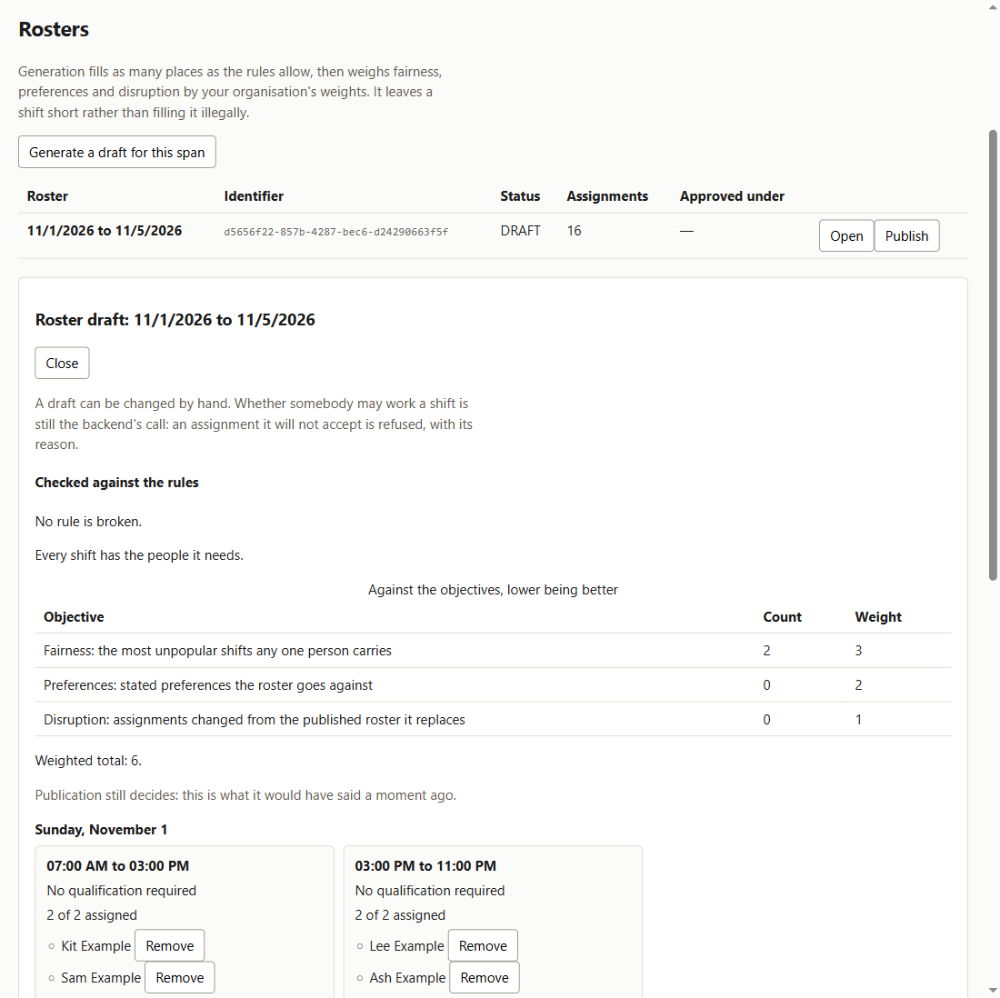
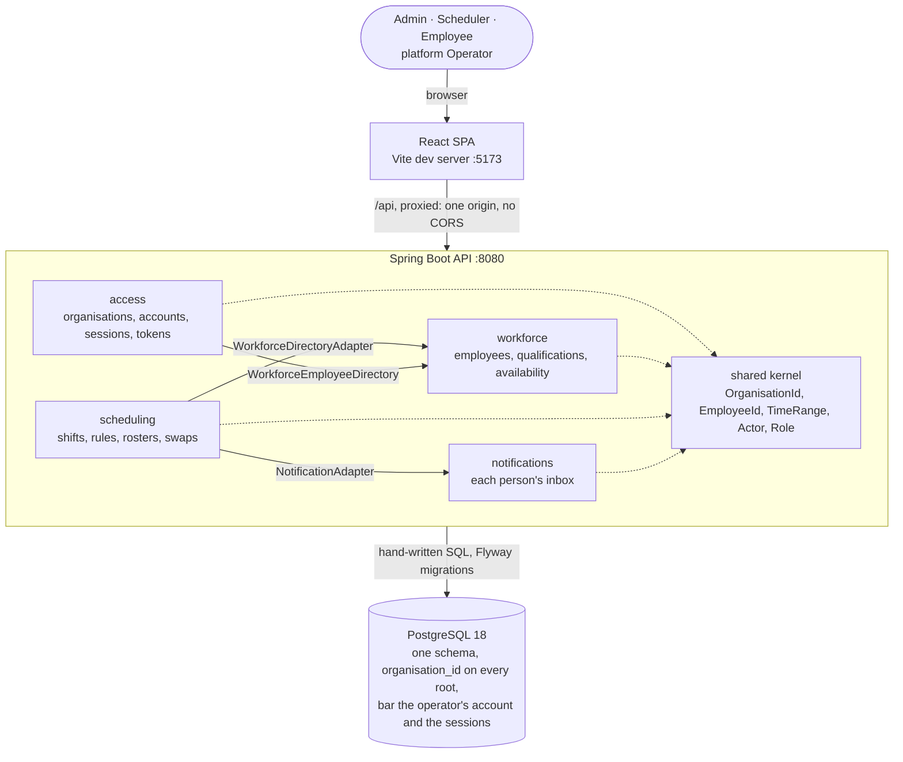

<div align="center">

# HrSched

**Staff rostering for many organisations at once: it turns shifts that need covering and people
with constraints into a roster that keeps every working-time rule the organisation sets, and
refuses to publish one that breaks them.**

[](LICENSE)

[Requirements](docs/requirements/requirements.md) · [Architecture](docs/architecture/architecture.md) · [Decisions](docs/ADRs/README.md) · [API](docs/api.md) · [Threat model](docs/security/threat-model.md) · [Roadmap](https://github.com/NaimElijah/HrSched/milestones)

</div>

---



## Contents

[What and why](#what-and-why) · [Features](#features) · [Architecture](#architecture) ·
[Tech stack](#tech-stack) · [Quick start](#quick-start) · [Configuration](#configuration) ·
[Usage](#usage) · [Development](#development) · [Testing](#testing) ·
[Operations](#deployment-and-operations) · [Structure](#project-structure) ·
[Decisions](#design-decisions) · [Status](#status-and-limitations)

## What and why

Rostering shift work by hand collapses under its own constraints. A scheduler balancing
availability, qualifications, rest periods and contracted hours across a few dozen people produces a
roster that looks finished and quietly breaks a rule, and the mistake surfaces on the shop floor at
04:00 rather than in the spreadsheet. HrSched generates a roster from the shifts that need covering
and the people who can cover them, refuses to publish any roster that breaks a rule, and keeps the
published one correct as swaps arrive. One deployment serves many organisations, and every record
belongs to exactly one of them.

It deliberately ships no country's working-time law: a rest period or an hours cap is a value each
organisation configures, never a number in the code. Its wider non-goals are an open question the
owner has chosen to leave open for now ([Q15](docs/requirements/requirements.md#open-questions)).

## Features

- **Run many organisations on one deployment.** An Operator onboards each with its first Admin.
- **Provision accounts from the top down.** Admin, Scheduler or Employee; there is no self-sign-up.
- **Describe your people.** Qualifications, absences, preferences and weekly contracted hours.
- **Configure the working-time rules.** Every limit is optional, none has a default, and any version
  can be read back.
- **Define shifts in their own time zone.** A headcount, required qualifications, and days counted
  across daylight saving changes.
- **Generate, adjust and publish a roster.** The CP-SAT solver
  ([ADR-044](docs/ADRs/ADR-044-generate-rosters-with-or-tools-cp-sat.md)) fills every place the
  rules allow, a Scheduler edits the draft, and publishing is refused with every violation listed.
- **Swap a shift.** An employee asks a colleague to cover, a Scheduler decides, and approval
  publishes a replacement roster judged by the same rules.
- **See your own work.** Published assignments, and the absences and preferences you declared.

The rules behind each, and what is decided but not yet built, are in
[`requirements.md`](docs/requirements/requirements.md).

## Architecture

The backend is one Spring Boot process, organised by bounded context, and each context is a complete
hexagon: the domain imports the JDK and HrSched's own `domain` packages, its context's and the
kernel's, and nothing else; the application layer knows nothing about adapters or Spring; and every
dependency points inward. A small shared kernel holds the identities and value types that cross
contexts. A context may use another only through that context's `application.port.in` package, and
the three adapters on the diagram are the only places that do
([ADR-008](docs/ADRs/ADR-008-context-integration.md)).



A publication, `POST /api/rosters/{id}/publication`, shows the direction. The bearer token is one
HrSched signed itself, and the acting account is loaded from the database on every request
([ADR-011](docs/ADRs/ADR-011-issue-our-own-access-tokens.md)). `SecurityConfiguration`, which ends
in `denyAll`, admits tenant roles. `SchedulingController` calls `SchedulingService.publish`, one
transaction that refuses anyone but a Scheduler and takes the organisation's publication lock before
it reads anything. It judges the roster against the current rules and against work held on other
published rosters, supersedes what it overlaps, and lapses those rosters' pending swaps.
`JdbcRosterRepository` writes the result, with the schema's `roster_one_published_per_moment`
constraint as the backstop. The answer is `200`, a `422` listing every violation, or a `409` if an
overlapping roster was published at the same moment.

[`HexagonalArchitectureTest`](backend/src/test/java/io/github/naimelijah/hrsched/architecture/HexagonalArchitectureTest.java)
runs twenty ArchUnit rules on every build, and a broken one fails it. Components, the authentication
sequence and the data flow are in
[`docs/architecture/architecture.md`](docs/architecture/architecture.md).

## Tech stack

| Layer | Technology | Version | Why |
| :--- | :--- | ---: | :--- |
| Language | Java | 21 LTS | The JDK on the development machine, which Boot 4 supports ([ADR-001](docs/ADRs/ADR-001-java-spring-boot-maven.md)) |
| Framework | Spring Boot | 4.1.2 | Supplies the adapters; the hexagon carries no annotation |
| Security | Spring Security, OAuth2 resource server | 7.1.2 | Verifies the RS256 tokens HrSched signs itself |
| Database | PostgreSQL | 18 | Its constraints refuse what the domain must never store |
| Persistence | Spring JDBC + Flyway | Flyway 12.4.0 | Hand-written SQL behind the ports, no ORM ([ADR-004](docs/ADRs/ADR-004-postgresql-behind-the-driven-ports.md)) |
| Generation | Google OR-Tools, CP-SAT | 9.12.4544 | Every rule is a constraint, so a generated roster keeps every configured rule by construction ([ADR-044](docs/ADRs/ADR-044-generate-rosters-with-or-tools-cp-sat.md)) |
| Tests | JUnit Jupiter, Testcontainers | 6.0.3 / 2.0.5 | Every test that touches storage runs on a real PostgreSQL |
| Architecture | ArchUnit | 1.5.1 | Turns the dependency rules into build failures |
| Observability | OpenTelemetry starter, Micrometer Prometheus | OpenTelemetry 1.67.0; Micrometer 1.17.2 | A trace id on every response and log line; metrics pull-only |
| Frontend | React, TypeScript, Vite | 19.3.1 / 6.0.3 / 8.3.5 | Strict types turn API drift into a compile error ([ADR-013](docs/ADRs/ADR-013-react-typescript-vite-frontend.md)) |
| Frontend tests | Vitest, Testing Library | 5.0.5 / 16.3.3 | `fetch` is stubbed at the one module that calls it |
| Format and lint | Spotless (google-java-format), Prettier, ESLint | 3.10.4 / 3.9.6 / 10.13.0 | Formatting is checked by the same command that builds |
| Build | Maven, through the Maven Wrapper | Maven 3.10.0 | The wrapper downloads this version, so no global Maven install is needed |

## Quick start

> [!IMPORTANT]
> Docker must be running. `npm run dev` starts the local PostgreSQL in `backend/compose.yaml`, and
> every build tests against a throwaway one through Testcontainers. There is no in-memory fallback,
> because a check that quietly does not run still reports green.

You need JDK 21, Node 22 or later (CI uses 24), and Docker with Compose v2. Maven is not needed: the
committed wrapper downloads its own pinned version. The first run downloads Maven's dependencies,
the PostgreSQL image and the OR-Tools native libraries (about 95 MB), so it takes several minutes.

```bash
git clone https://github.com/NaimElijah/HrSched.git && cd HrSched
npm run setup   # install the frontend's locked dependencies
npm run dev     # API on :8080 with its database, UI on :5173
```

Open <http://localhost:5173> and sign in as `operator` / `local-development-only`. You are made to
choose a password of at least 15 characters before the account can do anything. The API is up when
`curl localhost:8080/actuator/health/readiness` answers `{"status":"UP"}`.

The operator only onboards organisations. In the Organisations tab, onboard one together with its
first Admin, then sign out and sign in as that Admin. There is no seed data; the
[Walkthrough in `docs/api.md`](docs/api.md#walkthrough) scripts the path to a published roster.

> [!CAUTION]
> The database keeps its rows between runs, so after the first sign-in only your new password
> works. `docker compose -f backend/compose.yaml down -v` starts over by deleting every local row.

## Configuration

Nothing is needed locally. `compose.yaml` supplies the database, and `./mvnw spring-boot:run`
supplies a throwaway signing key and the local operator. A deployment sets the variables in
[`.env.example`](.env.example) instead:

| Variable | Purpose | Default | Required |
| :--- | :--- | :--- | :--- |
| `SPRING_DATASOURCE_URL` | JDBC URL of the database, e.g. `jdbc:postgresql://host:5432/hrsched` | none | In a deployment |
| `SPRING_DATASOURCE_USERNAME` | Who connects to it | none | In a deployment |
| `SPRING_DATASOURCE_PASSWORD` | Their password | none | In a deployment |
| `HRSCHED_SECURITY_TOKEN_PRIVATEKEY` | RSA key that signs access tokens; PKCS#8 PEM, 2048 bits or more | none | Yes; startup fails without it |
| `HRSCHED_BOOTSTRAP_OPERATOR_SIGNINNAME` | First platform Operator, created once at startup; startup fails if a tenant's account holds the name | none | Both or neither |
| `HRSCHED_BOOTSTRAP_OPERATOR_PASSWORD` | Its temporary password, replaced at first sign-in | none | Both or neither |

Every other setting, from `application.properties`, with why it has the value it has, is in
[`docs/operations.md`](docs/operations.md#settings).

## Usage

Every call carries a bearer token, and the organisation comes from the account it names, never from
the request ([ADR-031](docs/ADRs/ADR-031-take-the-organisation-from-the-account.md)). These
responses are real ones from a local run. [`docs/api.md`](docs/api.md) has every endpoint and
sign-in, and its [Walkthrough](docs/api.md#walkthrough), run first, sets `$SCHEDULER` (a
Scheduler's access token) and `$ROSTER` (a generated draft's id).

**Publish a roster.** Only a Scheduler may. The roster records the rule version that approved it, so
a later change to the rules does not change what it was approved against.

```bash
curl -s -X POST "localhost:8080/api/rosters/$ROSTER/publication" \
  -H "Authorization: Bearer $SCHEDULER"
```

```json
{
  "id": "c17ccc8f-91da-4124-8bfa-77d716f70113",
  "start": "2026-11-02T00:00:00Z",
  "end": "2026-11-03T00:00:00Z",
  "status": "PUBLISHED",
  "assignments": [
    {
      "shift": "5f963c30-24ae-41c2-864a-12d01e2de90d",
      "employee": "7c1fddc0-8a18-4e20-aa24-7a994a95815b"
    }
  ],
  "validatedAgainstConstraintVersion": 2
}
```

**Break a rule, and be told exactly how.** After a second draft was generated, the Admin set the
rules to `{"maximumDailyMinutes":60}`, an invented one-hour limit. Publishing that draft is then
refused with `422`. The response lists every violation, because a scheduler told only "rejected"
cannot act on it. There is no override.

```json
{
  "detail": "The roster breaks 1 rule(s)",
  "instance": "/api/rosters/d269eec8-97ae-4761-bdc3-07aa4fdcd62a/publication",
  "status": 422,
  "title": "Roster breaks the rules",
  "type": "urn:hrsched:problem:roster-breaks-the-rules",
  "violations": [
    {
      "employee": "7c1fddc0-8a18-4e20-aa24-7a994a95815b",
      "constraint": "maximum daily working time",
      "detail": "PT8H worked on 2026-11-03 exceeds the maximum of PT1H"
    }
  ]
}
```

## Development

```bash
cd backend
./mvnw verify                                   # the whole gate: format, architecture, tests
./mvnw spring-boot:run                          # API on :8080, starting compose.yaml's database
./mvnw spotless:apply test -Dtest=RosterTest    # one class; format first, as validate checks it
cd ../frontend
npm run verify                                  # format, lint, typecheck, tests, build
```

From the root, `npm run verify` runs both gates in turn.

On Windows without a POSIX shell, use `mvnw.cmd` for `./mvnw`. It needs PowerShell on `PATH`, and
its exit code is unreliable: it has exited 0 and 1 when Maven never started. A run has passed only
when its log shows `Tests run:` and `BUILD SUCCESS`.

**Adding a use case** goes from the inside out: its context (one that fits none is a new context and
a new ADR), the domain model, its ports, the service with no annotations, its registration in
`UseCaseConfiguration`, the adapters, the route in `SecurityConfiguration`, its controller in the
context's `@RestControllerAdvice`, and tests; the steps are in
[`backend/CLAUDE.md`](backend/CLAUDE.md#adding-a-use-case).

**Conventions:**
- **Migrations:** Flyway SQL named `V<n>__<rule_in_snake_case>.sql`. An applied migration is never
  edited; correct it with a new one.
- **Branches:** name each one `type/short-kebab-description`, branch it off `dev`, and open its pull
  request into `dev`. `dev` reaches `main` only through a pull request of its own.
- **Commits:** [Conventional Commits](https://www.conventionalcommits.org/), one change each.
- **Agents:** guidance for coding agents is in [`.claude/CLAUDE.md`](.claude/CLAUDE.md),
  [`backend/CLAUDE.md`](backend/CLAUDE.md) and [`frontend/CLAUDE.md`](frontend/CLAUDE.md).

## Testing

Backend tests are named `Given<scenario>_When<action>_Then<result>`. Services take an injected
`Clock`, and no test sleeps: the concurrency tests coordinate real threads with barriers and
latches. Each layer below is run by one class as an example; `./mvnw test` runs them all. Spotless
checks formatting before any test, so `spotless:apply` comes first.

| Layer | What it proves | Command (from `backend/`) |
| :--- | :--- | :--- |
| Domain | Invariants, rule thresholds at their boundaries, and day arithmetic in each shift's zone, daylight saving included | `./mvnw spotless:apply test -Dtest=RosterTest` |
| Application | Use cases against hand-written fakes of their own ports: no Spring, no mocking framework | `./mvnw spotless:apply test -Dtest=SchedulingServiceTest` |
| Persistence | Every query scoped to its organisation, on a real PostgreSQL 18; migrations pinned; concurrent publications and edits raced on real threads | `./mvnw spotless:apply test -Dtest=JdbcRosterRepositoryTest` |
| HTTP | Every endpoint through the real security chain: who reaches what, every problem body, and a trace id on every response | `./mvnw spotless:apply test -Dtest=RosteringHttpTest` |
| Architecture | The twenty architecture rules, and the ones with our own logic run against classes built to break them | `./mvnw spotless:apply test -Dtest=HexagonalArchitectureTest` |
| Frontend | The one module that calls `fetch`, error-body validation, session renewal, and one test file per screen | `npm test` (from `frontend/`) |

CI runs both gates, and a dependency audit, on every push and on every pull request into `main` or
`dev` ([`ci.yml`](.github/workflows/ci.yml)), with no path filters, because a check filtered out by
mistake is skipped silently and still reports green. The audit fails on any known advisory, and the
only way past one is an entry in [`osv-scanner.toml`](osv-scanner.toml) with an expiry and a reason
([ADR-047](docs/ADRs/ADR-047-audit-dependencies-in-ci-with-osv-scanner.md)). Coverage is reported
but never enforced ([ADR-015](docs/ADRs/ADR-015-report-coverage-without-a-threshold.md)); the
reports are `backend/target/site/jacoco/index.html` and, from `npm run test:coverage`,
`frontend/coverage/index.html`.

## Deployment and operations

HrSched is not deployed anywhere; the planned AWS target is under
[Status and limitations](#status-and-limitations). `./mvnw verify` builds the executable jar
`backend/target/hrsched-0.0.1-SNAPSHOT.jar`, and Flyway migrates the database at startup, before the
application reports ready.

| Concern | Where |
| :--- | :--- |
| Liveness, readiness | `GET /actuator/health/liveness`, `GET /actuator/health/readiness` |
| Logs | One ECS JSON object per line on stdout; every line a request produces carries `traceId` and `spanId` |
| Traces | A W3C trace id on every response as `X-Trace-Id`, refusals included, and shown by the UI so a person's report joins the log. Nothing is exported yet: which backend receives it is an [open question](docs/requirements/requirements.md#open-questions) |

The metrics endpoints, `/actuator/prometheus` and `/actuator/metrics`, are refused to every caller
until [#78](https://github.com/NaimElijah/HrSched/issues/78) is decided
([ADR-049](docs/ADRs/ADR-049-refuse-the-metrics-to-every-caller-until-a-scraper-exists.md)). The
meters the application records are in [`docs/operations.md`](docs/operations.md#meters).

## Project structure

```text
HrSched/
├── backend/       Spring Boot API; guidance in backend/CLAUDE.md
│   ├── src/       a package per context (access, workforce, scheduling, notifications),
│   │              the shared kernel and the wiring; Flyway SQL in resources/db/migration
│   └── compose.yaml   local PostgreSQL for spring-boot:run
├── frontend/      React SPA
│   └── src/       api/ · auth/ · components/ · pages/ · test-support/
├── docs/          requirements/ (what) · architecture/ (how) · ADRs/ (why) · security/ · api.md
├── scripts/       run.mjs, the root task runner for dev and verify (ADR-014)
└── .github/       CI and Dependabot
```

## Design decisions

**One hexagon per bounded context, enforced by the build**
([ADR-003](docs/ADRs/ADR-003-hexagonal-architecture-with-ddd.md),
[ADR-006](docs/ADRs/ADR-006-organise-packages-by-bounded-context.md)). Rostering rules should be
testable without Spring or a database, and a convention nobody enforces rots; multi-module Maven
was too much for one developer. Cost: more classes per use case, enforced by a test, not a compiler.

**PostgreSQL, hand-written SQL, and a real database in every test**
([ADR-004](docs/ADRs/ADR-004-postgresql-behind-the-driven-ports.md)). Real transactions and check
constraints, with every tenant predicate visible in its query; JPA, Spring Data JDBC, jOOQ and an
embedded database lost. Cost: Docker to build, and every adapter maps its rows by hand.

**Its own tokens, with the organisation taken from the account**
([ADR-011](docs/ADRs/ADR-011-issue-our-own-access-tokens.md),
[ADR-031](docs/ADRs/ADR-031-take-the-organisation-from-the-account.md)). One API and one SPA do not
justify an external identity provider, and loading the account on every request ends a revoked
session at once, which roles in token claims could not. Cost: a database read per request, and
HrSched stores password hashes.

**Publications take turns, and history is written once**
([ADR-027](docs/ADRs/ADR-027-take-turns-publishing-within-an-organisation.md),
[ADR-037](docs/ADRs/ADR-037-keep-roster-history-as-a-record-in-time.md)). A lock per organisation
queues concurrent publications, where `SERIALIZABLE` still needs a retry on abort and
`SELECT … FOR UPDATE` would lock another context's row. Cost: publications queue per organisation.

**Generation with CP-SAT behind a port**
([ADR-044](docs/ADRs/ADR-044-generate-rosters-with-or-tools-cp-sat.md),
[ADR-045](docs/ADRs/ADR-045-generate-outside-the-use-cases-transaction.md)). The rules are hard and
the objectives soft, which an exact solver models directly; Timefold's search must drive a broken
rule's penalty to zero and proves no bound, and a MIP solver lost too. Cost: about 95 MB of native
libraries, no determinism under a time limit, and OR-Tools held at 9.12 for the Visual C++ runtime
that JDK 21 bundles on Windows.

Every decision, and every one still waiting to be recorded, is in the
[ADR index](docs/ADRs/README.md).

## Status and limitations

**Alpha.** It works end to end on a developer's machine, has never been deployed, and is unreleased.

**Shipped:** everything under [Features](#features), running locally against a PostgreSQL in
Docker. The [requirements](docs/requirements/requirements.md) mark each row decided but `not yet`
built.

**Planned**, tracked by the [milestones](https://github.com/NaimElijah/HrSched/milestones): M0, the
full-system scans of the code and the docs; M1, v1 feature-complete; M2, the engineering baseline;
M3 and M4, AWS staging and production on ECS Fargate, RDS and CloudFront, defined in CDK
([#153](https://github.com/NaimElijah/HrSched/issues/153); ADR-035 and ADR-036 are reserved for the
topology); and M5, machine learning that proposes and never decides.

**Known limitations:**
- **No jurisdiction preset exists yet.** HrSched ships no statute's numbers, so every limit is typed
  in by the organisation ([#105](https://github.com/NaimElijah/HrSched/issues/105)).
- **Generation takes minutes at the largest size.** It runs in the background
  ([ADR-046](docs/ADRs/ADR-046-generate-in-the-background-and-keep-the-job-in-postgresql.md)), and
  each of the solver's two searches stops at `hrsched.generation.time-limit-per-phase` with the best
  roster it has found, which at the largest stated size may not be the best there is. Two
  generations of one week can differ, each keeping every configured rule.
- **A shift's zone is the Scheduler's browser zone.** The Shifts page sends the zone its times were
  typed in, and no page shows it ([#136](https://github.com/NaimElijah/HrSched/issues/136)).
- **Some reads load a tenant's whole history.** Publishing, assigning and reading your own schedule
  each load every roster the organisation has ever had, and child rows are inserted one at a time.
  The target is p95 under 300 ms, but nothing measures it yet.
- **The audit trail is a log stream.** An Admin cannot read it, and a record written in a
  transaction that fails to commit outlives the change. A durable trail is decided
  ([#31](https://github.com/NaimElijah/HrSched/issues/31)).
- **Notifications are pull-only.** A colleague learns of a change when they next open the app; any
  other channel is an [open question](docs/requirements/requirements.md#open-questions).
- **Nothing proves the UI and the API agree.** The client is written by hand, and there is no
  contract or browser test ([ADR-013](docs/ADRs/ADR-013-react-typescript-vite-frontend.md)).
- **Nothing blocks a merge on a red build or a vulnerable dependency.** CI runs on every push and
  every pull request into `main` or `dev`, but none of its jobs is a required check yet
  ([#217](https://github.com/NaimElijah/HrSched/issues/217)), so a red one blocks nothing. The audit
  has no severity threshold, and does not audit Maven build plugins such as Spotless and JaCoCo.

## Contributing and licence

There is no `CONTRIBUTING.md` yet, and no `CHANGELOG.md` until the first release; the
[Development](#development) conventions and the CLAUDE.md files are the standard.

Proprietary, all rights reserved; see [`LICENSE`](LICENSE). The repository is public to be read, and
no permission is granted to use, copy, modify or distribute it.
