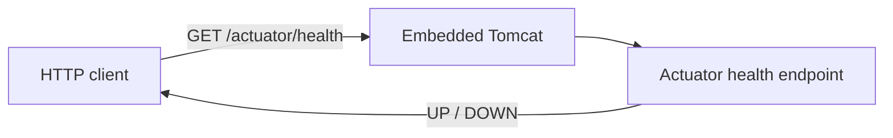

<div align="center">

# HrSched

**Staff shift scheduling — turning shifts that need covering and people with constraints into a roster that is actually legal to work.**


[Requirements](docs/requirements/requirements.md) · [Architecture](docs/architecture/architecture.md) · [Decisions](docs/ADRs/)

</div>

---

> [!WARNING]
> **The application runs, but it does nothing yet.** It starts, serves health and readiness
> endpoints, and has no rostering logic — no domain model, no persistence, no API beyond
> Actuator. What is real is the build, the test harness, and the decisions behind them.

This README is ordered for a **contributor**, not an evaluator: there is not yet anything to
evaluate, so Quick start comes before Architecture.

## Contents

- [What and why](#what-and-why) · [Features](#features)
- [Quick start](#quick-start) · [Usage](#usage) · [Configuration](#configuration)
- [Tech stack](#tech-stack) · [Architecture](#architecture) · [Project structure](#project-structure)
- [Development](#development) · [Testing](#testing) · [Deployment and operations](#deployment-and-operations)
- [Design decisions](#design-decisions) · [Documentation](#documentation)
- [Status and limitations](#status-and-limitations)
- [Contributing](#contributing) · [Licence](#licence)

## What and why

Rostering shift work by hand collapses under its own constraints. A scheduler juggling
availability, qualifications, rest periods, and contracted hours across a few dozen people
will produce a roster that looks finished and is quietly illegal — and the error surfaces on
the shop floor at 04:00, not in the spreadsheet.

HrSched takes the shifts that need covering and the people available to cover them, and
produces a roster that respects those constraints, then keeps it correct as sickness, swaps,
and cancellations arrive. The value is in the constraint checking; the calendar is the easy
part.

What it deliberately does *not* do is not yet settled — see
[Non-goals](docs/requirements/requirements.md#non-goals), currently an open question rather
than an answer.

## Features

**None yet.** No functional requirement is implemented; the
[requirements table](docs/requirements/requirements.md#functional-requirements) is still
empty by design. This section stays empty until a capability exists in code — a feature
listed here and absent from the build is a bug report waiting to be filed.

## Quick start

**Prerequisites**

| Tool | Version | Notes |
| --- | --- | --- |
| JDK | 21 (LTS) | Verified against Temurin 21.0.9. Later JDKs are untested here. |
| Git | any recent | — |

Maven is **not** a prerequisite — the committed wrapper downloads its own pinned version
(3.9.16).

```bash
git clone https://github.com/NaimElijah/HrSched.git
cd HrSched

./mvnw verify          # format check + compile + tests. First run downloads Maven and deps.
./mvnw spring-boot:run # starts on http://localhost:8080
```

On Windows without a POSIX shell, use `mvnw.cmd` in place of `./mvnw`.

There is no seed data and there are no credentials, because there is no database and no
authentication yet.

> [!TIP]
> `./mvnw verify` is the whole gate — format check, build, and tests in one command. CI runs
> that exact command and nothing else, so it cannot drift away from what gates a merge. See
> [ADR-002](docs/ADRs/ADR-002-single-command-build-gate.md).

## Usage

The only endpoints that exist today are the health probes. Real responses from a local run:

```console
$ curl -s localhost:8080/actuator/health
{"groups":["liveness","readiness"],"status":"UP"}

$ curl -s localhost:8080/actuator/health/readiness
{"status":"UP"}

$ curl -s localhost:8080/actuator/health/liveness
{"status":"UP"}
```

## Configuration

All configuration lives in `src/main/resources/application.properties`. There are no
environment variables and no `.env.example` yet, because nothing needs a secret — there is no
database, no third-party API, and no authentication.

| Property | Purpose | Default |
| --- | --- | --- |
| `spring.application.name` | Name reported in logs and Actuator | `HrSched` |
| `management.endpoint.health.probes.enabled` | Exposes `health/liveness` and `health/readiness` | `true` (set explicitly; Spring defaults it off outside Kubernetes) |
| `management.endpoints.web.exposure.include` | Which Actuator endpoints are reachable over HTTP | `health,info` |
| `server.port` | HTTP port | `8080` (Spring default, not overridden) |

When the first secret appears, it goes in an environment variable and a committed
`.env.example` with keys and no values — never in the repository, the logs, or an error
message.

## Tech stack

| Layer | Technology | Version | Why |
| --- | --- | --- | --- |
| Language | Java | 21 (LTS) | Matches the installed JDK; supported by Boot 4.x. [ADR-001](docs/ADRs/ADR-001-java-spring-boot-maven.md) |
| Framework | Spring Boot | 4.1.1 | Supplies the HTTP boundary and health endpoints as configuration rather than code |
| HTTP | `spring-boot-starter-webmvc` | via Boot BOM | Embedded Tomcat. **Note:** Boot 4.x renamed this from `spring-boot-starter-web` |
| Operations | `spring-boot-starter-actuator` | via Boot BOM | Health and readiness probes, required of every service by the project baseline |
| Build | Maven Wrapper | 3.9.16 | Toolchain pinned in the repo; no global Maven install needed |
| Format | Spotless + google-java-format | 2.44.5 / 1.27.0 | Bound to `validate`, so formatting is checked by the same command that builds. [ADR-002](docs/ADRs/ADR-002-single-command-build-gate.md) |
| Test | JUnit 5 via Boot test starters | via Boot BOM | Boot 4.x splits the old `spring-boot-starter-test` into per-concern starters |

## Architecture

One Spring Boot process, packaged as an executable JAR, serving HTTP on 8080 via embedded
Tomcat. No database, no broker, no second deployable. The only path through the system today
is a health check.



Full detail — components, dependency direction, and what is *not* yet enforced — is in
[`docs/architecture/architecture.md`](docs/architecture/architecture.md).

## Project structure

```
.
├── .github/workflows/ci.yml   # Runs `./mvnw verify` on every push and PR
├── .claude/                   # Agent configuration, tracked in git
├── docs/
│   ├── ADRs/                  # Decision records, index, and template
│   ├── architecture/          # The system as it actually is
│   └── requirements/          # What the system must do
├── src/
│   ├── main/java/io/github/naimelijah/hrsched/
│   │   └── HrSchedApplication.java   # Composition root; holds no logic on purpose
│   ├── main/resources/application.properties
│   └── test/java/io/github/naimelijah/hrsched/
│       └── HrSchedApplicationTests.java
├── mvnw, mvnw.cmd, .mvn/      # Maven Wrapper — the single entry point
└── pom.xml
```

There is no domain package yet. When one lands, it must not import Spring, I/O, or transport
types — see [Structural decisions](docs/architecture/architecture.md#structural-decisions-not-visible-from-the-file-layout).

## Development

```bash
./mvnw spotless:apply   # fix formatting (google-java-format; non-negotiable, non-configurable)
./mvnw spotless:check   # check only — what the build runs during `validate`
./mvnw spring-boot:run  # run locally
./mvnw clean            # drop build output
```

**Conventions**

- **Commits** — [Conventional Commits](https://www.conventionalcommits.org/):
  `type(scope): imperative subject`, under 72 characters. The body explains *why* and
  references the issue or ADR. One logical change per commit; never a refactor mixed with a
  behaviour change.
- **Branches** — `type/short-kebab-description`. Never commit straight to `main`.
- **Formatting** — the formatter is authoritative. Never hand-format; run `spotless:apply`.
- **Documentation** — a change to behaviour and the documentation describing it ship in the
  same commit.
- **Dependencies** — every new third-party dependency needs a recorded justification: what it
  replaces, its maintenance status, its licence, and why the standard library or an existing
  dependency is not enough. Add it to the table in
  [`architecture.md`](docs/architecture/architecture.md#external-dependencies-and-integration-points).

> [!IMPORTANT]
> Spring Boot 4.x renamed starters that most tutorials and AI answers still refer to by their
> 3.x names — `spring-boot-starter-web` is now `spring-boot-starter-webmvc`, and
> `spring-boot-starter-test` is split per concern. Copy-pasted advice will not compile. Check
> `pom.xml`, not the internet.

## Testing

```bash
./mvnw verify                            # everything
./mvnw test -Dtest=HrSchedApplicationTests   # a single test class
```

One test exists: a smoke test asserting the Spring context loads. Naming follows
`Given<scenario>_When<action>_Then<result>`.

Tests run against the public boundary — the port, the API, the CLI — never against internals,
so that refactoring stays possible. They are deterministic: injected clock, seeded randomness,
no `sleep`, no real network, no dependence on ordering.

**CI** runs `./mvnw verify` on every push and pull request
([`.github/workflows/ci.yml`](.github/workflows/ci.yml)). That single command is the merge
gate: a formatting violation, a compile error, or a failing test all turn it red.

*Not yet:* coverage reporting, and integration tests against real dependencies in containers —
neither has anything to measure or connect to.

## Deployment and operations

*Not written yet — blocked on [Q5](docs/requirements/requirements.md#open-questions) (where
this runs).* The build already produces an executable JAR at
`target/hrsched-0.0.1-SNAPSHOT.jar`, and liveness/readiness probes are exposed, so the
operational primitives exist even though no environment does.

Still owed: structured JSON logging, correlation-ID propagation, and OpenTelemetry
instrumentation.

## Design decisions

| ADR | Decision | Cost accepted |
| --- | --- | --- |
| [ADR-001](docs/ADRs/ADR-001-java-spring-boot-maven.md) | Java 21, Spring Boot 4.1.1, Maven Wrapper | Boot 4.x is recent, so most existing tutorials name starters that no longer exist |
| [ADR-002](docs/ADRs/ADR-002-single-command-build-gate.md) | `./mvnw verify` as the single gate, Spotless for format | google-java-format is not configurable; formatting fails the build before tests run |

Three decisions are known-open and blocking: **ADR-003** (module boundaries), **ADR-004**
(data storage), **ADR-005** (roster generation strategy). See the
[ADR index](docs/ADRs/).

## Documentation

| Document | Answers |
| --- | --- |
| [`docs/requirements/requirements.md`](docs/requirements/requirements.md) | **What** the system must do, and the six open questions blocking it |
| [`docs/architecture/architecture.md`](docs/architecture/architecture.md) | **How** it is built, as it actually is today |
| [`docs/ADRs/`](docs/ADRs/) | **Why** each choice was made, and what was rejected |
| [`.claude/CLAUDE.md`](.claude/CLAUDE.md) | Repository guidance for coding agents |

## Status and limitations

**Maturity: skeleton.** The build, test harness, and CI are real and verified. The product is
not started.

**Shipped:** a runnable Spring Boot application with health and readiness probes, a green
build gate, and the decisions behind them.

**Next:** answer the [open questions](docs/requirements/requirements.md#open-questions) —
particularly Q2 (roles) and Q3 (multi-tenancy) — then write ADR-003 and ADR-004 before the
first domain module.

**Known limitations**

- No domain model, no persistence, no authentication, no API beyond Actuator.
- Dependency direction is *intended* but **not enforced** — no ArchUnit test or module
  boundary stops the domain importing Spring once one exists.
- Dependabot alerts are enabled, but nothing **blocks** a merge on a vulnerable dependency;
  `dependency-review-action` needs Advanced Security on a private repo. See
  [ADR-002](docs/ADRs/ADR-002-single-command-build-gate.md).
- No static analysis (Checkstyle/PMD/SpotBugs) — deliberately deferred until there is code
  worth analysing.
- No `CHANGELOG.md` until the first release.

## Contributing

No `CONTRIBUTING.md` yet. Until there is one, the conventions in
[Development](#development) and [`.claude/CLAUDE.md`](.claude/CLAUDE.md) are the standard.

## Licence

Proprietary — **all rights reserved**. See [`LICENSE`](LICENSE). No permission is granted to
use, copy, modify, or distribute this software.
