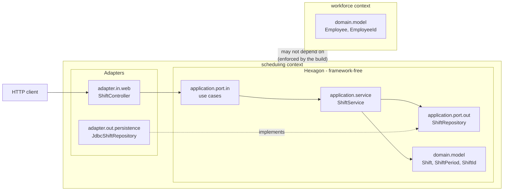

<div align="center">

# HrSched

**Staff shift scheduling — turning shifts that need covering and people with constraints into a roster that is actually legal to work.**


[Requirements](docs/requirements/requirements.md) · [Architecture](docs/architecture/architecture.md) · [Decisions](docs/ADRs/)

</div>

---

> [!WARNING]
> **The domain is real; the product is not finished.** You can onboard an organisation, define
> people and shifts, configure working-time rules, generate a roster, adjust it by hand, publish
> it, and swap a shift, and all of it is stored in PostgreSQL. People sign in, and every request
> is authenticated by a token HrSched signed and authorised against the account it names. What is
> still unfinished is the part the product is named for: **generation is greedy, not optimised**.

This README is ordered for a **contributor**, not an evaluator: there is not yet anything to
evaluate, so Quick start comes before Architecture.

## Contents

- [What and why](#what-and-why) · [Features](#features)
- [Quick start](#quick-start) · [Usage](#usage) · [Configuration](#configuration)
- [Tech stack](#tech-stack) · [Architecture](#architecture) · [Project structure](#project-structure)
- [Development](#development) · [Testing](#testing) · [Deployment and operations](#deployment-and-operations)
- [Design decisions](#design-decisions) · [Documentation](#documentation)
- [Status and limitations](#status-and-limitations)
- [Contributing](#contributing) · [Licence](#licence)

## What and why

Rostering shift work by hand collapses under its own constraints. A scheduler juggling
availability, qualifications, rest periods, and contracted hours across a few dozen people
will produce a roster that looks finished and is quietly illegal — and the error surfaces on
the shop floor at 04:00, not in the spreadsheet.

HrSched takes the shifts that need covering and the people available to cover them, and
produces a roster that respects those constraints, then keeps it correct as sickness, swaps,
and cancellations arrive. The value is in the constraint checking; the calendar is the easy
part — which is why that logic is deliberately kept away from HTTP, storage, and the
framework.

What it deliberately does *not* do is not yet settled — see
[Non-goals](docs/requirements/requirements.md#non-goals), currently an open question rather
than an answer.

## Features

What works today, end to end over HTTP:

- **Define the work.** Shifts with a period, a required headcount, and required qualifications.
- **Describe the people.** Employees, the qualifications they hold, the times they cannot work,
  soft preferences, and contracted hours.
- **Configure the rules.** A per-organisation constraint set — minimum rest, maximum daily and
  period working time, maximum consecutive days. **No jurisdiction is hardcoded**; every
  threshold is configuration, and a jurisdiction is a preset you load.
- **Generate a draft roster** that satisfies every configured rule, leaving a shift short rather
  than filling it illegally.
- **Publish a roster**, which is refused if it breaks any rule, and records the constraint
  version that approved it so a later rule change can never make it retroactively illegal.
  Publishing supersedes any published roster it overlaps, so exactly one is ever authoritative.
- **Assign and unassign by hand.** A Scheduler who disagrees with the generated result can put
  somebody on a shift or take them off, on a draft only — a published roster is superseded, never
  edited.
- **See your own work.** An employee reads the assignments naming them, from published rosters
  only. Reading a whole roster stays an Admin and Scheduler act, because it says who works when
  about every colleague.
- **Swap a shift.** An employee asks for one of their shifts to be covered by a colleague; a
  Scheduler decides. Approving publishes a replacement roster that supersedes the old one and is
  refused if it breaks any rule, so a swap cannot become a way around the rules. The colleague is
  told, in an inbox they can read.
- **Administer the platform.** An Operator onboards organisations and lists them. A request acts
  in the organisation its account belongs to, so there is no organisation in a request to name or
  invent ([ADR-031](docs/ADRs/ADR-031-take-the-organisation-from-the-account.md)).
- **Multi-tenant throughout.** Every aggregate belongs to an organisation and every query is
  scoped to it.

What does **not** work: generation optimises nothing (see
[ADR-005](docs/ADRs/ADR-005-roster-generation-behind-a-port.md)).

## Quick start

**Prerequisites**

| Tool | Version | Notes |
| --- | --- | --- |
| JDK | 21 (LTS) | Verified against Temurin 21.0.9. Later JDKs are untested here. |
| Git | any recent | — |

Maven is **not** a prerequisite — the committed wrapper downloads its own pinned version
(3.9.16).

```bash
git clone https://github.com/NaimElijah/HrSched.git
cd HrSched/backend

./mvnw verify          # format + architecture rules + compile + tests
./mvnw spring-boot:run # starts on http://localhost:8080
```

All backend commands run from `backend/`. On Windows without a POSIX shell, use
`mvnw.cmd` in place of `./mvnw`.

**Docker must be running.** `spring-boot:run` starts the PostgreSQL in `backend/compose.yaml` for
you and stops it afterwards, and `verify` starts its own throwaway database through Testcontainers.
There is deliberately no in-memory fallback and no skip-when-Docker-is-absent: a check that quietly
does not run still reports green ([ADR-004](docs/ADRs/ADR-004-postgresql-behind-the-driven-ports.md)).

There is no seed data. No credentials are needed locally either: the database in `compose.yaml`
has throwaway ones, and `./mvnw spring-boot:run` bootstraps a local platform operator —
`operator` / `local-development-only` — which you are made to change at first sign-in. A real
deployment sets `HRSCHED_BOOTSTRAP_OPERATOR_*` instead; see Configuration below.

To run the user interface as well, from the repository root:

```bash
npm run setup     # install frontend dependencies
npm run dev       # backend on :8080 and the UI on :5173
npm run verify    # both gates: mvnw verify, then the frontend's own verify
```

The UI opens on <http://localhost:5173>. Vite proxies `/api` to the backend, so the browser only
ever sees one origin and there is no CORS configuration anywhere in this repository.

> [!TIP]
> `./mvnw verify` in `backend/` is the whole backend gate — formatting, architecture, build, and
> tests in one command — and `npm run verify` in `frontend/` is the whole frontend gate. CI runs
> those exact commands and nothing else, so neither can drift away from what gates a merge. See
> [ADR-002](docs/ADRs/ADR-002-single-command-build-gate.md) and
> [ADR-014](docs/ADRs/ADR-014-root-task-runner.md).

> [!NOTE]
> The UI signs in. A session lives in memory and survives a reload through a refresh cookie the
> page cannot read ([ADR-028](docs/ADRs/ADR-028-keep-the-session-in-memory-and-a-rotating-refresh-cookie.md)),
> and which tabs appear follows the kind of account rather than the role — a role's refusal is
> shown as the 403 it is, because the UI enforces nothing.

## Usage

Every request carries an access token this service signed, and who is acting is the account that
token names — resolved from stored state on every request, so disabling somebody or changing their
role takes effect on their next call ([ADR-011](docs/ADRs/ADR-011-issue-our-own-access-tokens.md)).
**The organisation is never in the request.** It comes from the account, so there is nothing for a
caller to change ([ADR-031](docs/ADRs/ADR-031-take-the-organisation-from-the-account.md)).

Accounts are created from the top down and nobody signs themselves up
([ADR-029](docs/ADRs/ADR-029-provision-accounts-from-the-top-down.md)). The platform operator comes
from configuration, onboarding creates an organisation's first Admin, and that Admin creates
everybody else. A password somebody else chose must be replaced before the account holds any role
at all, which is why every sign-in below is followed by a password change.

Passwords come from the environment so that none of them lands in shell history.

```bash
api() { curl -s -H "Authorization: Bearer $1" -H 'Content-Type: application/json' "${@:2}"; }

# Sign in, replace the password whoever created the account chose, and print a usable token.
enter() {
  local pending
  pending=$(curl -s -X POST localhost:8080/api/auth/sign-in -H 'Content-Type: application/json' \
    -d "{\"signInName\":\"$1\",\"password\":\"$2\"}" | jq -r .accessToken)
  api "$pending" -X POST localhost:8080/api/auth/password \
    -d "{\"currentPassword\":\"$2\",\"newPassword\":\"$3\"}" | jq -r .accessToken
}

# 0. The operator onboards an organisation together with its first Admin. It is refused everything
#    inside one (ADR-030), so an organisation without an Admin would have nobody able to add one.
OPERATOR=$(enter "$HRSCHED_BOOTSTRAP_OPERATOR_SIGNINNAME" \
  "$HRSCHED_BOOTSTRAP_OPERATOR_PASSWORD" "$OPERATOR_PASSWORD")

api "$OPERATOR" -X POST localhost:8080/api/organisations \
  -d "{\"name\":\"Acme\",\"firstAdmin\":{\"signInName\":\"admin@acme.example\",\"temporaryPassword\":\"$ADMIN_TEMPORARY\"}}"

ADMIN=$(enter admin@acme.example "$ADMIN_TEMPORARY" "$ADMIN_PASSWORD")

# 1. The Admin adds someone, and gives a colleague an account that can build rosters.
api "$ADMIN" -X POST localhost:8080/api/employees -d '{"name":"Ada Lovelace"}'
api "$ADMIN" -X POST localhost:8080/api/accounts \
  -d "{\"signInName\":\"scheduler@acme.example\",\"temporaryPassword\":\"$SCHEDULER_TEMPORARY\",\"role\":\"SCHEDULER\"}"

# 2. The Admin configures the rules. These numbers are yours, not any statute's.
api "$ADMIN" -X PUT localhost:8080/api/constraints \
  -d '{"minimumRestMinutes":660,"maximumDailyMinutes":600,"maximumConsecutiveDays":6}'

SCHEDULER=$(enter scheduler@acme.example "$SCHEDULER_TEMPORARY" "$SCHEDULER_PASSWORD")

# 3. The Scheduler defines the work.
api "$SCHEDULER" -X POST localhost:8080/api/shifts \
  -d '{"start":"2026-10-05T08:00:00Z","end":"2026-10-05T16:00:00Z","requiredHeadcount":1}'

# 4. Generate a draft, then publish it. Only a Scheduler may.
ROSTER=$(api "$SCHEDULER" -X POST localhost:8080/api/rosters \
  -d '{"start":"2026-10-05T00:00:00Z","end":"2026-10-06T00:00:00Z"}' | jq -r .id)
api "$SCHEDULER" -X POST "localhost:8080/api/rosters/$ROSTER/publication"
```

A roster that breaks the rules is refused with 422 and every violation listed, because a
scheduler told only "rejected" cannot act on it:

```json
{
  "title": "Roster breaks the working-time rules",
  "status": 422,
  "violations": ["<employee>: minimum rest between assignments (only PT4H rest ...)"]
}
```

There is no override. Cover is arranged by publishing a roster that is itself legal, or by
leaving the shift uncovered so the gap is visible.

## Configuration

Most configuration lives in `backend/src/main/resources/application.properties`. The database is
the exception, and it is deliberately not in there: locally `backend/compose.yaml` supplies it, and
a deployment supplies the three variables in [`.env.example`](.env.example). A committed URL would
be a default that travels somewhere it is wrong.

| Property | Purpose | Default |
| --- | --- | --- |
| `spring.application.name` | Name reported in logs and Actuator | `HrSched` |
| `management.endpoint.health.probes.enabled` | Exposes `health/liveness` and `health/readiness` | `true` (set explicitly; Spring defaults it off outside Kubernetes) |
| `management.endpoints.web.exposure.include` | Which Actuator endpoints are reachable over HTTP | `health,info,metrics,prometheus`. An allow list: `loggers`, `env` and `heapdump` are deliberately absent, because the security chain lets anybody reach `/actuator/**` without a token ([ADR-017](docs/ADRs/ADR-017-expose-metrics-to-be-scraped.md), [ADR-032](docs/ADRs/ADR-032-close-the-security-chain-by-default.md)). Whether it stays open is [#78](https://github.com/NaimElijah/HrSched/issues/78) |
| `server.port` | HTTP port | `8080` (Spring default, not overridden) |
| `hrsched.security.token.issuer` | The `iss` claim put in an access token, and required of one | `hrsched` ([ADR-011](docs/ADRs/ADR-011-issue-our-own-access-tokens.md)) |
| `hrsched.security.token.audience` | The `aud` claim put in an access token, and required of one | `hrsched-api` |
| `hrsched.security.token.lifetime` | How long an issued access token stays valid | `10m`. Short on purpose: a stolen token is useful only until it expires. The number is open for review (Q27) |
| `HRSCHED_SECURITY_TOKEN_PRIVATEKEY` | The RSA private key tokens are signed with, as a PKCS#8 PEM of at least 2048 bits | None, and **startup fails without it**. See [`.env.example`](.env.example). `./mvnw spring-boot:run` is the exception: it permits a throwaway key generated at startup, so local development needs no secret |
| `hrsched.security.password.bcrypt-strength` | Bcrypt's work factor for hashing passwords | `12` (tests use `4`). Reviewed by the owner against the hardware in use (Q27) |
| `HRSCHED_BOOTSTRAP_OPERATOR_SIGNINNAME` / `_PASSWORD` | Creates the first platform operator at startup, once | Unset. Set both or neither; setting one fails startup. The password must be changed at first sign-in ([ADR-029](docs/ADRs/ADR-029-provision-accounts-from-the-top-down.md)). `./mvnw spring-boot:run` supplies throwaway local values |
| `SPRING_DATASOURCE_URL` / `_USERNAME` / `_PASSWORD` | Where the database is, and who connects to it | **Deliberately unset.** Supplied by `compose.yaml` locally and by the environment in a deployment; see [`.env.example`](.env.example) |
| `logging.structured.format.console` | Log format on stdout | `ecs` — Elastic Common Schema JSON, always, with no profile that turns it off ([ADR-016](docs/ADRs/ADR-016-structured-logs-and-a-propagated-trace-id.md)) |
| `logging.structured.ecs.service.name` / `.version` | Identify the emitting service in every line | `HrSched` / the Maven project version, filtered in at build time |
| `logging.structured.ecs.service.environment` | Which environment produced the line | **Deliberately unset.** A committed default would travel to a real environment that forgot to override it |
| `management.tracing.sampling.probability` | Share of requests given a trace id | `1.0` — free while nothing is exported |
| `management.tracing.export.otlp.enabled` | Ship spans over OTLP | `false` — nothing listens yet (Q19), and an exporter with nowhere to send logs its own failure forever |
| `management.logging.export.otlp.enabled` | Ship logs over OTLP | `false`, same reason |
| `management.otlp.metrics.export.enabled` | Push metrics over OTLP | `false`, same reason. Metrics are pulled instead, from `/actuator/prometheus` |

## Tech stack

| Layer | Technology | Version | Why |
| --- | --- | --- | --- |
| Language | Java | 21 (LTS) | Matches the installed JDK; supported by Boot 4.x. [ADR-001](docs/ADRs/ADR-001-java-spring-boot-maven.md) |
| Framework | Spring Boot | 4.1.1 | Supplies the HTTP boundary and health endpoints as configuration rather than code |
| HTTP | `spring-boot-starter-webmvc` | via Boot BOM | Embedded Tomcat. **Boot 4.x renamed this** from `spring-boot-starter-web` |
| Operations | `spring-boot-starter-actuator` | via Boot BOM | Health and readiness probes, required of every service by the project baseline |
| Observability | `spring-boot-starter-opentelemetry` | via Boot BOM | OpenTelemetry API, the Micrometer Tracing bridge and the OTLP exporters, so a W3C trace id reaches every response and every log line the request produces. Export is off. [ADR-016](docs/ADRs/ADR-016-structured-logs-and-a-propagated-trace-id.md) |
| Logging | Boot's built-in structured logging | via Boot BOM | ECS JSON needs no encoder library and no `logback-spring.xml` — one property. [ADR-016](docs/ADRs/ADR-016-structured-logs-and-a-propagated-trace-id.md) |
| Metrics | `micrometer-registry-prometheus` | via Boot BOM | Renders the meters Micrometer already collects for a scraper to pull. Nothing pushes. [ADR-017](docs/ADRs/ADR-017-expose-metrics-to-be-scraped.md) |
| Frontend | React | 19.2.8 | Largest ecosystem for a small SPA; TypeScript makes an API contract drift a compile error. [ADR-013](docs/ADRs/ADR-013-react-typescript-vite-frontend.md) |
| Frontend build | Vite | 8.2.2 | Dev server proxies `/api`, so no CORS exists anywhere. |
| Frontend types | TypeScript | 6.0.3 | `strict`, plus the TS 6 defaults `verbatimModuleSyntax` and `noUncheckedIndexedAccess`. |
| Frontend tests | Vitest | 4.1.11 | `fetch` is stubbed directly; the HTTP API is our own port. |
| Frontend coverage | `@vitest/coverage-v8` | 4.1.11 | Pinned to Vitest by peer dependency; reported, never enforced (ADR-015) |
| Architecture | ArchUnit | 1.5.0 | Fails the build on a broken dependency rule, a cross-context reference, or a kernel that learns about a context. [ADR-003](docs/ADRs/ADR-003-hexagonal-architecture-with-ddd.md), [ADR-006](docs/ADRs/ADR-006-organise-packages-by-bounded-context.md), [ADR-008](docs/ADRs/ADR-008-context-integration.md) |
| Build | Maven Wrapper | 3.9.16 | Toolchain pinned in the repo; no global Maven install needed |
| Format | Spotless + google-java-format | 3.10.0 / 1.27.0 | Bound to `validate`, so formatting is checked by the same command that builds |
| Test | JUnit 5, AssertJ, MockMvc | via Boot BOM | Boot 4.x splits the old `spring-boot-starter-test` into per-concern starters |
| Backend coverage | JaCoCo | 0.8.13 | Pinned explicitly: the Boot 4.1.1 BOM manages no JaCoCo version. Reported, never enforced (ADR-015) |

## Architecture

**Bounded contexts, each a hexagon.** Three contexts — `scheduling`, `workforce`, `access` —
plus a `shared` kernel holding the identities and value types that cross them. Inside a context,
dependencies point inward: the domain knows nothing about the application layer, which knows
nothing about adapters or Spring. Between contexts, one may reference another's
`application.port.in` package and **nothing else**
([ADR-008](docs/ADRs/ADR-008-context-integration.md)).



These are not conventions — they are **build failures**. `HexagonalArchitectureTest` runs in
`./mvnw verify` and fails when the domain imports Spring, when the application reaches into an
adapter, when one context references another, when a context's own layers form a cycle, when
anything prints to stdout, when a domain class logs, when a meter or a span appears inward of an
adapter, or when anything reads who is acting out of Spring Security's thread-local instead of
taking it as an argument.

Every rule has been observed failing on a deliberately introduced violation, then reverted —
including the cross-context rule in both directions, since it *permits* something it used to
forbid and a loosened rule is exactly where enforcement quietly becomes decoration. A rule that
has only ever been green proves nothing.

Component detail, the request sequence, and what is deliberately *not* modelled yet are in
[`docs/architecture/architecture.md`](docs/architecture/architecture.md).

## Project structure

```
HrSched/
├── package.json  scripts/run.mjs        # root task runner (ADR-014)
├── backend/
│   ├── pom.xml  mvnw  mvnw.cmd  .mvn/
│   └── src/main/java/io/github/naimelijah/hrsched/
│       ├── shared/domain/model/         # kernel: identities, TimeRange, sealed Actor. Knows no context.
│       ├── scheduling/                  # shifts, rosters, constraint sets, generation
│       ├── workforce/                   # employees, qualifications, unavailability, preferences
│       ├── access/                      # organisations
│       ├── configuration/               # Spring wiring; the only place that sees two contexts
│       └── HrSchedApplication.java      # composition root; holds no logic on purpose
├── frontend/
│   ├── vite.config.ts                   # dev proxy: /api -> localhost:8080
│   └── src/
│       ├── api/                         # typed client; client.ts is the only caller of fetch
│       ├── identity/                    # acting-as context and its warning bar
│       ├── components/                  # failure rendering, async loading
│       └── pages/                       # People, Qualifications, Rules, Shifts, Rosters, Swaps, Me, Organisations
├── docs/                                # requirements, architecture, ADRs
├── LICENSE
└── README.md
```

Every bounded context repeats the same hexagon, and the package path *is* the dependency rule:

```
<context>/domain/model/          entities and value objects. JDK imports only.
<context>/application/port/in/   driving ports — this context's published API
<context>/application/port/out/  driven ports — what it needs from outside
<context>/application/service/   use cases. No Spring annotations.
<context>/adapter/in/web/        controllers, DTOs, exception translation
<context>/adapter/out/...        driven port implementations
```

A context may reference another context's `application.port.in` package and nothing else, and the
build fails if it does otherwise ([ADR-008](docs/ADRs/ADR-008-context-integration.md)).

## Development

All of these run from `backend/`.

```bash
./mvnw spotless:apply   # fix formatting (google-java-format; non-configurable)
./mvnw spring-boot:run  # run locally
./mvnw clean            # drop build output
```

**Adding a use case** — the order that keeps the hexagon intact:

1. Decide which **context** it belongs to. If it fits none, that is a new context and a new ADR.
2. Model or extend the concept in `<context>/domain/model`, invariants in the constructor.
3. Declare the driving port in `<context>/application/port/in` and anything new it needs in
   `<context>/application/port/out`.
4. Implement it in `<context>/application/service` — no annotations.
5. Register the bean in `configuration/UseCaseConfiguration`.
6. Add the adapters: `<context>/adapter/in/web` for transport, `<context>/adapter/out/…` for
   the port.
7. Test the domain and service without Spring; test the slice through HTTP.

Never reach into another context to do it. That fails the build, by design.

**Conventions**

- **Commits** — [Conventional Commits](https://www.conventionalcommits.org/):
  `type(scope): imperative subject`, under 72 characters. One logical change per commit.
- **Branches** — `type/short-kebab-description`. Never commit straight to `main`.
- **Formatting** — the formatter is authoritative. Never hand-format; run `spotless:apply`.
- **Dependencies** — each new one needs a justification recorded in
  [`architecture.md`](docs/architecture/architecture.md#external-dependencies-and-integration-points).

> [!IMPORTANT]
> Spring Boot 4.x renamed things that most tutorials and AI answers still use by their 3.x
> names: `spring-boot-starter-web` → `spring-boot-starter-webmvc`; `spring-boot-starter-test`
> split per concern; `@WebMvcTest` moved to `org.springframework.boot.webmvc.test.autoconfigure`;
> `@MockBean` replaced by `@MockitoBean`; and **Jackson 3** means `tools.jackson.databind`, not
> `com.fasterxml.jackson.databind`. Check `pom.xml` and the jars, not the internet.

## Testing

From `backend/`:

```bash
./mvnw verify                                  # everything: format, architecture, unit, HTTP
./mvnw test -Dtest=HexagonalArchitectureTest   # just the architecture rules
```

`./mvnw verify` also writes a coverage report to `target/site/jacoco/index.html`. It is reported
and never enforced — there is no threshold and nothing fails a build on it ([ADR-015](docs/ADRs/ADR-015-report-coverage-without-a-threshold.md)).
`./mvnw test` alone does not produce one; the report goal runs at `verify`.

| Test | Layer | What it covers |
| --- | --- | --- |
| `TimeRangeTest`, `ActorTest`, `IdentityTest` | Shared kernel | The range invariant, which actor may cross an organisation boundary, and every identity record — including that a `UserId` and an `EmployeeId` wrapping one UUID stay unequal ([ADR-012](docs/ADRs/ADR-012-acting-identity-carries-its-employee-record.md)). |
| `OrganisationTest`, `EmployeeTest`, `QualificationTest`, `ContractTermsTest`, `ShiftPreferenceTest` | Domain (access, workforce) | Constructor invariants and identity equality. No Spring. |
| `ShiftTest`, `RosterTest`, `ConstraintSetTest`, `WorkingTimeConstraintTest`, `EmployeeScheduleTest`, `SchedulingValueObjectsTest` | Domain (scheduling) | Headcount, the roster lifecycle, rule thresholds at their boundaries, and day arithmetic in each shift's own zone, daylight saving included. |
| `SchedulingServiceTest`, `SwapServiceTest`, `EmployeeServiceTest`, `QualificationServiceTest`, `OrganisationServiceTest`, `NotificationServiceTest` | Application | Use cases against hand-written stubs of their own ports. No Spring, no mocking framework. `SwapServiceTest` is the exception that proves the rule: it wires a **real** `SchedulingService`, because the claim worth testing is that approving a swap goes through the same publication everything else does. |
| `SwapHttpTest` | Adapter (HTTP) | The widest path in the system — onboard a tenant, hire people, roster, publish, hand a shift over, and have the colleague read about it. Four contexts in one test. |
| `RequestBindingHttpTest` | Configuration | A missing query parameter or an identifier that does not parse is answered with a problem detail naming it, whose detail never repeats the value sent. |
| `NotificationTest` | Domain (notifications) | Among other invariants, that no field of a notification can hold free text — asserted by reflection over the type, because a future field is what would break it. |
| `SchedulingCommandsTest`, `WorkforceCommandsTest` | Application | Every command rejects a null field, copies what it is handed, and stops short of judging what it carries. |
| `RosterCandidateTest`, `PublishedLanguageTest` | Published language | What one context tells another, and nothing more. |
| `WorkforceDirectoryAdapterTest` | Anti-corruption layer | The only class in scheduling permitted to name another context, including that contracted hours do not cross. |
| `Jdbc*RepositoryTest` (×8) | Driven adapters | Every read filters by organisation in the query before returning anything, the ordering each one promises, and that a save leaves the owned rows agreeing with the aggregate rather than accumulating. Run against a real PostgreSQL. |
| `AccountHttpTest`, `OrganisationHttpTest`, `SessionHttpTest` | Driving adapters | Who a token makes somebody, what each kind of account may reach, and that an identity header claiming otherwise changes nothing. |
| `SchedulingExceptionHandlerTest`, `WorkforceExceptionHandlerTest` | Driving adapters | Which failure earns which status, the structured 422, and that there is no catch-all. |
| `GreedyRosterGeneratorTest` | Driven adapter | The placeholder generator never breaks a rule, and leaves a shift short rather than filling it illegally. |
| `RosteringHttpTest`, `EmployeeHttpTest`, `QualificationHttpTest` | End to end | Every endpoint through the real hexagon and the real adapters. |
| `TraceIdHttpTest` | Observability over HTTP | Every response carries a trace id, including the refusals — which are the ones a person has cause to report. |
| `MetricsHttpTest` | Operations over HTTP | Both probes answer, the meters are published, and `loggers`, `env` and `heapdump` are **not** exposed. |
| `SchedulingAuditLogTest`, `WorkforceAuditLogTest` | Driven adapters | Every audit field is an identifier and never a name, the message is a constant, and the counter is not tagged by tenant. |
| `HexagonalArchitectureTest` | Whole codebase | **Ten** ArchUnit rules: dependency direction, framework-free application, published-port integration, kernel independence, layer cycles, no printing, no logging in the domain, no instrumentation inward of an adapter, and no ambient read of who is acting. |
| `HrSchedApplicationTests` | Spring context | The application starts. |

Naming follows `Given<scenario>_When<action>_Then<result>`. Tests run against the public
boundary, never internals, and are deterministic: no `sleep`, no real network, no ordering
dependence. There is no `Clock` and `.now()` is never called in `backend/src` — every time value
enters through a `TimeRange` the caller supplies.

From `frontend/`:

```bash
npm run verify         # format, lint, types, tests, build — no coverage
npm run test:coverage  # the same tests, plus coverage/index.html
```

| Test | What it covers |
| --- | --- |
| `api/client.test.ts` | The one module that calls `fetch`: the claim headers, the failure shapes, and the reload key. |
| `api/problem.test.ts` | The error boundary: a body that is not the shape we expect is validated, never cast. |
| `api/workforce.test.ts` | That an identifier placed in a path stays one segment at the call site, whoever supplied it. |
| `components/useAsync.test.tsx` | The state machine: a stale answer never reaches the screen, `busy` is derived, reload works after a failure. |
| `components/localDates.test.ts` | The local-day round trip, the documented timezone hazard, and the day and time labels a roster board is read by — all asserted relatively so they hold in any zone. |
| `components/Feedback.test.tsx` | Every refusal branch, including a 422 that lists no broken rules — a refusal, not a working-time breach — and the 404 that may also mean another tenant owns it. |
| `components/ErrorBoundary.test.tsx` | One broken render does not become a blank page, and "Try again" recovers. |
| `auth/session.test.tsx` | Signing in, the restore handshake every load begins with, the single-flight refresh, and that the access token is held where no script can read it back. |
| `pages/*.test.tsx` (×9) | One per screen: what is sent, what is refused before sending, and what the user is told. |
| `App.test.tsx` | Tab navigation, and the one 403 the shell deliberately swallows — with the proof that nothing else is. |

**CI** runs `./mvnw verify` and `npm run verify` on every push and pull request
([`.github/workflows/ci.yml`](.github/workflows/ci.yml)). Those two commands are the merge gate.

Since [ADR-004](docs/ADRs/ADR-004-postgresql-behind-the-driven-ports.md) the whole suite runs
against a real PostgreSQL in a container — one container, started once and shared — so every HTTP
test exercises real SQL rather than a hash map. Docker is therefore required to build.

*Not yet:* no contract test between the UI and the API, and no browser test; ADR-013 records that
as accepted debt, to be revisited the first time UI/API drift actually bites.

## Deployment and operations

*Not written yet.* [Q5](docs/requirements/requirements.md#open-questions) answered that this is
containerised with the provider deferred to its own ADR, so there is a shape but still no
environment to describe. The operational primitives exist: the build produces an executable JAR at
`target/hrsched-0.0.1-SNAPSHOT.jar`, liveness and readiness probes are exposed, and every log line
is machine-readable.

**Logs.** One ECS JSON object per line on stdout, ready for whatever collects the container's
output. Every line a request produces carries `trace_id` — startup and shutdown lines have no span
to belong to and carry none — and every HTTP response carries the same value as
`X-Trace-Id` — which the user interface shows on a refusal, so a report from a person can be joined
to the log ([ADR-016](docs/ADRs/ADR-016-structured-logs-and-a-propagated-trace-id.md)). Pipe it
through `jq` to read it locally.

**Metrics.** Pulled, never pushed: point a scraper at `/actuator/prometheus`
([ADR-017](docs/ADRs/ADR-017-expose-metrics-to-be-scraped.md)).

| Meter | What it answers |
| --- | --- |
| `http_server_requests_seconds` | Request rate, latency and error rate, per endpoint and status |
| `jvm_*`, `process_*`, `tomcat_*` | Saturation: heap, threads, file descriptors, connections |
| `hrsched_shifts_required_places` | Places each generation was asked to fill |
| `hrsched_shifts_uncovered_places` | Places it could not fill without breaking a rule — the product's own success metric, and the ratio of the two is coverage |
| `hrsched_access_denied_total{kind}` | Refusals, split into `cross_tenant` and `role`. A rise in `cross_tenant` is a security signal, not a usage one — and it is the only way to tell that 404 apart from an ordinary miss |
| `hrsched_rosters_refused_total{reason}` | Publications refused by the working-time rules, because the work could not be checked, or because an overlapping roster was published at the same time (`concurrent_publication`) |
| `hrsched_changes_total{context,change}` | Every recorded state change, by context and kind |

Exposure is an allow list. `loggers`, `env` and `heapdump` are deliberately shut, and
`MetricsHttpTest` fails the build if one of them opens.

Still owed: somewhere to export telemetry to
([Q19](docs/requirements/requirements.md#open-questions)), and a dashboard to read it on — both
blocked on the same missing environment.

## Design decisions

| ADR | Decision | Cost accepted |
| --- | --- | --- |
| [ADR-001](docs/ADRs/ADR-001-java-spring-boot-maven.md) | Java 21, Spring Boot 4.1.1, Maven Wrapper | Boot 4.x is recent, so most existing tutorials name things that no longer exist |
| [ADR-002](docs/ADRs/ADR-002-single-command-build-gate.md) | `./mvnw verify` as the single gate, Spotless for format | google-java-format is not configurable; formatting fails the build before tests run |
| [ADR-003](docs/ADRs/ADR-003-hexagonal-architecture-with-ddd.md) | Hexagon in one module, enforced by ArchUnit | Many more classes per use case; hand-wiring; enforcement is a test, not the compiler |
| [ADR-004](docs/ADRs/ADR-004-postgresql-behind-the-driven-ports.md) | PostgreSQL behind the driven ports, hand-written SQL, Flyway migrations | Docker is required to build; eight adapters of explicit mapping where an ORM would have generated it; last writer still wins |
| [ADR-005](docs/ADRs/ADR-005-roster-generation-behind-a-port.md) | Generation behind a port, greedy for now | The product does not yet do the thing it exists to do; a greedy result is a poor solver baseline |
| [ADR-006](docs/ADRs/ADR-006-organise-packages-by-bounded-context.md) | Organise packages by bounded context | A layer is no longer one place; `workforce` precedes its requirements |
| [ADR-007](docs/ADRs/ADR-007-monorepo-backend-and-frontend.md) | Monorepo: `backend/` + `frontend/` siblings | Every backend command grows a `cd`; CI and Dependabot need explicit paths |
| [ADR-008](docs/ADRs/ADR-008-context-integration.md) | Contexts integrate through published ports and a small shared kernel | Translation duplicated at every boundary; the kernel is a coupling every context pays for |
| [ADR-009](docs/ADRs/ADR-009-tenant-isolation-in-the-domain.md) | Tenancy in every signature, enforced in the application | Every signature is longer, and that verbosity is the point |
| [ADR-011](docs/ADRs/ADR-011-issue-our-own-access-tokens.md) | HrSched signs its own access tokens, and resolves the actor from the stored account and session on every request | The account table now holds password hashes; verifying a token costs a database read; a lockout is a lever for keeping somebody out |
| [ADR-012](docs/ADRs/ADR-012-acting-identity-carries-its-employee-record.md) | The acting identity carries the employee record it is | One more field in the shared kernel, which ADR-008 named as the thing to watch |
| [ADR-013](docs/ADRs/ADR-013-react-typescript-vite-frontend.md) | React + TypeScript + Vite, with a dev proxy instead of CORS | A second toolchain and CI job; a hand-written client that can drift from the DTOs |
| [ADR-014](docs/ADRs/ADR-014-root-task-runner.md) | A Node script orchestrates both builds from the root | The root becomes nominally an npm project; per-project commands are named in two places |
| [ADR-015](docs/ADRs/ADR-015-report-coverage-without-a-threshold.md) | Coverage measured on both projects, never enforced | A number nothing gates on is a number that can quietly fall |
| [ADR-016](docs/ADRs/ADR-016-structured-logs-and-a-propagated-trace-id.md) | ECS JSON logs everywhere, and a W3C trace id on every response | Local output is JSON and not pleasant to read; one starter brings the whole OpenTelemetry SDK |
| [ADR-017](docs/ADRs/ADR-017-expose-metrics-to-be-scraped.md) | Metrics pulled from `/actuator/prometheus`; no monitoring stack committed | The endpoint is reachable without a token ([ADR-032](docs/ADRs/ADR-032-close-the-security-chain-by-default.md)), and whether it stays so is [#78](https://github.com/NaimElijah/HrSched/issues/78); nothing scrapes it yet |
| [ADR-018](docs/ADRs/ADR-018-audit-through-a-port-not-a-queryable-trail.md) | Changes and refusals recorded through a port, as log events | The trail is only as durable as the log; every new use case must remember to call the port |
| [ADR-019](docs/ADRs/ADR-019-an-application-layer-for-the-access-context.md) | The access context gets an application layer; an organisation is a real record | A register held in memory, which after ADR-020 makes a restart a total outage rather than an empty start |
| [ADR-020](docs/ADRs/ADR-020-refuse-a-request-naming-an-unknown-organisation.md) | An unknown `X-Organisation` is refused at the boundary, with the ordinary 404 | Superseded by ADR-031: there is no claimed organisation left to check, and the filter was deleted rather than left unable to fire |
| [ADR-021](docs/ADRs/ADR-021-notifications-as-a-bounded-context.md) | Notifications are their own context, and hold no words | Delivery is pull-only, so somebody is informed when they next open the app; a lost notification means they were never told while the system believes they were |
| [ADR-022](docs/ADRs/ADR-022-approving-a-swap-publishes-a-replacement-roster.md) | Approving a swap publishes a replacement roster rather than editing one | A refused approval left the replacement behind as a draft, which ADR-023 fixed |
| [ADR-023](docs/ADRs/ADR-023-the-transaction-boundary-is-the-use-case.md) | A use case is one transaction, applied at the composition root | A proxy nothing in the service hints at; an audit entry can now outlive the change it records |
| [ADR-024](docs/ADRs/ADR-024-answer-unbindable-requests-with-a-problem-detail.md) | A request Spring cannot bind is answered with a problem detail, from one fallback handler | Three exception types listed by hand; 405, 415 and unmapped paths still answer with Spring's default body |
| [ADR-025](docs/ADRs/ADR-025-edit-a-draft-roster-with-controls-not-drag-and-drop.md) | A draft roster is edited through a picker and buttons on a board, not by drag and drop | Moving somebody is two actions; the picker offers people the backend will refuse |
| [ADR-026](docs/ADRs/ADR-026-make-overlapping-published-rosters-unrepresentable.md) | Two overlapping published rosters of one organisation cannot be stored: an exclusion constraint, refused with 409 | The database needs the `btree_gist` extension; a database already holding such a pair fails to migrate |
| [ADR-027](docs/ADRs/ADR-027-take-turns-publishing-within-an-organisation.md) | Publications within one organisation take turns, under a transaction-scoped advisory lock | Publications in one tenant serialise; a port gained a method, and the lock is a convention the constraint stands behind |
| [ADR-028](docs/ADRs/ADR-028-keep-the-session-in-memory-and-a-rotating-refresh-cookie.md) | The access token lives in memory and the session outlives it through a rotating refresh cookie | A reload costs one refresh round trip, and two tabs have to take turns or reuse detection ends the session for both |
| [ADR-029](docs/ADRs/ADR-029-provision-accounts-from-the-top-down.md) | Accounts are created from the top down, with temporary passwords; the first operator comes from configuration | Nobody can sign themselves up, and there is no way back into an organisation from outside it when its last Admin is locked out — Q28 |
| [ADR-030](docs/ADRs/ADR-030-confine-the-operator-to-the-register-of-organisations.md) | The platform operator administers the register of tenants and is refused everything inside one | Support cannot look at a customer's data, which is the point and also the cost |
| [ADR-031](docs/ADRs/ADR-031-take-the-organisation-from-the-account.md) | A request acts in the organisation its account belongs to; no request names one | Somebody working for two customers needs two accounts, and ADR-020's boundary filter was deleted rather than left unable to fire |
| [ADR-032](docs/ADRs/ADR-032-close-the-security-chain-by-default.md) | The security chain ends in `denyAll`; every open route is named | Adding a route takes a second edit in a file its author may not have opened, which is the point |

Still open and blocking: **ADR-010** (generation objectives). Authentication is settled — ADR-011
and ADR-028 to ADR-032 are Accepted, and ADR-020 is superseded. See the [ADR index](docs/ADRs/).

## Documentation

| Document | Answers |
| --- | --- |
| [`docs/requirements/requirements.md`](docs/requirements/requirements.md) | **What** the system must do, and the five open questions blocking it |
| [`docs/architecture/architecture.md`](docs/architecture/architecture.md) | **How** it is built, as it actually is today |
| [`docs/ADRs/`](docs/ADRs/) | **Why** each choice was made, and what was rejected |
| [`.claude/CLAUDE.md`](.claude/CLAUDE.md) | Repository guidance for coding agents |

## Status and limitations

**Maturity: skeleton.** The build, the test harness, CI, and the architecture are real and
enforced. The product is not started.

**Shipped:** two bounded contexts with an enforced hexagon and enforced context independence,
a two-endpoint walking skeleton, health probes, and the decisions behind them.

**Next:** Q2 (roles), Q3 (tenancy) and Q4 (working-time rules) are answered, so the real
domain can now be modelled — multi-tenant, three roles, and working-time rules as a
*configured constraint set* rather than any country's law hardcoded. Storage (ADR-004) and
authentication (ADR-011, ADR-028 to ADR-032) are settled, so what remains blocking is ADR-010
(objectives).

**Known limitations**

- **Generation optimises nothing.** `GreedyRosterGenerator` fills shifts with the first eligible
  person and ignores fairness, preferences and disruption — the three things that make a roster
  good rather than merely legal. A solver is the next substantial piece of work.
- **Objectives are not modelled**, so there is nothing for a solver to optimise against yet.
- **Constraint versions are stored but cannot be read back.** Every revision is kept now, keyed by
  version, so the record a published roster holds is no longer worthless — but the port offers only
  `findCurrent`, so reading a historical version still needs a method nobody has asked for.
- **A shift's zone is the Scheduler's browser's.** Working-time days are counted in each shift's
  own zone (R36, ADR-034), and the Shifts page sends the zone it read the typed times in. Planning
  a site in another zone, and seeing which zone a shift is counted in, are #136. Shifts stored
  before that change keep the UTC they were judged in.
- **Nothing automated proves the UI and the API agree.** The typed client is written by hand from
  the Java records, so a DTO change can drift silently. There is no contract test and no browser
  test — see ADR-013 for the trigger to add one.
- **A concurrent edit of one draft is atomic but not optimistic.** Every use case is one
  transaction (ADR-023), so two concurrent saves of one roster serialise rather than interleaving
  and neither is left half-done. There is still no version column, so the later one wins outright
  rather than being rejected — adding one would change port signatures. Publications are
  different: within one organisation they take turns (ADR-027), and the schema refuses two
  overlapping published rosters from any writer that does not (ADR-026).
- **Three reads still assume a hash map.** Superseding on publish and viewing one's own schedule
  both load every roster a tenant ever had; checking constraints fetches each assignment's shift
  one at a time; and every child row is written with its own `INSERT`. Free against a map, not
  against a database, and unbounded as a tenant accumulates history. The fix needs new port
  methods, and the performance requirement that would size it is still `TODO`.
- **An audit entry can outlive the change it records.** The trail is a log stream (ADR-018) and a
  log line cannot be rolled back, so a use case that records a change and then fails to commit
  leaves a record of something that did not happen. Newly true because the transaction is; Q20.
- **A notification reaches somebody when they next open the application.** There is no email, no
  push and no unread badge, which for a rota change may be too late — Q21.
- Time is modelled as `Instant`; rosters are read in local time across potentially different
  regions, so this will have to carry a zone.
- Architecture enforcement is a test, not the compiler — a multi-module layout would make
  violations impossible rather than merely detected.
- Dependabot alerts are enabled, but nothing **blocks** a merge on a vulnerable dependency.
- No static analysis, and no `CHANGELOG.md` until the first release.

## Contributing

No `CONTRIBUTING.md` yet. Until there is one, the conventions in
[Development](#development) and [`.claude/CLAUDE.md`](.claude/CLAUDE.md) are the standard.

## Licence

Proprietary — **all rights reserved**. See [`LICENSE`](LICENSE). No permission is granted to
use, copy, modify, or distribute this software.
