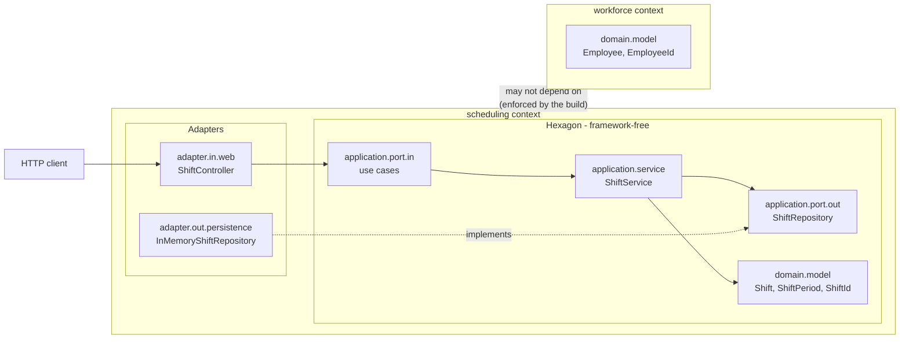

<div align="center">

# HrSched

**Staff shift scheduling — turning shifts that need covering and people with constraints into a roster that is actually legal to work.**


[Requirements](docs/requirements/requirements.md) · [Architecture](docs/architecture/architecture.md) · [Decisions](docs/ADRs/)

</div>

---

> [!WARNING]
> **The architecture is real; the product is not.** Two bounded contexts exist, the hexagon is
> enforced by build-failing tests, and contexts cannot reference each other. But `scheduling`
> holds one walking-skeleton use case that satisfies **no stated requirement**, and `workforce`
> holds an identity and a name. There is no roster, no assignment, and no persistence that
> survives a restart.

This README is ordered for a **contributor**, not an evaluator: there is not yet anything to
evaluate, so Quick start comes before Architecture.

## Contents

- [What and why](#what-and-why) · [Features](#features)
- [Quick start](#quick-start) · [Usage](#usage) · [Configuration](#configuration)
- [Tech stack](#tech-stack) · [Architecture](#architecture) · [Project structure](#project-structure)
- [Development](#development) · [Testing](#testing) · [Deployment and operations](#deployment-and-operations)
- [Design decisions](#design-decisions) · [Documentation](#documentation)
- [Status and limitations](#status-and-limitations)
- [Contributing](#contributing) · [Licence](#licence)

## What and why

Rostering shift work by hand collapses under its own constraints. A scheduler juggling
availability, qualifications, rest periods, and contracted hours across a few dozen people
will produce a roster that looks finished and is quietly illegal — and the error surfaces on
the shop floor at 04:00, not in the spreadsheet.

HrSched takes the shifts that need covering and the people available to cover them, and
produces a roster that respects those constraints, then keeps it correct as sickness, swaps,
and cancellations arrive. The value is in the constraint checking; the calendar is the easy
part — which is why that logic is deliberately kept away from HTTP, storage, and the
framework.

What it deliberately does *not* do is not yet settled — see
[Non-goals](docs/requirements/requirements.md#non-goals), currently an open question rather
than an answer.

## Features

**None yet.** No functional requirement is implemented; the
[requirements table](docs/requirements/requirements.md#functional-requirements) is still
empty by design.

The `/api/shifts` endpoints below exist as a **walking skeleton** — the thinnest possible
slice through every layer, so the architecture rules have real classes to check. They are
scaffolding, not a capability, and this section stays empty until something satisfies a
stated requirement.

## Quick start

**Prerequisites**

| Tool | Version | Notes |
| --- | --- | --- |
| JDK | 21 (LTS) | Verified against Temurin 21.0.9. Later JDKs are untested here. |
| Git | any recent | — |

Maven is **not** a prerequisite — the committed wrapper downloads its own pinned version
(3.9.16).

```bash
git clone https://github.com/NaimElijah/HrSched.git
cd HrSched/backend

./mvnw verify          # format + architecture rules + compile + tests
./mvnw spring-boot:run # starts on http://localhost:8080
```

All backend commands run from `backend/`. On Windows without a POSIX shell, use
`mvnw.cmd` in place of `./mvnw`.

There is no seed data and there are no credentials, because there is no database and no
authentication yet.

> [!TIP]
> `./mvnw verify` is the whole gate — formatting, architecture, build, and tests in one
> command. CI runs that exact command and nothing else, so it cannot drift away from what
> gates a merge. See [ADR-002](docs/ADRs/ADR-002-single-command-build-gate.md).

## Usage

Walking skeleton only. Real responses from a local run:

```console
$ curl -si -X POST localhost:8080/api/shifts -H 'Content-Type: application/json' \
    -d '{"start":"2026-09-01T08:00:00Z","end":"2026-09-01T16:00:00Z"}'
HTTP/1.1 201
Location: /api/shifts/1f9c1e2a-...
{"id":"1f9c1e2a-...","start":"2026-09-01T08:00:00Z","end":"2026-09-01T16:00:00Z"}

$ curl -s localhost:8080/actuator/health
{"groups":["liveness","readiness"],"status":"UP"}
```

A period that ends before it starts is rejected by the domain and translated to an RFC 9457
problem by the web adapter:

```console
$ curl -s -X POST localhost:8080/api/shifts -H 'Content-Type: application/json' \
    -d '{"start":"2026-09-01T16:00:00Z","end":"2026-09-01T08:00:00Z"}'
{"type":"about:blank","title":"Invalid shift period","status":400,
 "detail":"A shift must end after it starts, but got start=... end=..."}
```

## Configuration

All configuration lives in `backend/src/main/resources/application.properties`. There are no
environment variables and no `.env.example` yet, because nothing needs a secret — there is no
database, no third-party API, and no authentication.

| Property | Purpose | Default |
| --- | --- | --- |
| `spring.application.name` | Name reported in logs and Actuator | `HrSched` |
| `management.endpoint.health.probes.enabled` | Exposes `health/liveness` and `health/readiness` | `true` (set explicitly; Spring defaults it off outside Kubernetes) |
| `management.endpoints.web.exposure.include` | Which Actuator endpoints are reachable over HTTP | `health,info` |
| `server.port` | HTTP port | `8080` (Spring default, not overridden) |

## Tech stack

| Layer | Technology | Version | Why |
| --- | --- | --- | --- |
| Language | Java | 21 (LTS) | Matches the installed JDK; supported by Boot 4.x. [ADR-001](docs/ADRs/ADR-001-java-spring-boot-maven.md) |
| Framework | Spring Boot | 4.1.1 | Supplies the HTTP boundary and health endpoints as configuration rather than code |
| HTTP | `spring-boot-starter-webmvc` | via Boot BOM | Embedded Tomcat. **Boot 4.x renamed this** from `spring-boot-starter-web` |
| Operations | `spring-boot-starter-actuator` | via Boot BOM | Health and readiness probes, required of every service by the project baseline |
| Architecture | ArchUnit | 1.5.0 | Fails the build on a broken dependency rule or a cross-context reference. [ADR-003](docs/ADRs/ADR-003-hexagonal-architecture-with-ddd.md), [ADR-006](docs/ADRs/ADR-006-organise-packages-by-bounded-context.md) |
| Build | Maven Wrapper | 3.9.16 | Toolchain pinned in the repo; no global Maven install needed |
| Format | Spotless + google-java-format | 3.10.0 / 1.27.0 | Bound to `validate`, so formatting is checked by the same command that builds |
| Test | JUnit 5, AssertJ, MockMvc | via Boot BOM | Boot 4.x splits the old `spring-boot-starter-test` into per-concern starters |

## Architecture

**Bounded contexts, each a hexagon.** Every context is a top-level package holding its own
complete ports-and-adapters structure, so a context is one directory rather than five. Inside
a context, dependencies point inward only: the domain knows nothing about the application
layer, the application layer knows nothing about adapters or Spring, and only `adapter` and
`configuration` import framework types. **Contexts may not reference each other.**



These are not conventions — they are **build failures**. `HexagonalArchitectureTest` runs in
`./mvnw verify` and fails when the domain imports Spring, when the application reaches into an
adapter, when one context references another, or when a context's own layers form a cycle.

All five rules have been observed failing on a deliberately introduced violation, then
reverted — four in isolation, and the layer-cycle rule alongside the inward-dependency rules.
A rule that has only ever been green proves nothing, so a sixth rule was **deleted** once it
turned out it could no longer fail at all.

Component detail, the request sequence, and what is deliberately *not* modelled yet are in
[`docs/architecture/architecture.md`](docs/architecture/architecture.md).

## Project structure

```
HrSched/
├── backend/
│   ├── pom.xml  mvnw  mvnw.cmd  .mvn/
│   └── src/main/java/io/github/naimelijah/hrsched/
│       ├── scheduling/                 # bounded context — the walking skeleton
│       │   ├── domain/model/           #   Shift (entity), ShiftPeriod, ShiftId. JDK only.
│       │   ├── application/port/in/    #   driving ports + commands
│       │   ├── application/port/out/   #   ShiftRepository
│       │   ├── application/service/    #   ShiftService. No Spring annotations.
│       │   ├── adapter/in/web/         #   controller, DTOs, problem-detail handler
│       │   └── adapter/out/persistence/ #   InMemoryShiftRepository (until ADR-004)
│       ├── workforce/                  # bounded context — domain only, no use cases
│       │   └── domain/model/           #   Employee, EmployeeId
│       ├── configuration/              # Spring wiring for every context
│       └── HrSchedApplication.java     # composition root; holds no logic on purpose
├── docs/                               # requirements, architecture, ADRs
├── LICENSE
└── README.md
```

`frontend/` does not exist yet — it is created when a framework is chosen, with its own ADR,
rather than sitting empty ([ADR-007](docs/ADRs/ADR-007-monorepo-backend-and-frontend.md)).

There is no `shared/` package: nothing is shared by two contexts yet, and one created in
anticipation becomes a dumping ground.

## Development

All of these run from `backend/`.

```bash
./mvnw spotless:apply   # fix formatting (google-java-format; non-configurable)
./mvnw spring-boot:run  # run locally
./mvnw clean            # drop build output
```

**Adding a use case** — the order that keeps the hexagon intact:

1. Decide which **context** it belongs to. If it fits none, that is a new context and a new ADR.
2. Model or extend the concept in `<context>/domain/model`, invariants in the constructor.
3. Declare the driving port in `<context>/application/port/in` and anything new it needs in
   `<context>/application/port/out`.
4. Implement it in `<context>/application/service` — no annotations.
5. Register the bean in `configuration/UseCaseConfiguration`.
6. Add the adapters: `<context>/adapter/in/web` for transport, `<context>/adapter/out/…` for
   the port.
7. Test the domain and service without Spring; test the slice through HTTP.

Never reach into another context to do it. That fails the build, by design.

**Conventions**

- **Commits** — [Conventional Commits](https://www.conventionalcommits.org/):
  `type(scope): imperative subject`, under 72 characters. One logical change per commit.
- **Branches** — `type/short-kebab-description`. Never commit straight to `main`.
- **Formatting** — the formatter is authoritative. Never hand-format; run `spotless:apply`.
- **Dependencies** — each new one needs a justification recorded in
  [`architecture.md`](docs/architecture/architecture.md#external-dependencies-and-integration-points).

> [!IMPORTANT]
> Spring Boot 4.x renamed things that most tutorials and AI answers still use by their 3.x
> names: `spring-boot-starter-web` → `spring-boot-starter-webmvc`; `spring-boot-starter-test`
> split per concern; `@WebMvcTest` moved to `org.springframework.boot.webmvc.test.autoconfigure`;
> `@MockBean` replaced by `@MockitoBean`; and **Jackson 3** means `tools.jackson.databind`, not
> `com.fasterxml.jackson.databind`. Check `pom.xml` and the jars, not the internet.

## Testing

From `backend/`:

```bash
./mvnw verify                                  # everything: format, architecture, unit, HTTP
./mvnw test -Dtest=HexagonalArchitectureTest   # just the architecture rules
```

| Test | Layer | What it covers |
| --- | --- | --- |
| `ShiftPeriodTest` | Domain | The one invariant that exists, plus null and boundary cases. No Spring. |
| `ShiftServiceTest` | Application | Use cases against a hand-written stub of their own port. No Spring, no mocking framework. |
| `ShiftHttpTest` | End to end | Drives the full hexagon over HTTP — controller, port, service, in-memory adapter. |
| `EmployeeTest` | Domain (workforce) | Name and identity invariants, one scenario per test. No Spring. |
| `HexagonalArchitectureTest` | Whole codebase | Five ArchUnit rules: dependency direction, context independence, layer cycles. |
| `HrSchedApplicationTests` | Spring context | The application starts. |

Naming follows `Given<scenario>_When<action>_Then<result>`. Tests run against the public
boundary, never internals, and are deterministic: no `sleep`, no real network, no ordering
dependence.

**CI** runs `./mvnw verify` on every push and pull request
([`.github/workflows/ci.yml`](.github/workflows/ci.yml)). That single command is the merge gate.

*Not yet:* coverage reporting, and integration tests against real dependencies in containers —
there is nothing to connect to until ADR-004.

## Deployment and operations

*Not written yet — blocked on [Q5](docs/requirements/requirements.md#open-questions) (where
this runs).* The build produces an executable JAR at `target/hrsched-0.0.1-SNAPSHOT.jar` and
liveness/readiness probes are exposed, so the operational primitives exist even though no
environment does.

Still owed: structured JSON logging, correlation-ID propagation, and OpenTelemetry
instrumentation.

## Design decisions

| ADR | Decision | Cost accepted |
| --- | --- | --- |
| [ADR-001](docs/ADRs/ADR-001-java-spring-boot-maven.md) | Java 21, Spring Boot 4.1.1, Maven Wrapper | Boot 4.x is recent, so most existing tutorials name things that no longer exist |
| [ADR-002](docs/ADRs/ADR-002-single-command-build-gate.md) | `./mvnw verify` as the single gate, Spotless for format | google-java-format is not configurable; formatting fails the build before tests run |
| [ADR-003](docs/ADRs/ADR-003-hexagonal-architecture-with-ddd.md) | Hexagon in one module, enforced by ArchUnit | Many more classes per use case; hand-wiring; enforcement is a test, not the compiler |
| [ADR-006](docs/ADRs/ADR-006-organise-packages-by-bounded-context.md) | Organise packages by bounded context | A layer is no longer one place; `workforce` precedes its requirements |
| [ADR-007](docs/ADRs/ADR-007-monorepo-backend-and-frontend.md) | Monorepo: `backend/` + `frontend/` siblings | Every backend command grows a `cd`; CI and Dependabot need explicit paths |

Still open and blocking: **ADR-004** (data storage) and **ADR-005** (roster generation
strategy). See the [ADR index](docs/ADRs/).

## Documentation

| Document | Answers |
| --- | --- |
| [`docs/requirements/requirements.md`](docs/requirements/requirements.md) | **What** the system must do, and the five open questions blocking it |
| [`docs/architecture/architecture.md`](docs/architecture/architecture.md) | **How** it is built, as it actually is today |
| [`docs/ADRs/`](docs/ADRs/) | **Why** each choice was made, and what was rejected |
| [`.claude/CLAUDE.md`](.claude/CLAUDE.md) | Repository guidance for coding agents |

## Status and limitations

**Maturity: skeleton.** The build, the test harness, CI, and the architecture are real and
enforced. The product is not started.

**Shipped:** two bounded contexts with an enforced hexagon and enforced context independence,
a two-endpoint walking skeleton, health probes, and the decisions behind them.

**Next:** Q2 (roles), Q3 (tenancy) and Q4 (working-time rules) are answered, so the real
domain can now be modelled — multi-tenant, three roles, and working-time rules as a
*configured constraint set* rather than any country's law hardcoded. ADR-004 (storage) is
needed before the first persistence adapter, and tenancy raises its stakes.

**Known limitations**

- No roster and no assignment. `Shift` is not yet an aggregate root, because the invariants it
  would guard are unanswered questions.
- **`workforce` was built before its requirements.** Q2 has since confirmed that employees are
  real, so `Employee` survives — but it is still missing everything that matters: no
  organisation, no qualifications, no contract.
- **Nothing is tenant-aware.** The product is multi-tenant by decision; the code is not, at all.
  No aggregate carries an organisation and no query is scoped to one.
- **Nothing survives a restart.** Storage is a `ConcurrentHashMap` until ADR-004.
- No authentication or authorisation. Every endpoint is open.
- Time is modelled as `Instant`; rosters are read in local time across potentially different
  regions, so this will have to carry a zone.
- Architecture enforcement is a test, not the compiler — a multi-module layout would make
  violations impossible rather than merely detected.
- Dependabot alerts are enabled, but nothing **blocks** a merge on a vulnerable dependency.
- No static analysis, and no `CHANGELOG.md` until the first release.

## Contributing

No `CONTRIBUTING.md` yet. Until there is one, the conventions in
[Development](#development) and [`.claude/CLAUDE.md`](.claude/CLAUDE.md) are the standard.

## Licence

Proprietary — **all rights reserved**. See [`LICENSE`](LICENSE). No permission is granted to
use, copy, modify, or distribute this software.
