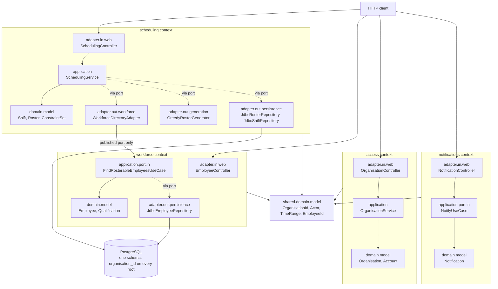
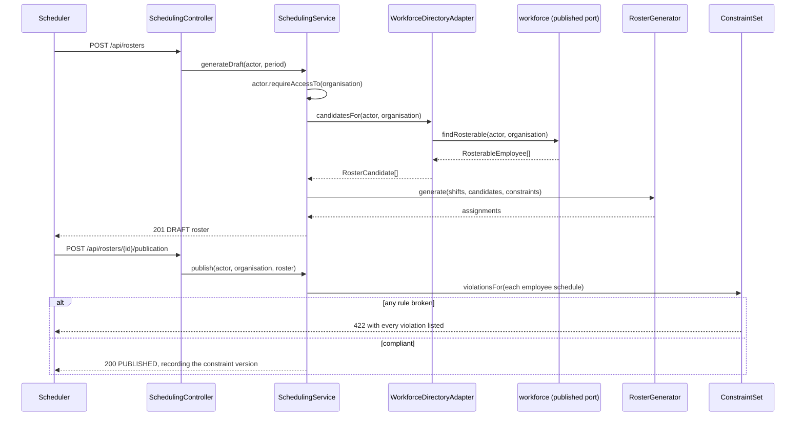

# Architecture — HrSched

This document records the system **as it actually is**. It is descriptive, never aspirational:
a plan for something not yet built belongs in an [ADR](../ADRs/) as a *Proposed* decision.

For *what the system must do*, see [requirements.md](../requirements/requirements.md); for *why*
these choices were made, see the [ADRs](../ADRs/).

> **Current state:** the domain is modelled and works end to end — onboard an organisation, define
> people and shifts, configure rules, generate a roster, adjust it by hand, publish it, and swap a
> shift — and it is all stored in PostgreSQL, so it survives a restart. But **generation is greedy,
> not optimised** (see [ADR-005](../ADRs/ADR-005-roster-generation-behind-a-port.md)) and **there is
> no authentication**: the acting identity comes from request headers and any caller can claim any
> role.

---

## Architecture overview

The repository holds `backend/` and `frontend/` as siblings with independent builds
([ADR-007](../ADRs/ADR-007-monorepo-backend-and-frontend.md)), orchestrated from the root by
`scripts/run.mjs` ([ADR-014](../ADRs/ADR-014-root-task-runner.md)).

`frontend/` is a React 19 single-page application built by Vite
([ADR-013](../ADRs/ADR-013-react-typescript-vite-frontend.md)). In development its dev server
proxies `/api` to the backend on 8080, so the browser sees one origin and **no CORS configuration
exists anywhere in this repository**.

The backend is a single Spring Boot process serving HTTP on 8080. Its code is organised **by
bounded context**, each context a top-level package holding its own complete **hexagon**
([ADR-006](../ADRs/ADR-006-organise-packages-by-bounded-context.md)).

Three rules hold this together, and each fails the build when broken:

1. Inside a context, dependencies point inward. The domain imports nothing but the JDK.
2. A context may reference another context's `application.port.in` package and nothing else.
3. The shared kernel depends on no context.

## Components

| Component | Responsibility |
| --- | --- |
| `shared.domain.model` | The kernel: `OrganisationId`, `UserId`, `EmployeeId`, `QualificationId`, `Role`, `TimeRange`, and the sealed `Actor` (`TenantActor`, `Operator`). Identities and pure values that cross contexts, with no behaviour of their own. A `TenantActor` also carries the `EmployeeId` it is, when it is one ([ADR-012](../ADRs/ADR-012-acting-identity-carries-its-employee-record.md)). |
| `access.domain.model` | `Organisation` — the tenant itself — and `Account`, what signs in. An account's `Membership` is sealed into one organisation in one role, or the platform operator, so an operator carrying a role or an employee link is unrepresentable. `SignInName` and `PasswordHash` both print as redacted. Otherwise deliberately small: the tenancy *types* live in the kernel because every context needs them. |
| `access.application` | Onboarding, listing and reading organisations (F13), and the register they live in. Onboarding and listing are the platform `Operator`'s alone — the guard is the inverse of every other one here, asking whether the actor belongs to a tenant rather than which role they hold in it. `KnownOrganisationsUseCase` is this context's **published API**: one question, whether an organisation exists, asked by the boundary check below. See [ADR-019](../ADRs/ADR-019-an-application-layer-for-the-access-context.md). |
| `notifications.domain.model` | `Notification` — something one person has been told, and whether they have seen it. It carries identifiers, a kind, a time and a flag, and **there is nowhere in it to put a sentence or a name** ([ADR-021](../ADRs/ADR-021-notifications-as-a-bounded-context.md)). |
| `notifications.application` | Raising and reading notifications. `NotifyUseCase` is this context's **published API** and is deliberately not on a controller; `ReadNotificationsUseCase` is strictly self-service, and whose inbox is read comes from the acting identity rather than from any parameter. Takes a `Clock`, so when something happened is an input rather than an ambient fact. |
| `workforce.domain.model` | `Employee` (aggregate root: qualifications, unavailability, preferences, contract terms), `Qualification`, `ShiftPreference`, `ContractTerms`. |
| `workforce.application` | Employee and qualification use cases. `FindRosterableEmployeesUseCase` is this context's **published API**, returning `RosterableEmployee` rather than the aggregate. |
| `scheduling.domain.model` | `Shift`, `Roster` (aggregate root), `Assignment`, `ConstraintSet` and the sealed `WorkingTimeConstraint` family, `EmployeeSchedule`. |
| `scheduling.application` | Shift definition, constraint configuration, roster generation and publication. Assembles the evidence constraints are judged against. |
| `scheduling.adapter.out.workforce` | An anti-corruption layer: one of **two** classes in scheduling permitted to name another context, and only its published port. |
| `scheduling.adapter.out.notification` | The other one. Translates "a swap was approved" into the word the `notifications` context uses for it, so nothing inward of the `Notifier` port knows that context exists ([ADR-021](../ADRs/ADR-021-notifications-as-a-bounded-context.md)). |
| `scheduling.adapter.out.generation` | `GreedyRosterGenerator` — a placeholder implementation of the generation port. It also records coverage (`hrsched.shifts.required` and `hrsched.shifts.uncovered`), because it is the only place that still knows both what was asked for and what could legally be filled. |
| `*.adapter.out.persistence` | `Jdbc*Repository` — hand-written SQL through `JdbcClient`, one per driven port, every read carrying its organisation in the `WHERE` clause. The one exception is named as such in its port: `JdbcAccountRepository.findBySignInName`, which sign-in needs because a submitted name is all it has to go on. No ORM: the domain may not be annotated, so mapping is explicit ([ADR-004](../ADRs/ADR-004-postgresql-behind-the-driven-ports.md)). |
| `*.adapter.out.audit` | `SchedulingAuditLog`, `WorkforceAuditLog`, `AccessAuditLog` and `NotificationAuditLog` — one per context, each implementing its own context's `AuditTrail` port and turning one recorded change into a structured log event and a counter. All four are named for their contexts because Spring derives a bean name from the simple class name alone, so four classes called `AuditLog` would collide at startup rather than at compile time. |
| `configuration` | Spring wiring. The only place permitted to see more than one context, which is why the rules exempt `@Configuration`-annotated classes and nothing else. |
| `configuration.observability` | Cross-cutting instrumentation that belongs to no context. Today that is `TraceIdResponseFilter`, which puts the request's trace id on the response as `X-Trace-Id`. It reads no request header, so unlike `ActorFromHeaders` it is unaffected by ADR-011. |
| `configuration.tenancy` | `KnownOrganisationFilter` — checks the claimed `X-Organisation` against the register before any handler runs, and answers the ordinary 404 when nobody onboarded it. Cross-cutting rather than per context, and it outlives ADR-011 ([ADR-020](../ADRs/ADR-020-refuse-a-request-naming-an-unknown-organisation.md)). |
| `configuration.web` | `RequestBindingExceptionHandler` — answers a request Spring could not bind to a controller's parameters (a missing header or query parameter, an identifier that does not parse) with a 400 problem detail naming what was wrong, whose detail repeats nothing that was sent. It belongs to no context because the failure happens before any controller runs ([ADR-024](../ADRs/ADR-024-answer-unbindable-requests-with-a-problem-detail.md)). |
| `frontend/src/api` | The typed client. `client.ts` is the only module that calls `fetch` or knows a header exists — it writes the four identity claims and reads back `X-Trace-Id`; `problem.ts` validates the RFC 9457 body into a typed `ApiError`, which carries that trace id as the reference a refusal can be quoted by; `scheduling.ts`, `workforce.ts`, `access.ts` and `notifications.ts` mirror the backend DTOs, one module per context. |
| `frontend/src/identity` | The acting-as context and its warning bar — the placeholder that supplies `X-Organisation`, `X-User`, `X-Role` and `X-Employee`, deleted with the backend placeholder when ADR-011 lands. |
| `frontend/src/pages` | One screen per capability: People, Qualifications, Rules, Shifts, Rosters, Swaps, Me, Organisations. Organisations is the platform Operator's: it lists and onboards organisations and switches the acting identity into one, sending every request as the identity the bar claims, so a tenant role is shown the 403 rather than a hidden tab. Swaps is where a Scheduler answers requests; approving publishes a replacement roster, so it is refused exactly as any publication is: with every broken working-time rule named, or, if it would put somebody in two places at once, with that. Me shows an employee their identifier, their published work over the planning span, and a way to hand a shift to a colleague named by that colleague's identifier, because an employee may not list colleagues (Q25). Me also holds the employee's `Inbox`. Opening a roster shows `RosterBoard`, which loads that roster by identifier and changes a draft through a picker and buttons per shift rather than by drag and drop ([ADR-025](../ADRs/ADR-025-edit-a-draft-roster-with-controls-not-drag-and-drop.md)). |

## Communication

Inbound HTTP only; nothing calls out. Contexts talk in-process, through published driving ports,
by direct method call. There are no events and no queues.

The browser talks to the backend over JSON on `/api`. In development that request goes to the Vite
dev server, which proxies it; in production the built bundle is served however the deployment
chooses and the same paths apply. The backend is unaware of either arrangement.

## Data flow

Generating and publishing a roster:

Everything is persisted, and the whole exchange above is one transaction: the boundary is the use
case, so a refusal at any point leaves nothing behind ([ADR-023](../ADRs/ADR-023-the-transaction-boundary-is-the-use-case.md)).

## External dependencies and integration points

**At runtime: PostgreSQL, and nothing else.** No broker and no third-party API. The schema is
created and changed only by the Flyway migrations in `backend/src/main/resources/db/migration`,
applied on startup. Locally `backend/compose.yaml` supplies the database and Boot starts it; a
deployment supplies `SPRING_DATASOURCE_URL`, `_USERNAME` and `_PASSWORD`.

| Dependency | Used for | Justification |
| --- | --- | --- |
| `spring-boot-starter-webmvc` | HTTP boundary, embedded Tomcat | ADR-001. Boot 4.x renamed this from `spring-boot-starter-web`. |
| `spring-boot-starter-actuator` | Health and readiness probes | Required of every service by the project baseline. A `db` health contributor now appears with the datasource. |
| `spring-boot-starter-security-oauth2-resource-server` | The security filter chain in front of every request, and (unused so far) signing and verifying JWTs | [ADR-011](../ADRs/ADR-011-issue-our-own-access-tokens.md). Pulls in Spring Security and Nimbus JOSE+JWT, both Apache-2.0 and maintained on Boot's release train. Authentication is security-critical code nobody should hand-roll. Today `SecurityConfiguration` declares one chain that permits every request unchanged; no token is issued or verified yet. |
| `spring-boot-starter-jdbc` | `JdbcClient`, the connection pool, and the transaction manager | [ADR-004](../ADRs/ADR-004-postgresql-behind-the-driven-ports.md). Chosen over JPA because the domain may not carry `jakarta.persistence` annotations. |
| `spring-boot-starter-flyway` + `flyway-database-postgresql` | Versioned schema migrations, applied on startup | ADR-004. New in Boot 4.x; 3.x had no Flyway starter. |
| `postgresql` | The JDBC driver | ADR-004. Runtime scope; nothing compiles against it. |
| `btree_gist` (PostgreSQL extension) | The `uuid` equality the `roster_one_published_per_moment` exclusion constraint indexes on | [ADR-026](../ADRs/ADR-026-make-overlapping-published-rosters-unrepresentable.md). Ships with PostgreSQL and is trusted, so the migrating role needs `CREATE` on the database, not superuser. Installed by migration `V2`. |
| `spring-boot-docker-compose` | Starting the local database on `./mvnw spring-boot:run` | ADR-004, and it keeps `scripts/run.mjs` free of build logic as [ADR-014](../ADRs/ADR-014-root-task-runner.md) requires. Optional scope, so it never reaches a deployed artifact. |
| `testcontainers-postgresql`, `testcontainers-junit-jupiter`, `spring-boot-testcontainers` | The real database the tests run against | ADR-004. Docker is required to build; there is deliberately no skip-when-absent. Pinned by the Testcontainers BOM, which the Boot BOM does not manage. |
| `spring-boot-starter-opentelemetry` | A W3C trace id per request, in the MDC and on the response | [ADR-016](../ADRs/ADR-016-structured-logs-and-a-propagated-trace-id.md). Supplies the OpenTelemetry API, the Micrometer Tracing bridge and the OTLP exporters; export is switched off until Q19 is answered. |
| `micrometer-registry-prometheus` | Rendering the collected meters for a scraper to pull from `/actuator/prometheus` | [ADR-017](../ADRs/ADR-017-expose-metrics-to-be-scraped.md). Nothing pushes; the pushgateway is off. |
| `archunit-junit5` | Enforcing the hexagon and the context boundaries | Nothing else can fail a build on a dependency direction. |
| `spotless-maven-plugin` + `google-java-format` | Format check bound to `validate` | ADR-002. |
| `jacoco-maven-plugin` | Coverage measurement, reported and never enforced | [ADR-015](../ADRs/ADR-015-report-coverage-without-a-threshold.md). The version is pinned because the Boot 4.1.1 BOM manages none. |
| `@vitest/coverage-v8` (frontend) | The same, for the SPA | ADR-015. Pinned to the exact Vitest version by peer dependency. |

## Structural decisions not visible from the file layout

- **No working-time threshold is hardcoded anywhere.** A minimum rest period is a value in a
  `ConstraintSet`, never a constant. A jurisdiction is a *preset*: a named set of values loaded
  as data, whose numbers must be sourced from the statute. This is the single most important
  property of the model, and the reason the constraint types carry their own thresholds.
- **Constraints are hard; objectives do not exist yet.** `ConstraintSet` holds only rules that
  must never be broken. Fairness, preferences and disruption — what makes one legal roster better
  than another — are a separate concept that is not modelled.
- **Tenancy is in every signature, on purpose.** Repository lookups take an `OrganisationId`, so
  a cross-tenant read cannot be written by forgetting a filter. See
  [ADR-009](../ADRs/ADR-009-tenant-isolation-in-the-domain.md).
- **A cross-tenant attempt returns 404, never 403.** A 403 would confirm the resource exists in
  another organisation.
- **Over HTTP that 404 is produced by the repositories, not by the tenant guard.**
  `ActorFromHeaders` builds a `TenantActor`'s organisation from the same `X-Organisation` header
  the operation targets, so `Actor.requireAccessTo` compares an organisation with itself and can
  never fail for a caller arriving over HTTP. Isolation there comes from every repository read
  filtering by organisation and returning nothing, which surfaces as an unknown-record 404.
  `CrossTenantAccessException` still guards every direct caller, and every exception handler still
  translates it. Worth knowing before anyone concludes the guard is dead code and deletes it.
- **An organisation must exist before anything can be done in its name.** `KnownOrganisationFilter`
  checks `X-Organisation` against the register on every `/api/**` request and answers the ordinary
  404 when it names an organisation nobody onboarded. Before it, a caller could invent a tenant with
  `uuidgen` and get a working private corner of the system that no operator could see. Onboarding is
  exempt, or the platform could never be bootstrapped; a missing or malformed header passes through
  to the 400 it already earned. It is a filter in `configuration` rather than three copies in the web
  adapters, and it outlives ADR-011 — whether a tenant exists is a different question from who the
  caller is. It is **not** authentication: anyone who learns a real identifier can still claim any
  role inside it ([ADR-020](../ADRs/ADR-020-refuse-a-request-naming-an-unknown-organisation.md)).
- **The two servlet filters are explicitly ordered, and the numbers matter.**
  `TraceIdResponseFilter` must run after Boot's observation filter (registered at
  `HIGHEST_PRECEDENCE + 1`), which opens the span it reads — ordered any earlier, `currentSpan()` is
  null and `X-Trace-Id` silently disappears from every response. `KnownOrganisationFilter` runs
  immediately after it, so a request it refuses still carries an id the caller can quote.
- **There is now one endpoint where that guard genuinely fires over HTTP.** On `GET
  /api/organisations/{id}` the acting identity comes from `X-Organisation` and the target comes from
  the path, so unlike every other route the two can differ, and a tenant naming somebody else's
  organisation is refused by the guard rather than by an empty repository read. It is the only place
  the branch is exercised outside a unit test
  ([ADR-019](../ADRs/ADR-019-an-application-layer-for-the-access-context.md)).
- **A `Location` header names an address that answers.** A created employee, qualification, shift,
  roster, swap request or organisation can be read back with `GET` at the address its 201 gave,
  authorised exactly as the listing it belongs to — reading one person takes an Admin or Scheduler
  because listing people does — so following a link never meets a looser or stricter rule than the
  list it came from. A swap request somebody is not party to is absent from their listing, so
  reading it directly answers them 404, as though it did not exist; one predicate in `SwapService`
  decides both.
- **Every log line is ECS JSON, in every environment including a laptop.** There is no profile that
  turns it off, because a format only production emits is one nobody reads until it matters. Each
  line carries the `trace_id` of the request that produced it, and the same value leaves on the
  response as `X-Trace-Id`, which the user interface shows on a refusal — so a person's report and
  the log are joinable. Nothing is exported: the OTLP exporters for traces, logs and metrics are all
  switched off until Q19 names somewhere to send them
  ([ADR-016](../ADRs/ADR-016-structured-logs-and-a-propagated-trace-id.md)).
- **Every change and every refusal is recorded, and no name is.** State-changing use cases call an
  `AuditTrail` driven port after saving; the two web exception handlers record refusals, because
  they are the only place that sees every one. An `AuditedChange` carries the organisation, the
  acting user, the kind of change and a bare `UUID` subject — a name cannot appear because there is
  nowhere to put one. A cross-tenant attempt, which the requirements call a security incident, is
  now a `WARN` and a counter while the caller still receives exactly the 404 it always did. Nothing
  is persisted and nothing is queryable; that is Q20
  ([ADR-018](../ADRs/ADR-018-audit-through-a-port-not-a-queryable-trail.md)).
- **Instrumentation lives outside the hexagon, and that is enforced.** No logger, meter or span
  appears in a domain or application class, and nothing anywhere prints: three architecture rules
  forbid `System.out` and `printStackTrace` outright, `org.slf4j`, `ch.qos.logback` and
  `java.util.logging` inside `..domain..`, and `io.micrometer` and `io.opentelemetry` inside either
  `..domain..` or `..application..`. Anything a use case needs recorded, it records through a driven
  port. The consequence worth knowing: Micrometer's `@Timed` and `@Counted` cannot be put on a use
  case.
- **Metrics are pulled, and nothing is pushed.** `/actuator/prometheus` publishes the JVM, process
  and `http.server.requests` meters Micrometer already collected, plus the product's own coverage
  measure. Exposure is an allow list: `loggers`, `env` and `heapdump` are shut, because there is no
  authentication and two of those disclose state while the third changes behaviour. Actuator shares
  port 8080 with the API, which is recorded rather than defended in
  [ADR-017](../ADRs/ADR-017-expose-metrics-to-be-scraped.md). No monitoring stack is committed;
  there is no environment yet to describe one for.
- **Coverage is measured and never enforced.** `./mvnw verify` writes `target/site/jacoco/`; the
  frontend reports only under `npm run test:coverage`. No threshold exists, on purpose
  ([ADR-015](../ADRs/ADR-015-report-coverage-without-a-threshold.md)).
- **`Actor` is sealed.** The set of things that can cross a tenant boundary is closed and lives
  in one file; `Operator` is the only member that can, and it is a named type rather than an
  implicit privilege.
- **Aggregates are immutable.** Every change returns a new instance, so nothing is ever observed
  half-updated and invariants are checked in exactly one place.
- **Entities are classes, value objects are records.** `Shift`, `Roster`, `Employee`,
  `Organisation` and `Qualification` compare by identity alone; `TimeRange`, `ShiftId`,
  `ContractTerms` and the constraints are their values.
- **Constraint checking lives in the application layer**, not in `Roster`. It needs when each
  shift runs and who is available — data the aggregate cannot reach. The judgement itself is
  still the domain's.
- **Days are counted in UTC**, because `TimeRange` carries no zone. `EmployeeSchedule` splits every
  period at midnight and totals the time landing on each day, so a shift running past midnight is
  counted against both days it touches and a shift ending exactly at midnight does not make the
  next day a working day. The arithmetic is right; the *zone* is not necessarily, and for an
  organisation whose local midnight is not UTC midnight this attributes work to the wrong day. That
  is Q17, and it must be answered before production.
- **`MaximumWeeklyWorkingTime` treats the roster period as the reference period.** Jurisdictions
  that average over a longer window cannot be expressed; that needs history beyond the roster.
- **The user interface enforces nothing.** Every rule is the backend's. The UI renders refusals —
  a 422 with its violations, a 422 listing none (an assignee without the qualification, a shift
  outside the roster's period), a 403, a 404 that may mean another tenant owns the resource — and
  it is written so those refusals read as outcomes rather than as bugs, but removing the UI removes
  no guarantee. A 422 is called a working-time breach only when it lists the rules it broke; the
  status alone does not say which kind of refusal it is.
- **Notification wording lives in the reader's interface.** The server stores a kind, a subject and
  a time, and holds no words ([ADR-021](../ADRs/ADR-021-notifications-as-a-bounded-context.md)).
  `Inbox` turns each kind into a sentence through a `Record` over the kinds it knows, so a kind added
  to the client's type cannot compile without its words, and a kind the server sends that this build
  does not know is shown as unknown rather than guessed at. Opening the inbox marks nothing read;
  the reader does.
- **The rules screen offers no default values.** Not a styling choice: a number suggested by the UI
  would be a working-time threshold chosen by a developer, which is exactly what this system
  refuses to contain.
- **The 422 body carries structured violations**, not formatted sentences, so a caller can resolve
  an employee to a name and group by person without parsing prose. The UI does exactly that.
- **`GET /api/constraints` returns thresholds, not just rule names.** `ConstraintSet.revisedTo`
  replaces the whole set rather than merging, so a caller that cannot read the current values cannot
  change one rule without deleting the others. The response mirrors the request shape for that
  reason.
- **A roster carries the period it covers**, so a caller resolves its assignments against the shifts
  that actually fall in it rather than whatever span it happens to be displaying.
- **Reading a roster requires Admin or Scheduler**, on the same reasoning as listing people: a
  roster says who works when.
- **An employee reads their own work through a separate, narrower port.** `ViewOwnScheduleUseCase`
  answers only for the personnel record the caller carries — the link `TenantActor` holds
  ([ADR-012](../ADRs/ADR-012-acting-identity-carries-its-employee-record.md)), never a `UserId`
  compared with an `EmployeeId` — and only from **published** rosters, because a draft binds nobody
  and a superseded one is no longer authoritative. It exists so that R12 does not have to be relaxed
  to satisfy F5. An actor with no personnel record is refused rather than shown an empty week: "you
  have no record" and "you are rostered for nothing" are different answers.
- **The header-based actor is insecure by design** and must be deleted when authentication
  arrives. It exists so the use cases can be exercised, not as a step towards a real one.
  `X-Organisation` names the organisation being acted *on* and is always required; `X-Role:
  OPERATOR` claims the platform operator, which is how the one identity permitted to cross tenants
  is reachable over HTTP at all rather than only from unit tests. `X-Employee` supplies the
  employee link. Every header is validated at the boundary, so a malformed one is a 400 and never
  a 500.
- **Every constraint version is stored, but only the current one can be read back.** The table is
  keyed `(organisation_id, version)`, so revising no longer discards what came before — which is
  what makes a published roster's record of the version that approved it worth anything. The port
  still offers only `findCurrent`; reading a historical version needs a method nobody has asked for
  yet.
- **Approving a swap publishes a replacement; it never edits.** `SwapService` builds the roster that
  would have been published had the swap been in it, and then calls `PlanRostersUseCase.publish` -
  the same door generation and manual assignment go through. So the constraint check, the
  supersession and both audit entries are not merely also applied to swaps, they are the same code,
  and a swap cannot become a way round rules generation cannot get round
  ([ADR-022](../ADRs/ADR-022-approving-a-swap-publishes-a-replacement-roster.md)). The cost is that a
  refused approval leaves the replacement behind as a draft.
- **Whether a colleague may cover a swapped shift is decided at approval, not at request.** Deciding
  it means listing colleagues, which discloses their unavailability, and an Employee may not. So a
  request may name somebody who cannot cover the shift — because they lack a qualification, or
  because they are already unavailable — and the Scheduler answering it is where that is found out,
  through the same `AssignmentEligibility` the manual path uses. A colleague who already works a
  shift overlapping the one handed over is found out a step later, when the replacement is
  published.
- **Publishing supersedes, so exactly one roster is authoritative.** `publish` marks every
  published roster of that organisation whose period overlaps as `SUPERSEDED`. Overlap rather than
  equality decides it, because a partly-overlapping published roster would otherwise still govern
  the days it shares. Whether a partial replacement should supersede the old roster whole is Q16.
- **Two overlapping published rosters cannot be stored.** Migration `V2` adds the
  `roster_one_published_per_moment` exclusion constraint over the organisation and the roster's
  period, for `PUBLISHED` rows only. A writer that publishes without seeing a publication still in
  flight is refused by PostgreSQL rather than leaving two rosters authoritative. PostgreSQL reports
  that as an exclusion violation, or, when two such writers wait on each other, by aborting one as
  a deadlock victim. `JdbcRosterRepository` turns either into `RosterPublicationConflictException`,
  which is answered 409 ([ADR-026](../ADRs/ADR-026-make-overlapping-published-rosters-unrepresentable.md)).
- **Assigning by hand asks the same questions generation asks, and no more.** `assign` enforces the
  three rules that are about one assignment — the person belongs to the organisation (R5), holds
  what the shift demands (R4), and has not declared they cannot work when it runs (F6) — plus that
  the shift falls inside the roster's own period, which generation cannot violate because it only
  ever assigns shifts it found there, and that the person holds no other shift on this draft
  overlapping it (R3), which generation cannot violate because it skips anybody already working
  then. It deliberately leaves the working-time rules to publication,
  exactly as generation does: those judge a whole schedule rather than a single assignment, so the
  honest place for them is the step that cannot be bypassed, and a hand-made roster breaking a daily
  limit is refused at publication just as a generated one is.
  The availability half of that was missing at first, and the asymmetry was the point: generation
  filters candidates through `RosterCandidate.couldCover`, which tests availability, so it refused to
  roster somebody through their declared absence while assigning by hand accepted it — and
  publication could not catch it afterwards, because unavailability is not a `WorkingTimeConstraint`.
  `AssignmentEligibility` is one helper for exactly this reason: a rule enforced on one of two paths
  is not enforced.
- **Work that cannot be checked refuses publication.** If an assignment names a shift the
  repository cannot return, publication fails with `RosterNotVerifiableException` rather than
  quietly omitting that work from the constraint check. Omission would publish hours nobody
  counted, which is the failure publication exists to prevent.
- **Nobody is published in two places at once, whatever the rules say.** Building each person's
  schedule for the constraint check refuses one holding two overlapping shifts with
  `OverlappingAssignmentException` (R3), before any constraint is evaluated. It cannot be left to
  the rules: minimum rest is the only one that notices an overlap, it is optional, and an empty
  constraint set checks nothing — the asymmetry unavailability once had. `assign` asks the same
  question of the one person being assigned, so the board is told as it happens; publication asks
  it of everybody, so a swap approval and a generated draft are held to it too. Both answer 422.
  It looks within one roster only: whether R3 should also look across rosters, for a shift that
  straddles two roster periods, is Q26.
- **Reading the people of an organisation is restricted to Admins and Schedulers**, because
  unavailability is personal data. Generation reaches the same data through the anti-corruption
  layer carrying the Scheduler's own identity, so the restriction holds there too.
- **Every use case is one transaction, and no use case says so.** `UseCaseConfiguration` wraps each
  service in a transactional proxy, because the architecture test forbids Spring inside the
  application layer and so `@Transactional` cannot go where a reader would look for it
  ([ADR-023](../ADRs/ADR-023-the-transaction-boundary-is-the-use-case.md)). A nested use case joins
  its caller's transaction, which is what makes approving a swap atomic.
- **Two edits of one draft are atomic, but the later still wins.** Two concurrent saves of one
  roster serialise on its row rather than interleaving, so neither is left half-done; but there is
  no version column, so the later one overwrites the earlier outright rather than being rejected.
  Adding one would change port signatures, which is a decision of its own.
- **Publications within one organisation take turns.** `publish` and `approveSwap` first call
  `RosterRepository.lockPublicationsOf`, a transaction-scoped PostgreSQL advisory lock per
  organisation, before reading anything they decide from. A second publication therefore waits,
  then reads what the first committed: it supersedes that roster as R11 says, and a second swap
  approval finds its request already decided or its roster no longer the published one. The lock is
  a convention every writer has to follow; the `roster_one_published_per_moment` constraint is what
  holds for one that does not
  ([ADR-027](../ADRs/ADR-027-take-turns-publishing-within-an-organisation.md)).
- **Three reads were written for a hash map and have not been revisited.** `supersedeOverlapping`
  and `findOwnSchedule` call `RosterRepository.findByOrganisation`, which now loads every roster the
  tenant has ever had together with all of their assignments, to find the few that overlap one week;
  `violations()` fetches each assignment's shift one at a time, an N+1 inside the publish
  transaction; and every owned collection is written one `INSERT` per row. All three were free
  against a map and are not against a database. Fixing the first two means new port methods that
  push the predicate into SQL, which is a change inward of the ports and so a decision of its own;
  the performance requirement that would size it is still `TODO`.
- **An audit entry cannot be rolled back.** The trail is a log stream (ADR-018) and a transaction
  that fails after a service has recorded a change leaves a record of something that did not
  happen. This is newly true because the transaction is, and it is Q20's problem to solve.
