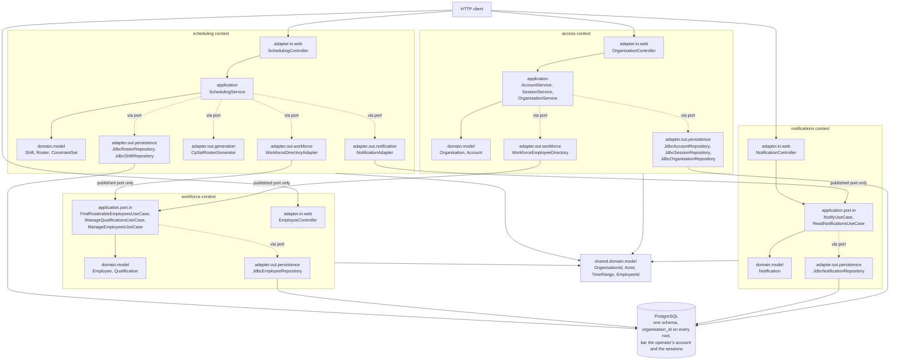
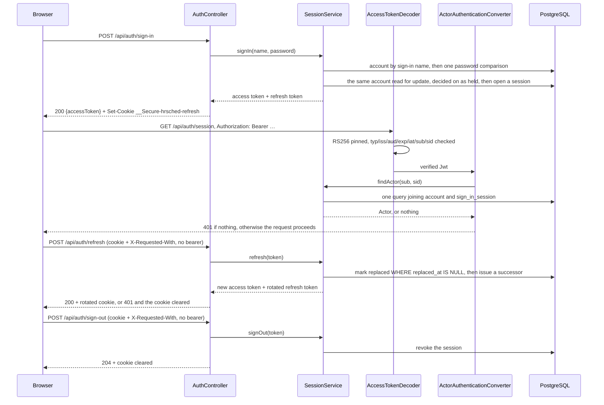

# Architecture — HrSched

This document records the system **as it actually is**. It is descriptive, never aspirational:
a plan for something not yet built belongs in an [ADR](../ADRs/) as a *Proposed* decision.

For *what the system must do*, see [requirements.md](../requirements/requirements.md); for *why*
these choices were made, see the [ADRs](../ADRs/).

> **Current state:** the domain is modelled and works end to end — onboard an organisation, define
> people and shifts, configure rules, generate a roster, adjust it by hand, publish it, and swap a
> shift — and it is all stored in PostgreSQL, so it survives a restart. People sign in, and every
> request is authenticated by a token HrSched signed and authorised against the account it names.
> Generation fills every place the rules allow, then minimises the organisation's weighted
> objectives, with the CP-SAT solver (see [ADR-044](../ADRs/ADR-044-generate-rosters-with-or-tools-cp-sat.md)).

---

## Architecture overview

The repository holds `backend/` and `frontend/` as siblings with independent builds
([ADR-007](../ADRs/ADR-007-monorepo-backend-and-frontend.md)), orchestrated from the root by
`scripts/run.mjs` ([ADR-014](../ADRs/ADR-014-root-task-runner.md)).

`frontend/` is a React 19 single-page application built by Vite
([ADR-013](../ADRs/ADR-013-react-typescript-vite-frontend.md)). In development its dev server
proxies `/api` to the backend on 8080, so the browser sees one origin and **no CORS configuration
exists anywhere in this repository**.

The backend is a single Spring Boot process serving HTTP on 8080. Its code is organised **by
bounded context**, each context a top-level package holding its own complete **hexagon**
([ADR-006](../ADRs/ADR-006-organise-packages-by-bounded-context.md)).



These rules hold this together, and each fails the build when broken:

1. Inside a context, dependencies point inward. The domain imports the JDK and HrSched's own
   `domain` packages, its context's and the kernel's, and nothing else.
2. A context may reference another context's `application.port.in` package and nothing else, and
   only from its own `adapter.out`.
3. The shared kernel depends on no context.
4. Contexts depend one way, with no cycle (`contexts_are_free_of_cycles`).

`HexagonalArchitectureTest` holds the full set. Its other structural rules: the application layer
depends only on an allow-list of the JDK, SLF4J and HrSched's own core; neither the domain nor the
application layer does I/O through the JDK; every class of a context sits in one of its layers;
only the `@Configuration` wiring sees inside a context; every `@RestController` is handled by its
own context's exception handler; the root package holds only `HrSchedApplication`; and every
repository and directory method but a save takes an `OrganisationId`, bar those named in
`UNSCOPED_METHODS`.

## Components

| Component | Responsibility |
| --- | --- |
| `shared.domain.model` | The kernel: `OrganisationId`, `UserId`, `EmployeeId`, `QualificationId`, `Role`, `TimeRange`, and the sealed `Actor` (`TenantActor`, `Operator`). Identities and pure values that cross contexts. The behaviour they have is what they are, such as a `TimeRange` saying whether it overlaps another, and the actor's access checks. `Actor.requireAccessTo` and `TenantActor.requireRoleIn` are kept in this one place by [ADR-030](../ADRs/ADR-030-confine-the-operator-to-the-register-of-organisations.md), `Actor.requireTenantMembership` comes from [ADR-031](../ADRs/ADR-031-take-the-organisation-from-the-account.md), and `TenantActor.isThemself` from [ADR-012](../ADRs/ADR-012-acting-identity-carries-its-employee-record.md). A `TenantActor` also carries the `EmployeeId` it is, when it is one ([ADR-012](../ADRs/ADR-012-acting-identity-carries-its-employee-record.md)). |
| `access.domain.model` | `Organisation` — the tenant itself — and `Account`, what signs in. An account's `Membership` is sealed into one organisation in one role, or the platform operator, so an operator carrying a role or an employee link is unrepresentable. So is an Employee account that may be used while linked to nobody (R34): the only one linked to nobody at all was stored before the rule, and migration `V9` disabled it until it is linked. `SignInName` and `PasswordHash` both print as redacted. Otherwise deliberately small: the tenancy *types* live in the kernel because every context needs them. |
| `access.application` | Signing in, renewing and ending a session, reading one's own session and changing one's own password (F14); bootstrapping the platform operator; administering an organisation's own accounts (F15); and onboarding, listing and reading organisations (F13), with the register they live in. Onboarding creates the organisation and its first Admin account in one transaction, so a refused account leaves no organisation behind; that account is created needing a password change, because the one it was given was typed by somebody else. Changing an account's role or link, and disabling or restoring one, take the organisation's advisory lock before they read, because R14 — an organisation keeps at least one active Admin — is decided by reading and then writing; creating an account and resetting a password take no Admin away, and no lock. Account administration reads the account it changes with `AccountRepository.findForUpdate`, as a password reset and a change of one's own password do, so two changes to one account take turns rather than one storing over the other ([ADR-041](../ADRs/ADR-041-make-concurrent-changes-take-turns-on-the-row.md)); the operator's account, which belongs to no organisation, is held under none. Sign-in makes its one password comparison on an unlocked read and refuses a locked or disabled account from it, before anything is held; otherwise it reads the account again for update and decides on that copy, so a disable, a reset or another attempt's failure committed during the comparison is neither stored over nor ignored; holding the row through the comparison would have told a second attempt which names exist. A change of one's own password decides on its held copy too: a locked account, or one disabled since the request was authenticated, is refused before a wrong current password is counted or a new session begun. Onboarding and listing are the platform `Operator`'s alone — the guard is the inverse of every other one here, asking whether the actor belongs to a tenant rather than which role they hold in it. See [ADR-019](../ADRs/ADR-019-an-application-layer-for-the-access-context.md). |
| `notifications.domain.model` | `Notification` — something one person has been told, and whether they have seen it. It carries identifiers, a kind, a time and a flag, and **there is nowhere in it to put a sentence or a name** ([ADR-021](../ADRs/ADR-021-notifications-as-a-bounded-context.md)). |
| `notifications.application` | Raising and reading notifications. `NotifyUseCase` is this context's **published API** and is deliberately not on a controller; `ReadNotificationsUseCase` is strictly self-service, and whose inbox is read comes from the acting identity rather than from any parameter. Takes a `Clock`, so when something happened is an input rather than an ambient fact. |
| `workforce.domain.model` | `Employee` (aggregate root: qualifications, unavailability, preferences, contract terms), `Qualification`, `ShiftPreference`, `ContractTerms`. |
| `workforce.application` | Employee and qualification use cases. Other contexts consume three of its ports, each from an `adapter.out.workforce` class: scheduling's `WorkforceDirectoryAdapter` takes `FindRosterableEmployeesUseCase`, which returns `RosterableEmployee` rather than the aggregate, and `ManageQualificationsUseCase`, and access's `WorkforceEmployeeDirectory` takes `ManageEmployeesUseCase` to ask whether an employee exists. A use case that changes an employee reads them with `EmployeeRepository.findForUpdate`, so two changes to one person at once — an Admin's and their own — take turns and both apply ([ADR-041](../ADRs/ADR-041-make-concurrent-changes-take-turns-on-the-row.md)). |
| `scheduling.domain.model` | `Shift`, `Roster` (aggregate root), `Assignment`, `ConstraintSet` and the sealed `WorkingTimeConstraint` family, `EmployeeSchedule` and the `WorkingPeriod`s it holds, `HeldWork`; `Objective`, `ObjectiveWeights` and the `StatedPreferences` a candidate carries ([ADR-010](../ADRs/ADR-010-score-a-roster-by-three-objectives-each-organisation-weights.md)). |
| `scheduling.application` | Shift definition, constraint and objective configuration, roster generation and publication. Assembles the evidence constraints are judged against. |
| `scheduling.adapter.out.workforce` | An anti-corruption layer: one of **two** classes in scheduling permitted to name another context, and only its published port. |
| `scheduling.adapter.out.notification` | The other one. Translates "a swap was approved" into the word the `notifications` context uses for it, so nothing inward of the `Notifier` port knows that context exists ([ADR-021](../ADRs/ADR-021-notifications-as-a-bounded-context.md)). |
| `scheduling.adapter.out.generation` | `CpSatRosterGenerator` — the generation port, solved with CP-SAT from Google OR-Tools ([ADR-044](../ADRs/ADR-044-generate-rosters-with-or-tools-cp-sat.md)). `RosterModel` states the request as one boolean per person who could take each shift, and every rule as a constraint over them: eligibility and time are decided in Java with the domain's own methods, and each kind of working-time rule is one case of an exhaustive `switch`, so a new kind does not compile until it is stated. It searches twice, each within `hrsched.generation.time-limit-per-phase`: first for as many places filled as it can, then, if the organisation weighs anything, for the lowest weighted score that keeps at least that many filled, starting from the first answer. Its score restates `RosterMeasures` exactly. It refuses to run inside a transaction (ADR-045). It also records coverage (`hrsched.shifts.required` and `hrsched.shifts.uncovered`), because it is the only place that still knows both what was asked for and what could legally be filled. The greedy generator it replaced lives on in the tests, as the baseline it is measured against. `GenerationRunner` implements the `BackgroundWork` port: the threads each solve runs on, after the request asking for it has been answered ([ADR-046](../ADRs/ADR-046-generate-in-the-background-and-keep-the-job-in-postgresql.md)). |
| `*.adapter.out.persistence` | `Jdbc*Repository` — hand-written SQL through `JdbcClient`, one per driven port, every read carrying its organisation in the `WHERE` clause, but for the access context's credential reads and its register, which have none to carry: `AccountRepository.findBySignInName` and `findForAuthentication`, `SessionRepository.findRefreshToken` and `findAuthenticatedSession` (the rest of that port takes none either), and `OrganisationRepository.findAll` and `findById`. Each port says so, and [ADR-055](../ADRs/ADR-055-read-an-account-or-session-without-an-organisation-where-none-is-known.md) lists them and why; `AccountRepository.findForUpdate` is scoped, and an empty organisation in it names the operator's. A `findForUpdate` holds the root's row until the use case's transaction ends, and refuses outside a writable one ([ADR-041](../ADRs/ADR-041-make-concurrent-changes-take-turns-on-the-row.md)). No ORM: the domain may not be annotated, so mapping is explicit ([ADR-004](../ADRs/ADR-004-postgresql-behind-the-driven-ports.md)). |
| `scheduling.adapter.out.persistence.TransactionalUnitsOfWork` | Implements the `UnitsOfWork` driven port with two `TransactionTemplate`s, both `REQUIRED`: `reading`, read-only, and `writing`. Generation uses them to read, solve outside any transaction, and write ([ADR-045](../ADRs/ADR-045-generate-outside-the-use-cases-transaction.md)). Besides `TransactionalUseCases`, it is the only code that begins a transaction. |
| `*.adapter.out.audit` | `SchedulingAuditLog`, `WorkforceAuditLog`, `AccessAuditLog` and `NotificationAuditLog` — one per context, each implementing its own context's `AuditTrail` port and turning one recorded change into a structured log event and a counter. All four are named for their contexts because Spring derives a bean name from the simple class name alone, so four classes called `AuditLog` would collide at startup rather than at compile time. |
| `configuration` | Spring wiring, and what belongs to no context. `UseCaseConfiguration` builds every use case, wraps it in a transaction and registers it. The subpackages below hold the HTTP filters and handlers (`web`, `observability`, `security`), the transaction proxy (`persistence`) and the policy properties (`scheduling`, `security` and `web`). The wiring is the only place permitted to see more than one context, which is why the rules exempt `@Configuration`-annotated classes and nothing else. |
| `configuration.persistence` | `TransactionalUseCases` — the proxy that runs every call to a use case in one transaction, `REQUIRED`, read-only when the method's name starts with `find` ([ADR-054](../ADRs/ADR-054-run-a-use-case-read-only-when-its-name-starts-with-find.md)). It leaves alone the methods it is told to, today `PlanRostersUseCase.startGeneration`, which `UseCaseConfiguration` resolves by reflection so that a rename fails startup ([ADR-045](../ADRs/ADR-045-generate-outside-the-use-cases-transaction.md)). It is here, not on the services, because the application layer may carry no Spring ([ADR-023](../ADRs/ADR-023-the-transaction-boundary-is-the-use-case.md)). |
| `configuration.scheduling` | `GenerationPolicyProperties` — `hrsched.generation.lost-after`, which `UseCaseConfiguration` turns into the domain's `GenerationPolicy` before handing it to the use case. It has no default in code, and lives here rather than in a scheduling adapter because it is the composition root that does the turning ([ADR-046](../ADRs/ADR-046-generate-in-the-background-and-keep-the-job-in-postgresql.md)). |
| `access.adapter.out.workforce` | `WorkforceEmployeeDirectory` — an anti-corruption layer, and the **only** class in access permitted to name another context. It asks workforce's published port whether an organisation employs somebody and reduces the answer to a boolean on the spot, so a colleague's name never enters the context that writes the access audit trail. |
| `access.adapter.in.token` | `AccessTokenDecoder` (the application's only `JwtDecoder`), `ActorAuthenticationConverter` and `ActorAuthentication`. Verifying a token and deciding who is acting both live here, in the context that owns accounts, rather than in `configuration` — which may not name an adapter class, so the chain receives them by type. |
| `access.adapter.out.token` | `AccessTokenKey` (the RSA key pair, or a refusal to start without one), `AccessTokenSigning`, `JwtAccessTokenIssuer` and `SecureRandomSessionSecrets`. |
| `access.adapter.out.password` | `BCryptPasswordHasher` — a `DelegatingPasswordEncoder`, so every stored hash names the algorithm that made it and a later change needs no migration. It holds bcrypt's 72-byte limit when verifying as well as when hashing, so a longer candidate never matches. |
| `access.adapter.in.bootstrap` | `OperatorBootstrap` — an `ApplicationRunner` that creates the first platform operator from configuration, and only if no account holds the name ([ADR-029](../ADRs/ADR-029-provision-accounts-from-the-top-down.md)); if a tenant's account holds it, startup fails: no operator can be created under that name, and one most likely exists already under another. |
| `configuration.security` | `SecurityConfiguration` (the one filter chain), `ProblemAuthenticationEntryPoint` and `ProblemAccessDeniedHandler` (which write the 401 and 403 bodies a filter would otherwise leave empty; the entry point also writes the `WWW-Authenticate` challenge itself, because Spring's always adds a `resource_metadata` parameter), and `SecurityPolicyProperties`. `SecurityConfiguration` also removes Spring's protected-resource metadata filter from the built chain ([ADR-050](../ADRs/ADR-050-reject-the-protected-resource-metadata-endpoint.md)). |
| `configuration.observability` | Cross-cutting instrumentation that belongs to no context. Today that is `TraceIdResponseFilter`, which puts the request's trace id on the response as `X-Trace-Id`. It depends on nothing about who is calling, so it can run ahead of the security chain, and it is ordered to (see *Structural decisions not visible from the file layout*), which is why a refusal still carries the id. |
| `configuration.web` | `RequestBindingExceptionHandler` — answers a request Spring could not bind to a controller's parameters (a missing query parameter, an identifier that does not parse) with a 400 problem detail naming what was wrong, whose detail repeats nothing that was sent. It belongs to no context because the failure happens before any controller runs ([ADR-024](../ADRs/ADR-024-answer-unbindable-requests-with-a-problem-detail.md)). This package also holds the bound on a request body ([ADR-053](../ADRs/ADR-053-bound-a-request-body-and-accept-only-utf-8-json.md)): `hrsched.web.max-json-document-bytes` (1 MiB by default, counted in bytes; in characters for a body Jackson detects as UTF-16 or UTF-32, #278) is handed to Jackson, and a JSON body over it is refused with a 413 titled `Request too large`, whose detail repeats nothing that was sent, before any use case runs. `RequestBodyLimitProperties` checks the limit at startup, and a value of 0 or less fails it, where Jackson would read it as no limit, as does one over `Integer.MAX_VALUE`, which the form limit below would wrap. `JsonCharsetFilter`, ordered after the security chain, refuses JSON declared in any charset but UTF-8 with a 415 before it is read, because Jackson counts a body in another charset in decoded characters, which would not hold the byte bound. Multipart is switched off (`spring.servlet.multipart.enabled=false`), so a multipart request is refused with a 415 and never parsed. Boot's form-content filter is switched off too (`spring.mvc.formcontent.filter.enabled=false`); it would otherwise read a form body sent with PUT, PATCH or DELETE ahead of the security chain (`RequestBodyReadingFiltersTest`). A form posted to a route that takes JSON is parsed before it is refused as the wrong type, so the server's form limit is the JSON one (`server.tomcat.max-http-form-post-size`), and a larger form is refused with a 413 (`FormPostLimitHttpTest`). Jackson refuses a number written with a fraction part or an exponent where a request field is a whole number (`spring.jackson.deserialization.accept-float-as-int=false`), so a headcount, threshold, weight or contracted minutes sent as 2.5, or as 2.0, is answered 400 `Malformed request` rather than stored truncated ([ADR-056](../ADRs/ADR-056-refuse-a-fraction-where-a-whole-number-is-bound.md), #237, `WholeNumberFieldHttpTest`). |
| `frontend/src/api` | The typed client. `client.ts` is the only module that calls `fetch` or knows a header exists — it attaches the bearer token to every request except renewing and signing out, whose credential is the refresh cookie and which a stale token would get refused (#179), renews the session once on a 401 from anything credentialed by the token, the session read and the password change included and retries the request exactly once (single-flight within the tab, serialised across tabs by a Web Lock); a retry refused too, with the token it carried still held, is not retried again, but the cookie is asked once more, so that renewal's own outcome decides whether the session goes on — refusing the request instead if the renewal answers for a different account than the request was sent as, since every tab shares one cookie — and reads back `X-Trace-Id`. A failure body that is not JSON becomes the error's detail only when it was sent as `text/plain`; any other is described by its status alone, so a gateway's HTML error page is never shown as a message. `session.ts` holds the access token in a module variable and **nowhere a script can read it back**, notifies the shell whenever a session is held, so the role, employee link and password flag a renewal answers with replace the ones on screen for the same account, and notifies it when a session ends — telling every other tab, over the `hrsched.session` BroadcastChannel where the browser has one, how it ended: `'sign-out-unconfirmed'` as a sign-out is sent, `'ended'` once it is confirmed or a renewal is refused. The channel carries only those words, never a token or who was signed in; a renewal that answers for another account forgets the session in this tab only ([ADR-048](../ADRs/ADR-048-keep-a-browsers-tabs-on-one-session.md)). It writes no identity claim of any kind: the bearer token is the whole of what says who is acting, and a request carrying a second, weaker answer would be offering one. `problem.ts` validates the RFC 9457 body into a typed `ApiError`, which carries that trace id as the reference a refusal can be quoted by; `scheduling.ts`, `workforce.ts`, `access.ts` and `notifications.ts` mirror the backend DTOs, one module per context. Lint refuses a request sent from any module but `client.ts` (see *Structural decisions not visible from the file layout*); that no other module names a header is not checked. |
| `frontend/src/components` | What more than one screen shares: `ErrorBoundary`, `Feedback`, `useAsync`, `localDates`, `useShiftsById`, `swapStatus`, and the wording tables `ruleFields` and `objectiveFields`. A helper only one screen uses stays beside that screen in `frontend/src/pages`, and moves here once a second screen uses it. Besides its own modules it imports `frontend/src/api` alone, so a helper that needs the session is handed it by the screen calling it, as `useShiftsById` is handed the session key. |
| `frontend/src/auth` | `SessionProvider` (which of six states the app is in, and the handshake every load begins with, including the one that cannot finish, because the backend was not reached or the session could not be read back), `SignInPage`, `ChangePasswordPage` and `SessionBar`. A sign-out that is in flight or was not confirmed — in this tab or announced by another — shows `SignOutUnconfirmedPage` in place of the sign-in form: inside `main`, it focuses its heading, warns that this browser may still be signed in because the backend clears the refresh cookie only on a sign-out that reaches it, shows the failure with its trace reference, and offers "Try signing out again" with a live status region that reports each attempt; the request is sent with `keepalive`, so closing the tab does not abort it. When a session that was on screen ends, the sign-in page focuses its heading and says the user has been signed out; on a first load it does neither. Replaced `frontend/src/identity`, whose bar let anybody claim any role in any organisation because the backend believed whatever headers it was sent. |
| `frontend/src/pages` | One screen per capability: People, Accounts, Qualifications, Rules, Objectives, Shifts, Rosters, Swaps, Me, Organisations. Objectives is the Admin's other half of the Rules tab, shown beneath `RulesPage`: how the organisation weighs fairness, preferences and disruption ([ADR-010](../ADRs/ADR-010-score-a-roster-by-three-objectives-each-organisation-weights.md)). It suggests no weight, because what matters more is the organisation's to say, and a blank field leaves an objective unweighed. Organisations is the platform Operator's: it lists and onboards organisations, and offers no way to act inside one, because the Operator is refused everything inside every tenant ([ADR-030](../ADRs/ADR-030-confine-the-operator-to-the-register-of-organisations.md)). A tenant role reaching it is shown the 403 rather than a hidden tab. Accounts is its mirror for an Admin: it creates accounts, changes what one is, disables and restores one, and resets a colleague's password. Nothing on it names an organisation, because the backend takes that from the token; every temporary password is typed, masked, never defaulted, and cleared once the request it was typed for has succeeded. Swaps is where a Scheduler answers requests; approving publishes a replacement roster, so it is refused exactly as any publication is: with every broken working-time rule named, or, if it would put somebody in two places at once, with that. Me shows an employee their identifier, their published work over the planning span, and a way to hand a shift to a colleague named by that colleague's identifier, because an employee may not list colleagues (Q25). Me also holds the employee's `Inbox`. Opening a roster shows `RosterBoard`, which loads that roster by identifier and changes a draft through a picker and buttons per shift rather than by drag and drop ([ADR-025](../ADRs/ADR-025-edit-a-draft-roster-with-controls-not-drag-and-drop.md)). |

## Communication

Inbound HTTP only; nothing calls out. Contexts talk in-process, through published driving ports,
by direct method call. There are no events and no queues.

The browser talks to the backend over JSON on `/api`. In development that request goes to the Vite
dev server, which proxies it; in production the built bundle is served however the deployment
chooses and the same paths apply. The backend is unaware of either arrangement. The build also
writes the licence notices of everything it bundles to `dist/.vite/license.md`; nothing serves it
yet, which is left to the edge ([#162](https://github.com/NaimElijah/HrSched/issues/162)).

## Authentication

**Every route under `/api` requires a token**, except the three that are authentication itself:
`POST /api/auth/sign-in`, `/refresh` and `/sign-out`. Who is acting is the account the token names,
and every controller takes it from `@AuthenticationPrincipal Actor`
([ADR-011](../ADRs/ADR-011-issue-our-own-access-tokens.md)).

**The organisation comes from the account, never from the request.** Each web adapter has one
`actingIn(actor)` helper over `Actor.requireTenantMembership()`, and that helper is the only way an
organisation enters a request — there is no identifier in a path, body or header for a caller to
change ([ADR-031](../ADRs/ADR-031-take-the-organisation-from-the-account.md)). That also makes the
platform operator's refusal structural rather than a check: it belongs to no organisation, so there
is nothing inside one for it to act in ([ADR-030](../ADRs/ADR-030-confine-the-operator-to-the-register-of-organisations.md)).
The one exception is `GET /api/organisations/{id}`, where the target is in the path because the
register is what the operator administers.

A request carrying an invalid token is refused on every route, including the ones that do not
require one — that is the bearer filter's own behaviour, and why a client must send no token rather
than a stale one.

**The chain is closed: it ends in `denyAll`.** Every route this application serves is named by a
rule, and anything else is refused — including a route somebody adds later and forgets to decide
about. The rules are the coarse outer line; the use case behind each route is what actually decides
([ADR-032](../ADRs/ADR-032-close-the-security-chain-by-default.md)).

| Route | Who may reach it |
| --- | --- |
| `POST /api/auth/sign-in`, `/refresh`, `/sign-out` | anybody — authentication itself |
| The `metrics` and `prometheus` endpoints, every path beneath each (matched by endpoint id) | nobody — 401 without a token and 403 with any token, until the scrape question is decided ([ADR-049](../ADRs/ADR-049-refuse-the-metrics-to-every-caller-until-a-scraper-exists.md)) |
| `/actuator/**` | anybody, for what remains: health, liveness, readiness and info. What exists there is decided by the exposure list (ADR-017) |
| `GET /api/auth/session`, `POST /api/auth/password` | any authenticated account, including one whose password change is still pending |
| `POST`/`GET /api/organisations` | `OPERATOR` |
| `GET /api/organisations/{id}` | any role; the use case decides whose |
| `/api/accounts/**` | `ADMIN` |
| `/api/employees/**`, `/api/qualifications/**`, `/api/shifts/**`, `/api/constraints/**`, `/api/objectives/**`, `/api/rosters/**`, `/api/me/**`, `/api/swaps/**`, `/api/notifications/**` | any tenant role |
| anything else | nobody |

Every response the security chain writes carries `Content-Security-Policy: default-src 'none';
frame-ancestors 'none'` and `Referrer-Policy: no-referrer`, beside Spring Security's own default
headers. The request firewall's own 400, for a malformed path such as `//`, is written before the
chain and carries neither. The SPA's own policy is the edge's, not the API's
([#162](https://github.com/NaimElijah/HrSched/issues/162)).

**A verified signature is not enough, and that is the point.** The decoder proves a token is one
this service signed, for this service, unexpired, of type `at+jwt`, and naming both an account and
a session. It cannot know whether the account has since been disabled, whether its role changed, or
whether the session was signed out a second ago — so every authenticated request asks the database,
and a token whose account or session no longer stands is refused. That is what makes disabling,
demoting and signing out take effect on the next request rather than whenever a token happens to
expire, and it costs one read per request.



Signing in, renewing and signing out are open by design: the credential for each is what the caller
presents. The session endpoints are reachable by an account whose temporary password is still
pending, because they are the two things such an account has to be able to do — it holds
`PASSWORD_CHANGE_REQUIRED` and no role at all, so every rule written in terms of a role refuses it.

## Data flow

Generating and publishing a roster:

```mermaid
sequenceDiagram
    participant C as Scheduler
    participant W as SchedulingController
    participant S as SchedulingService
    participant D as WorkforceDirectoryAdapter
    participant F as workforce (published port)
    participant G as RosterGenerator
    participant B as GenerationRunner
    participant R as ConstraintSet

    C->>W: POST /api/rosters/generations
    W->>S: startGeneration(actor, period)
    S->>S: actor.requireAccessTo(organisation)
    S->>S: store the generation, PENDING; record it
    S->>B: start(the solve)
    alt every run busy, or the runner stopped
        S-->>C: 503, the generation stored as FAILED
    end
    S-->>C: 202, with where to read it
    Note over B,S: on a thread of the runner's, as the Scheduler who asked
    S->>D: candidatesFor(actor, organisation)
    D->>F: findRosterable(actor, organisation)
    F-->>D: RosterableEmployee[]
    D-->>S: RosterCandidate[]
    S->>S: work held on the authoritative rosters beside it (R35)
    S->>S: seed the draft with whoever they put on its shifts (#130)
    alt that work cannot stay
        S->>S: the generation ends REFUSED, with every violation
    end
    S->>G: generate(request)
    G-->>S: assignments to add
    S->>S: judge the filled draft; a broken promise is a defect: FAILED, logged
    S->>S: store the draft and the generation SUCCEEDED, in one unit of work

    loop every second, until it is no longer PENDING
        C->>W: GET /api/rosters/generations/{id}
        W->>S: findGeneration(actor, organisation, id)
        S-->>C: its status: LOST if still pending past its lost-at
    end

    C->>W: POST /api/rosters/{id}/publication
    W->>S: publish(actor, organisation, roster)
    S->>S: roster.requireDraft()
    alt not a draft
        S-->>C: 409, before anything is superseded or recorded
    end
    S->>R: violationsFor(each employee schedule)
    alt any rule broken
        R-->>C: 422 with every violation listed
    else compliant
        S-->>C: 200 PUBLISHED, recording the constraint version
    end
```

Everything is persisted. Publication is one transaction: the boundary is the use case, so a
refusal at any point stores nothing ([ADR-023](../ADRs/ADR-023-the-transaction-boundary-is-the-use-case.md)).
Generation is the one use case that is not: it stores the generation in one transaction, and its
solve, on a thread of its own, reads in another, asks the generator with none open, and stores the
draft in a third, so that a solve holds no pooled connection while it runs
([ADR-045](../ADRs/ADR-045-generate-outside-the-use-cases-transaction.md), [ADR-046](../ADRs/ADR-046-generate-in-the-background-and-keep-the-job-in-postgresql.md)). An audit entry is
a log line, though, and no rollback takes one back. So publication makes every
refusal it can before it writes anything, and makes every write, the notifications it stores
included, before it records anything. A refusal that can only come from a write, such as
`RosterPublicationConflictException` when a writer skipped the publication lock
([ADR-027](../ADRs/ADR-027-take-turns-publishing-within-an-organisation.md)), therefore leaves no
scheduling entry behind. A durable trail is [#31](https://github.com/NaimElijah/HrSched/issues/31).

## External dependencies and integration points

**At runtime: PostgreSQL, and nothing else.** No broker and no third-party API. The schema is
created and changed only by the Flyway migrations in `backend/src/main/resources/db/migration`,
applied on startup. Locally `backend/compose.yaml` supplies the database and Boot starts it; a
deployment supplies `SPRING_DATASOURCE_URL`, `_USERNAME` and `_PASSWORD`.

| Dependency | Used for | Justification |
| --- | --- | --- |
| `spring-boot-starter-webmvc` | HTTP boundary, embedded Tomcat | ADR-001. Boot 4.x renamed this from `spring-boot-starter-web`. |
| `spring-boot-starter-actuator` | Health and readiness probes | Required of every service by the project baseline. A `db` health contributor now appears with the datasource. |
| `spring-boot-starter-security-oauth2-resource-server` | The security filter chain in front of every request, and signing and verifying the access tokens | [ADR-011](../ADRs/ADR-011-issue-our-own-access-tokens.md). Pulls in Spring Security and Nimbus JOSE+JWT, both Apache-2.0 and maintained on Boot's release train. Authentication is security-critical code nobody should hand-roll. `SecurityConfiguration` declares the one chain; a bearer token is verified on every request that carries one, and every route requires one except signing in, refreshing, signing out and `/actuator/**` (whose metrics are refused to everyone, [ADR-049](../ADRs/ADR-049-refuse-the-metrics-to-every-caller-until-a-scraper-exists.md)). A route no rule names is refused ([ADR-032](../ADRs/ADR-032-close-the-security-chain-by-default.md)). The starter's RFC 9728 filter, which would answer `/.well-known/oauth-protected-resource` outside the rules, is removed from the chain, so that path falls to `denyAll` ([ADR-050](../ADRs/ADR-050-reject-the-protected-resource-metadata-endpoint.md)). |
| `spring-boot-starter-jdbc` | `JdbcClient`, the connection pool, and the transaction manager | [ADR-004](../ADRs/ADR-004-postgresql-behind-the-driven-ports.md). Chosen over JPA because the domain may not carry `jakarta.persistence` annotations. |
| `spring-boot-starter-flyway` + `flyway-database-postgresql` | Versioned schema migrations, applied on startup | ADR-004. New in Boot 4.x; 3.x had no Flyway starter. |
| `postgresql` | The JDBC driver | ADR-004. Runtime scope; nothing compiles against it. |
| `btree_gist` (PostgreSQL extension) | The `uuid` equality the `roster_one_published_per_moment` exclusion constraint indexes on | [ADR-037](../ADRs/ADR-037-keep-roster-history-as-a-record-in-time.md), which widened the constraint in `V6` and kept `btree_gist`. Ships with PostgreSQL and is trusted, so the migrating role needs `CREATE` on the database, not superuser. Installed by migration `V2`, under [ADR-026](../ADRs/ADR-026-make-overlapping-published-rosters-unrepresentable.md), which ADR-037 superseded. |
| `spring-boot-docker-compose` | Starting the local database on `./mvnw spring-boot:run` | ADR-004, and it keeps `scripts/run.mjs` free of build logic as [ADR-014](../ADRs/ADR-014-root-task-runner.md) requires. Optional scope, so it never reaches a deployed artifact. |
| `testcontainers-postgresql`, `spring-boot-testcontainers` | The real database the tests run against | ADR-004. Docker is required to build; there is deliberately no skip-when-absent. Version-managed by the Boot BOM, which imports the Testcontainers BOM. |
| `spring-boot-starter-opentelemetry` | A W3C trace id per request, in the MDC and on the response | [ADR-016](../ADRs/ADR-016-structured-logs-and-a-propagated-trace-id.md). Supplies the OpenTelemetry API, the Micrometer Tracing bridge and the OTLP exporters; export is switched off until Q19 is answered. OpenTelemetry is held at 1.67.0, ahead of the Boot BOM, for a `tracestate` parsing advisory ([#285](https://github.com/NaimElijah/HrSched/issues/285)); removing the hold once Boot catches up is [#289](https://github.com/NaimElijah/HrSched/issues/289). |
| `micrometer-registry-prometheus` | Rendering the collected meters at `/actuator/prometheus`, which the security chain refuses to every caller until a scraper is decided | [ADR-017](../ADRs/ADR-017-expose-metrics-to-be-scraped.md), [ADR-049](../ADRs/ADR-049-refuse-the-metrics-to-every-caller-until-a-scraper-exists.md). Nothing pushes; the pushgateway is off. |
| `ortools-java` | CP-SAT, which generates every draft | [ADR-044](../ADRs/ADR-044-generate-rosters-with-or-tools-cp-sat.md). Apache-2.0, with native libraries for five platforms reached over JNI (which bundle third-party libraries under their own licences, undeclared by the POM: [#280](https://github.com/NaimElijah/HrSched/issues/280)), and confined to `scheduling.adapter.out.generation`. Held at 9.12, the newest whose Windows libraries run on the Visual C++ runtime JDK 21 bundles. Its `jna` is pinned at or above the 5.18.1 Testcontainers' Docker client was built against, so neither runs on an older JNA than it expects. |
| `archunit-junit5` | Enforcing the hexagon and the context boundaries | Nothing else can fail a build on a dependency direction. |
| `spotless-maven-plugin` + `google-java-format` | Format check bound to `validate` | ADR-002. |
| `jacoco-maven-plugin` | Coverage measurement, reported and never enforced | [ADR-015](../ADRs/ADR-015-report-coverage-without-a-threshold.md). The version is pinned because the Boot BOM manages none. |
| `@vitest/coverage-v8` (frontend) | The same, for the SPA | ADR-015. Pinned to the exact Vitest version by peer dependency. |
| `react`, `react-dom` (frontend) | The component model the screens are written in, and its browser renderer (`createRoot` in `src/main.tsx`). With their `scheduler`, the only packages in the production bundle | [ADR-013](../ADRs/ADR-013-react-typescript-vite-frontend.md). The React team (Meta), MIT. ADR-013 weighs React against Svelte and Angular, and did not weigh going without a framework or Web Components. Moves with `@types/react` and `@types/react-dom`: React throws at runtime unless the two are exactly the same version. |
| `vite` (frontend) | The dev server, with the `/api` proxy to port 8080, and `vite build` | [ADR-013](../ADRs/ADR-013-react-typescript-vite-frontend.md). The Vite organisation, MIT. Neither Node nor a browser bundles TypeScript and JSX or proxies a dev server. A major waits until `@vitejs/plugin-react` and Vitest both admit it. Brings in `lightningcss`, MPL-2.0 ([ADR-051](../ADRs/ADR-051-record-why-each-frontend-dependency-is-there.md)). |
| `@vitejs/plugin-react` (frontend) | React support in Vite, enabled in `vite.config.ts` | The Vite organisation, MIT. ADR-013 does not name it. Why it rather than Vite's own handling of JSX was not recorded at the time. |
| `typescript` (frontend) | The compiler; `npm run typecheck` runs `tsc --noEmit` | [ADR-013](../ADRs/ADR-013-react-typescript-vite-frontend.md), which calls it the load-bearing half of its choice: a backend contract change becomes a compile error. Microsoft, Apache-2.0. Held below 7 until `typescript-eslint` admits it as a peer ([ADR-043](../ADRs/ADR-043-defer-typescript-7-until-typescript-eslint-supports-it.md)). |
| `@types/react`, `@types/react-dom` (frontend) | The type declarations for `react` and `react-dom` | DefinitelyTyped, MIT. React publishes no types of its own. `@types/react-dom` peers `@types/react` at `^` its own minor, so `npm ci` fails with `ERESOLVE` if one is bumped alone; `.github/dependabot.yml` groups them with React ([ADR-051](../ADRs/ADR-051-record-why-each-frontend-dependency-is-there.md)). |
| `eslint`, `@eslint/js` (frontend) | The linter behind `npm run lint`, and its recommended rule set | The ESLint project (OpenJS Foundation), MIT. `tsc` does not enforce the rules `eslint.config.js` sets, such as no `console`, no explicit `any`, no request sent from outside `client.ts`, and the one-way direction of the folders under `frontend/src`. ESLint turns no rule on by itself, and `@eslint/js` holds the recommended set; it peers `eslint` at `^10.0.0`. |
| `typescript-eslint` (frontend) | Lets ESLint parse TypeScript, and supplies the `@typescript-eslint/*` rules | The typescript-eslint organisation, MIT. ESLint cannot parse TypeScript alone. Its peer range excludes TypeScript 7, which is why TypeScript is held ([ADR-043](../ADRs/ADR-043-defer-typescript-7-until-typescript-eslint-supports-it.md)). |
| `eslint-plugin-react-hooks` (frontend) | The rules of hooks | The React team, MIT. No other package carries them. Brings in `@babel/core`, and with it `caniuse-lite`, CC-BY-4.0 ([ADR-051](../ADRs/ADR-051-record-why-each-frontend-dependency-is-there.md)). |
| `prettier` (frontend) | The formatter behind `npm run format:check`, configured in `.prettierrc.json` | The Prettier organisation, MIT. The ESLint config sets no formatting rule, so nothing else formats. Why Prettier rather than another formatter was not recorded at the time. |
| `vitest` (frontend) | The test runner behind `npm test`, configured in the `test` key of `vite.config.ts`; `@vitest/coverage-v8` is above | The Vitest team, MIT. It reads the build's own config, so tests run through the build's transform. Why Vitest rather than Jest was not recorded at the time. `@vitest/coverage-v8` is pinned to its exact version ([ADR-015](../ADRs/ADR-015-report-coverage-without-a-threshold.md)). |
| `jsdom` (frontend) | The DOM the tests run in (`environment: 'jsdom'`) | The jsdom organisation, MIT. Node has no DOM. Why jsdom rather than `happy-dom` was not recorded at the time. |
| `@testing-library/react`, `@testing-library/user-event`, `@testing-library/jest-dom` (frontend) | Rendering and querying a component as a user sees it; typing and clicking as a user does; DOM matchers such as `toBeInTheDocument` | The Testing Library organisation, MIT. Without them each test builds its own root, dispatches raw events with `fireEvent` and asserts on DOM properties by hand. Why these rather than that was not recorded at the time. All three peer `@testing-library/dom`, which npm installs. |

The frontend rows are marked `(frontend)`. They say who maintains a package and under what licence,
which `package.json` cannot, and a frontend dependency added, replaced or removed changes its row in
the same commit. The reasons nobody wrote down, the constraints that bind the versions and the
licence of the whole tree are in
[ADR-051](../ADRs/ADR-051-record-why-each-frontend-dependency-is-there.md).

**In CI, one more integration point.** `.github/workflows/ci.yml` runs three jobs on every push and
on pull requests into `main` and `dev`: `backend` and `frontend`, each running its own project's
verify command, and `dependency-audit`. The last runs Google's OSV-Scanner image, pinned by digest,
over the two named manifests `backend/pom.xml` and `frontend/package-lock.json`. It resolves
Maven's transitive tree, Boot-managed versions included, through deps.dev, and compares every
version against advisory data fetched live from osv.dev. Any advisory fails the job, and so does
any scan error, unless `osv-scanner.toml` ignores the advisory with an expiry and a reason. The
job's first step enforces that and rejects `[[PackageOverrides]]`
([ADR-047](../ADRs/ADR-047-audit-dependencies-in-ci-with-osv-scanner.md)). Maven build plugins
are not audited. Nothing at runtime depends on any of it.

## Structural decisions not visible from the file layout

- **No working-time threshold is hardcoded anywhere.** A minimum rest period is a value in a
  `ConstraintSet`, never a constant. A jurisdiction is a *preset*: a named set of values loaded
  as data, whose numbers must be sourced from the statute. This is the single most important
  property of the model, and the reason the constraint types carry their own thresholds.
- **Constraints are hard; objectives only rank.** `ConstraintSet` holds only rules that must never
  be broken. Fairness, preferences and disruption — what makes one legal roster better than another
  — are `Objective`s, and `ObjectiveWeights` says how much one organisation cares about each: a
  whole number of at least one, or not weighed at all, with no default anywhere (R40). Weights are
  one row per organisation, replaced whole and never versioned, because nothing is judged against
  a weight. The draft check scores a draft under them, and generation minimises the same score
  once it has filled every place it can ([ADR-044](../ADRs/ADR-044-generate-rosters-with-or-tools-cp-sat.md), [ADR-010](../ADRs/ADR-010-score-a-roster-by-three-objectives-each-organisation-weights.md)).
- **Tenancy is in every signature, on purpose.** Repository lookups take an `OrganisationId`, so
  a cross-tenant read cannot be written by forgetting a filter. See
  [ADR-009](../ADRs/ADR-009-tenant-isolation-in-the-domain.md). The exceptions are the access
  context's credential reads and its register of organisations, which carry no organisation
  because none is known when they run, or because they are the register
  ([ADR-055](../ADRs/ADR-055-read-an-account-or-session-without-an-organisation-where-none-is-known.md)).
  A `save` takes no organisation of
  its own, so the upsert of every aggregate an organisation owns guards the write instead: its
  `ON CONFLICT … DO UPDATE` applies only where the stored row's organisation is the one being
  saved, and a save that so touched no row throws rather than overwrite another organisation's, or
  the operator's, row. A notification's guard also holds its recipient, kind, subject and moment,
  so a save never moves one to another inbox or rewrites what somebody was told; the upsert only
  ever sets `read`, never clears it. The register of organisations is the exception, having no
  owner to compare: its save is a plain insert, so an identity already stored is refused by the
  primary key rather than renaming the tenant that holds it. `JdbcOrganisationRepository` matches
  `organisation_pkey` by name and throws an `IllegalStateException` naming the identity, never the
  name, as a fault rather than a refusal any caller could act on.
- **An organisation stored breaking a rule is this system's defect, not the Operator's mistake.**
  `JdbcOrganisationRepository` rebuilds every organisation it reads through its own constructor,
  so the name's rule is checked again on the way out of the store. A name the schema's `btrim`
  lets through, as it trims spaces only, but the domain calls blank (R2), is refused there, and the
  refusal is replaced by an `IllegalStateException` naming the identity and the rule, never the
  name. No access handler takes it, so reading or listing the register answers a server error
  rather than the 400 the same refusal earns a caller onboarding a blank name. The refusal travels
  suppressed rather than as the cause, because Spring resolves a handler by an exception's causes
  too.
- **A cross-tenant attempt returns 404, never 403.** A 403 would confirm the resource exists in
  another organisation.
- **Over HTTP that 404 is produced by the repositories, not by the tenant guard.** A request acts
  in the organisation its own account belongs to (ADR-031), so `Actor.requireAccessTo` compares an
  organisation with itself and cannot fail for a caller arriving over HTTP. Isolation there comes
  from every repository read filtering by organisation and returning nothing, which surfaces as an
  unknown-record 404, bar the reads ADR-055 lists, which run before an organisation is known or
  are the register. `CrossTenantAccessException` still guards every direct caller, and every
  exception handler still translates it. Worth knowing before anyone concludes the guard is dead
  code and deletes it.
- **The platform operator is refused inside an organisation, with a 403 rather than that 404.** The
  404 exists so a tenant cannot learn another organisation exists; an operator already knows,
  because listing them is the job. `NotATenantMemberException` carries that refusal and every
  exception handler translates it, counting it as `hrsched.access.denied{kind="operator_confined"}`.
  Reading one organisation from the register is the single documented exemption (ADR-030).
- **An organisation cannot be named at all, so it cannot be invented.** A request acts in the
  organisation of the account its token names, read from a row the caller cannot write. There used
  to be a boundary filter checking a claimed `X-Organisation` against the register; it was deleted
  when the last route stopped sending one, because a check that can never fire reads like
  protection and is not
  ([ADR-031](../ADRs/ADR-031-take-the-organisation-from-the-account.md), superseding ADR-020).
- **Only an account makes an actor, and only the access service asks it to.** Who is acting is
  never built by the code that acts on someone's behalf. Only `access.domain.model` constructs a
  `TenantActor` or the `Operator`, whether by a call or by a constructor reference, and only
  `access.application.service` calls `Account.actor()`; both are rules in
  `HexagonalArchitectureTest`, which fails the build on a breach
  ([ADR-031](../ADRs/ADR-031-take-the-organisation-from-the-account.md)). Tests are not analysed, so
  a test may build any actor it needs.
- **The security filter chain's filter list is pinned by a test.** `SecurityConfiguration` rebuilds
  the built chain without Spring's protected-resource metadata filter
  ([ADR-050](../ADRs/ADR-050-reject-the-protected-resource-metadata-endpoint.md)), and a filter that
  arrives with an upgrade can answer a request ahead of every rule, which is how that one did.
  `SecurityFilterChainTest` asserts the chain's exact filters, so an upgrade that adds one fails the build and somebody
  decides whether it belongs.
- **The servlet filters are explicitly ordered, and the numbers matter.**
  `TraceIdResponseFilter` must run after Boot's observation filter (registered at
  `HIGHEST_PRECEDENCE + 1`), which opens the span it reads — ordered any earlier, `currentSpan()` is
  null and `X-Trace-Id` silently disappears from every response. Spring Security's chain runs after
  it, at its own default order (`spring.security.filter.order`, −100), which is why a 401 from the
  security chain still carries a trace id.
- **There is one endpoint where that guard genuinely fires over HTTP.** On `GET
  /api/organisations/{id}` the acting identity comes from the token and the target comes from the
  path, so unlike every other route the two can differ, and a tenant naming somebody else's
  organisation is refused by the guard rather than by an empty repository read. It is the only place
  the branch is exercised outside a unit test
  ([ADR-019](../ADRs/ADR-019-an-application-layer-for-the-access-context.md)).
- **A `Location` header names an address that answers.** A created employee, qualification, shift,
  roster, swap request or organisation can be read back with `GET` at the address its 201 gave,
  authorised exactly as the listing it belongs to — reading one person takes an Admin or Scheduler
  because listing people does — so following a link never meets a looser or stricter rule than the
  list it came from. A swap request somebody is not party to is absent from their listing, so
  reading it directly answers them 404, as though it did not exist; one predicate in `SwapService`
  decides both.
- **Every log line is ECS JSON, in every environment including a laptop.** There is no profile that
  turns it off, because a format only production emits is one nobody reads until it matters. Each
  line carries the `traceId` of the request that produced it, and the same value leaves on the
  response as `X-Trace-Id`, which the user interface shows on a refusal — so a person's report and
  the log are joinable. Nothing is exported: the OTLP exporters for traces, logs and metrics are all
  switched off until Q19 names somewhere to send them
  ([ADR-016](../ADRs/ADR-016-structured-logs-and-a-propagated-trace-id.md)).
- **Every change and every refusal is recorded, and no name is.** State-changing use cases call an
  `AuditTrail` driven port after saving; the four contexts' web exception handlers record
  refusals, because they are the only place that sees every one. An `AuditedChange` carries the organisation, the
  acting user, the kind of change and a bare `UUID` subject — a name cannot appear because there is
  nowhere to put one. A cross-tenant attempt, which the requirements call a security incident, is
  now a `WARN` and a counter while the caller still receives exactly the 404 it always did. Nothing
  is persisted and nothing is queryable; that is Q20
  ([ADR-018](../ADRs/ADR-018-audit-through-a-port-not-a-queryable-trail.md)).
- **Instrumentation lives outside the hexagon, and that is enforced.** No logger, meter or span
  appears in a domain or application class, and nothing anywhere prints: three architecture rules
  forbid `System.out` and `printStackTrace` outright, `org.slf4j`, `ch.qos.logback` and
  `java.util.logging` inside `..domain..`, and `io.micrometer` and `io.opentelemetry` inside either
  `..domain..` or `..application..`. Anything a use case needs recorded, it records through a driven
  port. The consequence worth knowing: Micrometer's `@Timed` and `@Counted` cannot be put on a use
  case.
- **Metrics are pulled, nothing is pushed, and nobody can pull them yet.** Micrometer collects the
  JVM, process and `http.server.requests` meters, plus the product's own coverage measure, and
  `/actuator/prometheus` would render them. `SecurityConfiguration` refuses that route and
  `/actuator/metrics` to every caller, because `hrsched.changes{change=ACCOUNT_LOCKED}` counts up
  only for a real, active account, so reading it tells a caller whether a sign-in name exists. The
  meters are still recorded and the endpoints still exist; whether and how they reopen to a scraper
  is open
  ([ADR-049](../ADRs/ADR-049-refuse-the-metrics-to-every-caller-until-a-scraper-exists.md),
  [#78](https://github.com/NaimElijah/HrSched/issues/78)). Exposure is an allow list: `loggers`,
  `env` and `heapdump` are shut, because two of those disclose state while the third changes
  behaviour, and an endpoint that is not exposed answers 404. `GET /actuator` does not list the
  exposed endpoints (`management.endpoints.web.discovery.enabled=false`), because it answered anybody
  with links built from the request's `Host`. Actuator shares port 8080 with the API
  ([ADR-017](../ADRs/ADR-017-expose-metrics-to-be-scraped.md)). No monitoring stack is committed;
  there is no environment yet to describe one for.
- **Coverage is measured and never enforced.** `./mvnw verify` writes `target/site/jacoco/`; the
  frontend reports only under `npm run test:coverage`. No threshold exists, on purpose
  ([ADR-015](../ADRs/ADR-015-report-coverage-without-a-threshold.md)).
- **`Actor` is sealed, and the tenancy guard returns what it proved.**
  `Actor.requireAccessTo(organisation)` hands back the `TenantActor` that may act there, decided by
  a `switch` over the sealed type. That shape is deliberate: the guard used to be a statement, and
  callers followed it with `if (actor instanceof TenantActor t)` before checking a role — an idiom
  that silently *skipped* the role check for an `Operator`. Returning the member leaves nothing to
  skip, and a third kind of actor cannot be added without deciding, in that one file, what it may
  reach. `Operator` reaches no organisation at all
  ([ADR-030](../ADRs/ADR-030-confine-the-operator-to-the-register-of-organisations.md)).
- **Aggregates are immutable.** Every change returns a new instance, so nothing is ever observed
  half-updated.
- **Entities are classes, value objects are records.** `Shift`, `Roster`, `Employee`,
  `Organisation` and `Qualification` compare by identity alone; `TimeRange`, `ShiftId`,
  `ContractTerms` and the constraints are their values.
- **Constraint checking lives in the application layer**, not in `Roster`. It needs when each
  shift runs and who is available — data the aggregate cannot reach. The judgement itself is
  still the domain's.
- **Days are counted in each shift's own zone (R36).** A `Shift` carries a `ZoneId`, and
  `EmployeeSchedule` holds `WorkingPeriod`s — a period with its shift's zone — rather than bare
  `TimeRange`s, which stay zone-free in the kernel. It splits every period at midnight *in that
  period's zone* and totals the time landing on each day, so a shift running past midnight is
  counted against both days it touches, a shift ending exactly at midnight does not make the next
  day a working day, and a day is 23 or 25 hours long when the clocks change. Work in two zones
  lands on each zone's own date. Only ids the JVM's time zone database knows are accepted, so a raw
  offset such as `+01:00` is refused; there is no default, and shifts stored before V5 keep the UTC
  they were judged in. The Shifts page sends the browser's zone, so a site in another zone cannot
  yet be planned for
  ([#136](https://github.com/NaimElijah/HrSched/issues/136),
  [ADR-034](../ADRs/ADR-034-count-working-days-in-each-shifts-own-time-zone.md)).
- **A shift may be marked unpopular,** by the Scheduler defining it, and by nobody else: nothing
  infers it from the clock, the weekday or anybody's preferences. It changes no rule; it is what
  the fairness objective counts ([ADR-010](../ADRs/ADR-010-score-a-roster-by-three-objectives-each-organisation-weights.md)). V10 stored every earlier shift as not
  marked and then dropped the column's default, so the mark is always somebody's answer.
- **`MaximumWeeklyWorkingTime` treats the roster period as the reference period.** Jurisdictions
  that average over a longer window cannot be expressed; that needs history beyond the roster.
- **The user interface enforces nothing.** Every rule is the backend's. The UI renders refusals —
  a 422 with its violations, a 422 listing none (an assignee without the qualification, a shift
  outside the roster's period), a 403, a 404 that may mean another tenant owns the resource — and
  it is written so those refusals read as outcomes rather than as bugs, but removing the UI removes
  no guarantee. A 422 is called a working-time breach only when it lists the rules it broke; the
  status alone does not say which kind of refusal it is.
- **The frontend's folders depend one way, and only `client.ts` sends a request; lint enforces
  both.** Under `frontend/src` the direction is `api ← components ← auth ← pages`: each folder
  imports only those before it. `auth` imports `components/Feedback`, so `components` never reads
  the session from `auth`; a shared helper that needs the session key is handed it by its screen.
  `no-restricted-imports` refuses an import against that direction, and production code importing
  `test-support`; test code may reach across, because a test sets up the screen it renders through
  `test-support`. `no-restricted-globals` refuses `fetch`, `XMLHttpRequest`, `EventSource` and
  `WebSocket` in every module but `src/api/client.ts`, tests included, whether bare or through
  `window`, `self` or `globalThis`, `no-restricted-syntax` refuses destructuring one off those
  (`const { fetch } = window`), and `no-restricted-properties` refuses `navigator.sendBeacon`: a
  request sent any other way carries no bearer token and is never renewed on a 401
  ([ADR-013](../ADRs/ADR-013-react-typescript-vite-frontend.md)). Still uncaught: a longer path to
  a global object (`document.defaultView.fetch`, `window.navigator.sendBeacon`), an alias of one,
  a dynamic `import()`, and an import climbing
  more than one folder (`../../`). In flat config a later block setting one of these rules for the
  same files replaces its options, and lint stays green, so `src/lintBoundaries.test.ts` lints a
  snippet against each boundary through the real config and fails when one stops being refused.
- **Notification wording lives in the reader's interface.** The server stores a kind, a subject and
  a time, and holds no words ([ADR-021](../ADRs/ADR-021-notifications-as-a-bounded-context.md)).
  `Inbox` turns each kind into a sentence through a `Record` over the kinds it knows, so a kind added
  to the client's type cannot compile without its words, and a kind the server sends that this build
  does not know is shown as unknown rather than guessed at. A swap's status is worded the same way,
  by `swapStatus`, for the inbox and the Scheduler's queue alike. So are a generation's status and
  a draft's objectives: one the build does not know is named by its raw value, a generation ending
  in one is reported as a failure rather than waited on, and an unknown objective is listed rather
  than dropped from the weighted total. Opening the inbox marks nothing read; the reader does.
- **The rules screen offers no default values.** Not a styling choice: a number suggested by the UI
  would be a working-time threshold chosen by a developer, which is exactly what this system
  refuses to contain.
- **The 422 body carries structured violations**, not formatted sentences, so a caller can resolve
  an employee to a name and group by person without parsing prose. The UI does exactly that.
- **`GET /api/constraints` returns thresholds, not just rule names.** `ConstraintSet.revisedTo`
  replaces the whole set rather than merging, so a caller that cannot read the current values cannot
  change one rule without deleting the others. The response mirrors the request shape for that
  reason.
- **A roster carries the period it covers**, so a caller resolves its assignments against the shifts
  that actually fall in it rather than whatever span it happens to be displaying.
- **Reading a roster requires Admin or Scheduler**, on the same reasoning as listing people: a
  roster says who works when.
- **An employee reads their own work through a separate, narrower port.** `ViewOwnScheduleUseCase`
  answers only for the personnel record the caller carries — the link `TenantActor` holds
  ([ADR-012](../ADRs/ADR-012-acting-identity-carries-its-employee-record.md)), never a `UserId`
  compared with an `EmployeeId` — and only from **published** rosters, because a draft binds nobody
  and a superseded one is no longer authoritative. It exists so that R12 does not have to be relaxed
  to satisfy F5. An actor with no personnel record is refused rather than shown an empty week: "you
  have no record" and "you are rostered for nothing" are different answers.
- **The acting identity comes from the access token and from nowhere else.** `X-User`, `X-Role`,
  `X-Organisation` and `X-Employee` are gone: no controller reads them, no filter checks them, and
  a request that sends them anyway is answered as whoever its token says it is. Each web adapter
  has one `actingIn(actor)` helper over `Actor.requireTenantMembership()`, which is the only way an
  organisation enters a request
  ([ADR-011](../ADRs/ADR-011-issue-our-own-access-tokens.md), [ADR-031](../ADRs/ADR-031-take-the-organisation-from-the-account.md)).
- **Every constraint version is stored, and any of them can be read back.** The table is keyed
  `(organisation_id, version)`, so revising never discards what came before, and
  `GET /api/constraints/{version}` answers the rules a roster naming that version was judged
  against (Q9). **Version one is never stored:** reading the rules stores nothing, and the first
  revision writes version two. Every organisation starts bound by the empty set, so
  `SchedulingService.findConstraints` answers version one from `ConstraintSet.initial` when no row
  holds it, and `roster.validated_against_constraint_version` carries no foreign key
  ([ADR-038](../ADRs/ADR-038-read-a-constraint-version-back-by-its-number.md)).
- **Approving a swap publishes a replacement; it never edits.** `SwapService` builds the roster that
  would have been published had the swap been in it, and then calls
  `PlanRostersUseCase.publishApproving` - `publish`, the same door generation and manual assignment
  go through, told which request it settles. So the constraint check, the supersession and both
  audit entries are not merely also applied to swaps, they are the same code, and a swap cannot
  become a way round rules generation cannot get round
  ([ADR-022](../ADRs/ADR-022-approving-a-swap-publishes-a-replacement-roster.md)). A refused approval
  takes the replacement draft with it, because the use case is one transaction (ADR-023).
- **A publication lapses the swap requests waiting on what it supersedes (R33).** Before it records
  anything, `SchedulingService.publish` reads `findPendingNaming` for each roster it supersedes and
  saves each request `LAPSED`. Once the published roster is stored, it tells both parties of each
  lapse, then, when a swap approval is what publishes, both parties of the approval (an inbox lists
  what was told at one instant last told first, by the order `notification.sequence` records since
  `V13`, so the approval tops it), and only then records one `ROSTER_SUPERSEDED` per roster it
  supersedes, `ROSTER_PUBLISHED`, and one `SWAP_LAPSED` per lapse - all in the publication's
  transaction; `SwapService` records `SWAP_APPROVED` once it returns. A swap approval stores its own
  request as approved before that read, so it is never lapsed with the others; every other request
  on that roster is. The swap upsert only ever changes a request still `REQUESTED`, so no decision
  is written over another. The same lookup keeps an assignment - roster, shift and person - to one
  pending request when one is raised (R32), and the partial unique index
  `swap_request_one_pending_per_assignment` refuses a writer that skipped the publication lock
  ([ADR-039](../ADRs/ADR-039-lapse-pending-swaps-in-the-publication-that-supersedes-their-roster.md)).
- **Whether a colleague may cover a swapped shift is decided at approval, not at request.** Deciding
  it means listing colleagues, which discloses their unavailability, and an Employee may not. So a
  request may name somebody who cannot cover the shift — because they lack a qualification, or
  because they are already unavailable — and the Scheduler answering it is where that is found out,
  through the same `AssignmentEligibility` the manual path uses. A colleague who already works a
  shift overlapping the one handed over is found out a step later, when the replacement is
  published, and so is anybody else on that roster who has since become unavailable or unqualified.
- **Publishing supersedes, so exactly one roster is authoritative.** `publish` marks every
  published roster of that organisation whose period overlaps as `SUPERSEDED`. Overlap rather than
  equality decides it, because a partly-overlapping published roster would otherwise still govern
  the days it shares, and the old roster goes whole, not only for the days replaced (Q16). Which
  rosters go is `Roster.isSupersededBy`'s decision.
- **Roster history is a record of when each roster governed, and is never rewritten (R37).** A
  roster stores `published_at` and `superseded_at`, each written once, and no status: the status is
  read off the two. Superseding writes `superseded_at` into a row that otherwise stays as it was
  published, so a roster governed its period from the one moment until the other, and which roster
  governed a day at any past moment is that interval read back. `publish` reads its `Clock` once,
  after the lock, and `Roster.nextMomentOfRecord` turns the reading into the moment it supersedes and
  publishes at: to the microsecond, and always after everything the organisation already recorded,
  so a clock that has not moved cannot record a roster that never governed. `JdbcRosterRepository`
  guards each write so that nothing is stored over a published roster but its supersession; a write
  the guard stops is `RosterNotEditableException`. Rows stored before `V6` carry the moment that
  migration ran, because none earlier was recorded
  ([ADR-037](../ADRs/ADR-037-keep-roster-history-as-a-record-in-time.md)).
- **Two rosters governing the same days at the same moment cannot be stored.** The
  `roster_one_published_per_moment` exclusion constraint, which `V2` introduced and `V6` widened,
  ranges over the organisation, the roster's period and the moments it governed, for published and
  superseded rows. A writer that publishes without seeing a publication still in flight is refused
  by PostgreSQL rather than leaving two rosters authoritative, and so is one that would record the
  past as having had two. PostgreSQL reports that as an exclusion violation, or, when two such
  writers wait on each other, by aborting one as a deadlock victim. `JdbcRosterRepository` turns
  either into `RosterPublicationConflictException`, which is answered 409
  ([ADR-037](../ADRs/ADR-037-keep-roster-history-as-a-record-in-time.md), which widened the
  constraint and kept that translation; the constraint began under
  [ADR-026](../ADRs/ADR-026-make-overlapping-published-rosters-unrepresentable.md), which it
  superseded).
- **Two revisions of one organisation's rules cannot both take the same version.** A revision
  reads the current rules without holding them and stores the next version with a plain `INSERT`,
  so of two Admins revising at once, the second waits on the first's row and is then refused by
  `constraint_set`'s primary key. `JdbcConstraintSetRepository` turns that unique violation into
  `ConstraintsRevisedConcurrentlyException`, which is answered 409: reload the rules and revise
  again ([#238](https://github.com/NaimElijah/HrSched/issues/238)).
- **Assigning by hand asks the same questions generation asks, and no more.** `assign` enforces the
  three rules that are about one assignment — the person belongs to the organisation (R5), holds
  what the shift demands (R4), and has not declared they cannot work when it runs (F6) — plus that
  the shift falls inside the roster's own period, which generation cannot violate because it only
  ever assigns shifts it found there, and that the person holds no other shift overlapping it (R3):
  on this draft, or on a published roster that stays authoritative beside the draft (R35).
  Generation cannot violate either: it is given that work as time each person is busy, and keeps
  whoever such a roster already puts on a shift the draft covers
  ([#130](https://github.com/NaimElijah/HrSched/issues/130)). It deliberately leaves the
  working-time rules to publication: those judge a whole schedule rather than a single assignment,
  so the honest place for them is the step that cannot be bypassed, and a hand-made roster breaking
  a daily limit is refused at publication. Generation, which builds whole schedules, judges them as
  it fills them, and the use case judges its answer again before storing it.
  The availability half of that was missing at first, and the asymmetry was the point: generation
  filters candidates through `RosterCandidate.couldCover`, which tests availability, so it refused to
  roster somebody through their declared absence while assigning by hand accepted it — and
  publication did not catch it afterwards either, because unavailability is not a
  `WorkingTimeConstraint`. `AssignmentEligibility` is one helper for exactly this reason: a rule
  enforced on one of two paths is not enforced. Publication now asks its questions too, of every
  assignment a draft carries.
- **Publication judges every rule through one judgement, and lists every breach.**
  `SchedulingService.violationsOf` combines `Roster.violationsUnder` — every overlap (R3, R35) and
  the working-time rules, judged one employee's schedule at a time — with
  `AssignmentEligibility.breachesOn` — R5, R4 and R18 for every assignment, against one read of the
  workforce directory. `publish` refuses with `RosterNotCompliantException` carrying all of them, a
  422 titled "Roster breaks the rules", so a draft carrying somebody who declared they cannot work
  after being assigned is refused, and a Scheduler is told everything wrong at once. Somebody whose
  own work overlaps has their working time left unjudged: a schedule nobody can work has no
  meaningful rest or daily total. A violation names things by identifier only, and an
  unavailability breach names the shift, never the span ([ADR-042](../ADRs/ADR-042-judge-a-roster-by-one-check-publication-and-a-read-share.md)).
- **Work that cannot be checked refuses publication.** If an assignment names a shift the
  repository cannot return, publication fails with `RosterNotVerifiableException` rather than
  quietly omitting that work from the constraint check. Omission would publish hours nobody
  counted, which is the failure publication exists to prevent.
- **A draft can be checked against every rule without publishing it (F34).**
  `findAssessment` (`GET /api/rosters/{id}/assessment`) runs the same `violationsOf` that
  `publish` refuses by, and adds coverage: `Roster.shortfallsAmong` lists each shift in the
  draft's period that it puts fewer people on than required, counting only the draft's own
  assignments, which include anybody generation carried over from a neighbouring roster
  ([#130](https://github.com/NaimElijah/HrSched/issues/130)). It is advisory: named
  `find…`, it runs read-only, takes neither the publication lock nor a row lock, stores and records
  nothing, and answers drafts only — a published roster was judged under the version it records
  (Q9), so asking about one is a 409. Admins and Schedulers may ask ([ADR-042](../ADRs/ADR-042-judge-a-roster-by-one-check-publication-and-a-read-share.md)).
  From the same reads it also scores the draft: `RosterMeasures.of` counts the heaviest
  unpopular load, the preferences gone against and the assignments changed from the published
  rosters the draft would supersede, found by `Roster.isSupersededBy` as publication finds them,
  and `RosterScore` totals them under the organisation's `ObjectiveWeights`. The directory is read
  once for both the judgement and the preferences ([ADR-010](../ADRs/ADR-010-score-a-roster-by-three-objectives-each-organisation-weights.md)).
- **Nobody is published in two places at once, whatever the rules say.** Judging a roster lists
  every pair of overlapping shifts in each person's work (R3), whatever the constraint set says. It
  cannot be left to the rules: minimum rest is the only one that notices an overlap, it is optional,
  and an empty constraint set checks nothing — the asymmetry unavailability once had. `assign` asks
  the same question of the one person being assigned and refuses at the first overlap with
  `OverlappingAssignmentException`, so the board is told as it happens; publication asks it of
  everybody and lists them all, so a swap approval and a generated draft are held to it too. Both
  answer 422.
- **R3 looks across rosters, not within one (R35).** A roster carries every shift overlapping its
  period, so a shift straddling two periods can sit on both, and two rosters that only touch are
  both authoritative. Each person's work on the roster being published is compared with the
  `HeldWork` they hold on every other published roster that stays authoritative once it lands.
  `Roster.isSupersededBy` and `Roster.staysAuthoritativeBeside` split one read of the organisation's
  rosters into what this publication supersedes and what it is judged beside. The same assignment
  carried by both rosters is one place to be, not two, and two pieces of held work are never
  compared with each other. Publication checks under the lock (ADR-027); `assign` checks without
  it, as early word. Nothing in the schema backs this up the way `roster_one_published_per_moment`
  backs R11, because `roster_assignment` stores no times. Held work is checked for R3 only: the
  working-time rules still judge one roster at a time
  ([#131](https://github.com/NaimElijah/HrSched/issues/131))
  ([ADR-033](../ADRs/ADR-033-judge-r3-across-authoritative-rosters-under-the-publication-lock.md)).
- **Generation carries a straddling shift's people over (#130).** Generation reads the same held
  work, for every candidate and for everybody on a shift the draft covers. Whoever an authoritative
  roster beside the draft already puts on one of its shifts starts on the draft, counts toward that
  shift's headcount, and stays: a generator only ever adds. Any other held work is time its holder
  is busy, so nobody is put where publication would refuse them for R35. If that carried work could
  not stay (somebody on it has since declared they cannot work then, lost a qualification, or
  breaks a rule by it alone), the generation ends REFUSED, listing the same violations publication
  would, before a generator is asked: leaving them off would have the published roster and the
  draft disagree about who works the shift ([#130](https://github.com/NaimElijah/HrSched/issues/130)).
- **Reading the people of an organisation is restricted to Admins and Schedulers**, because
  unavailability is personal data. Generation reaches the same data through the anti-corruption
  layer carrying the Scheduler's own identity, so the restriction holds there too. One person's
  own declarations are read the way they are declared instead: `findUnavailability` and
  `findPreferences` admit the person themself, decided by `TenantActor.isThemself`, or an Admin or
  Scheduler on their behalf (F6). That answers for one person at a time, so it widens nothing.
  Preferences reach the API only through that read. They also cross into scheduling, on the
  restricted listing: `RosterableEmployee` carries each person's stated spans, one list per
  strength, and `RosterCandidate` holds them as `StatedPreferences`, which never decide whether
  anybody may work, only how a roster scores
  ([ADR-010](../ADRs/ADR-010-score-a-roster-by-three-objectives-each-organisation-weights.md)).
  Contracted hours travel on `RosterableEmployee` too, as `weeklyContractedHours`, but
  scheduling's `WorkforceDirectoryAdapter` drops them, so nothing in scheduling reads them until
  [#103](https://github.com/NaimElijah/HrSched/issues/103) bounds a roster by them.
- **A declaration is withdrawn by what it says, because it has no identity** (F26). Unavailability
  is a `TimeRange` and a preference a `ShiftPreference` value inside the `Employee` aggregate, and
  their rows are keyed by an ordinal the repository renumbers on every save. So
  `DELETE /api/employees/{id}/unavailability` and `/preferences` name the declaration in the
  query: its exact span, and for a preference its strength too. `Employee.noLongerUnavailableFor`
  refuses a span that only overlaps one declared, and `noLongerPreferring` removes every identical
  statement, since R26 lets them repeat and they cannot be told apart. The row is deleted outright;
  only the audit line says a withdrawal happened. No roster is touched, because a withdrawal only
  widens who may be assigned and scheduling reads unavailability live through
  `WorkforceDirectoryAdapter`
  ([ADR-040](../ADRs/ADR-040-withdraw-a-declaration-by-what-it-says.md)).
- **Every use case is one transaction, and no use case says so, but one.** `UseCaseConfiguration`
  wraps each service in a transactional proxy, because the architecture test forbids Spring inside
  the application layer and so `@Transactional` cannot go where a reader would look for it
  ([ADR-023](../ADRs/ADR-023-the-transaction-boundary-is-the-use-case.md)). A nested use case joins
  its caller's transaction, which is what makes approving a swap atomic. A method named `find…`
  runs read-only and any other may write, so a writer named `find…` is refused by PostgreSQL
  ([ADR-054](../ADRs/ADR-054-run-a-use-case-read-only-when-its-name-starts-with-find.md)). The exception is
  `startGeneration`, which the proxy is told to leave alone: it marks out its own units of work
  through the `UnitsOfWork` port, so the generation it stores commits before its solve is handed to
  a thread, and the solve then reads in one unit and writes in another, with no transaction open
  and no connection held while the generator runs. The generator refuses to run inside a
  transaction, so nesting generation inside another use case fails loudly rather than holding a
  connection for the length of a solve
  ([ADR-045](../ADRs/ADR-045-generate-outside-the-use-cases-transaction.md), [ADR-046](../ADRs/ADR-046-generate-in-the-background-and-keep-the-job-in-postgresql.md)).
- **A draft is generated in the background, and the generation is a row.** `POST
  /api/rosters/generations` answers 202 at once, and the SPA asks `GET
  /api/rosters/generations/{id}` every second until it ends. The shell, not the Rosters page, holds
  which generation it is waiting for, so leaving that tab and coming back resumes the wait.
  `GenerationRunner` runs each solve on a daemon thread, at most `hrsched.generation.concurrent-runs`
  at once, refusing one more with a 503
  rather than queueing it, and carries the request's logging context, trace id included, onto the
  thread. Once it has stopped, as the instance shuts down, it refuses every generation with
  `GenerationsStoppedException`, also a 503 but titled apart and not counted as saturation. Either
  refusal stores the generation as FAILED at once. `RosterGeneration` is stored by
  `JdbcRosterGenerationRepository` in `roster_generation` (`V12`), so any instance can answer a
  poll. It ends once: SUCCEEDED naming its draft, stored in the
  draft's own unit of work; REFUSED with the rules the work it would carry over breaks, kept in
  `roster_generation_violation`; or FAILED. One still PENDING past its `lost_at`, fixed at
  `hrsched.generation.lost-after` after it was asked for, reads as LOST, derived from the clock on
  every read, so nothing sweeps. It stays lost: a solve ending after that instant stores no draft,
  because `RosterGeneration` refuses to end. The use case checks before writing anything, and
  again once the draft is saved, inside the unit that saved it, so a save outlasting the instant
  takes the draft back with it
  ([ADR-046](../ADRs/ADR-046-generate-in-the-background-and-keep-the-job-in-postgresql.md)).
- **At the largest stated size, a solve takes minutes and gigabytes.** Measured on an 8-core, 16 GB
  development machine with `GenerationAtScaleRun` (`./mvnw spotless:apply test
  -Dtest=GenerationAtScaleRun`, kept out of the build): the coverage search alone spent 75 s in
  presolve on 359,449 choices and reached 978 of 980 places after 139 s; a run of both searches took
  the JVM to about 7 GB, mostly the solver's native memory, and was stopped for want of more before
  it finished. Sizing instances, and how many solves one runs at once, is
  [#170](https://github.com/NaimElijah/HrSched/issues/170)'s to decide.
- **Changes to one roster take turns on its row.** `assign` and `unassign` read the draft with
  `RosterRepository.findForUpdate`, which holds its row until the use case's transaction ends, so a
  second edit of the same draft waits, then reads the first one's change: both apply. `publish`
  reads its draft the same way, under the publication lock, so an edit landing between its read and
  its save waits for it rather than being stored over; an edit that waited on a publication finds
  the roster published, and is refused. There is no version column to reject the later of two
  changes, because every command is a change the server makes to what it reads
  ([ADR-041](../ADRs/ADR-041-make-concurrent-changes-take-turns-on-the-row.md)).
- **Publications within one organisation take turns.** `publish`, `approveSwap`, `rejectSwap` and
  `requestSwap` first call `RosterRepository.lockPublicationsOf`, a transaction-scoped PostgreSQL
  advisory lock per organisation, before reading anything they decide from. A second publication
  therefore waits, then reads what the first committed: it supersedes that roster as R11 says, a
  second swap decision finds its request no longer pending, and a request is never raised against
  a roster a publication in flight is superseding (ADR-039). The lock is
  a convention every writer has to follow; the `roster_one_published_per_moment` constraint is what
  holds for one that does not
  ([ADR-027](../ADRs/ADR-027-take-turns-publishing-within-an-organisation.md)).
- **Three costs were written for a hash map and have not been revisited.** The first is
  `RosterRepository.findByOrganisation`, which loads every roster the tenant has ever had together
  with all of their assignments. Six paths in `SchedulingService` call it. Five of them load them
  all to find the few that matter: `generationRequestFor` (a generation's request), `assign` and
  `publish`, which want the ones that overlap one week or stay authoritative beside it,
  `findOwnSchedule`, which keeps the published ones, and `findAssessment`. The sixth, `findRosters`,
  returns them all, because listing is its job. The second cost is that `violations()` fetches
  each assignment's shift one at a time, an N+1 inside the publish transaction, and the work held
  elsewhere for R35 is resolved the same way. The third is that every owned collection is written
  one `INSERT` per row. All three were free against a map and are not against a database. Fixing
  the first two means new port methods that push the predicate into SQL, which is a change inward
  of the ports and so a decision of its own. The requirement that sizes it is now stated —
  interactive requests within 300 ms at the 95th percentile — and nothing measures it yet
  ([#34](https://github.com/NaimElijah/HrSched/issues/34)).
- **An audit entry cannot be rolled back.** The trail is a log stream (ADR-018) and a transaction
  that fails after a service has recorded a change leaves a record of something that did not
  happen. This is newly true because the transaction is, and it is Q20's problem to solve.
