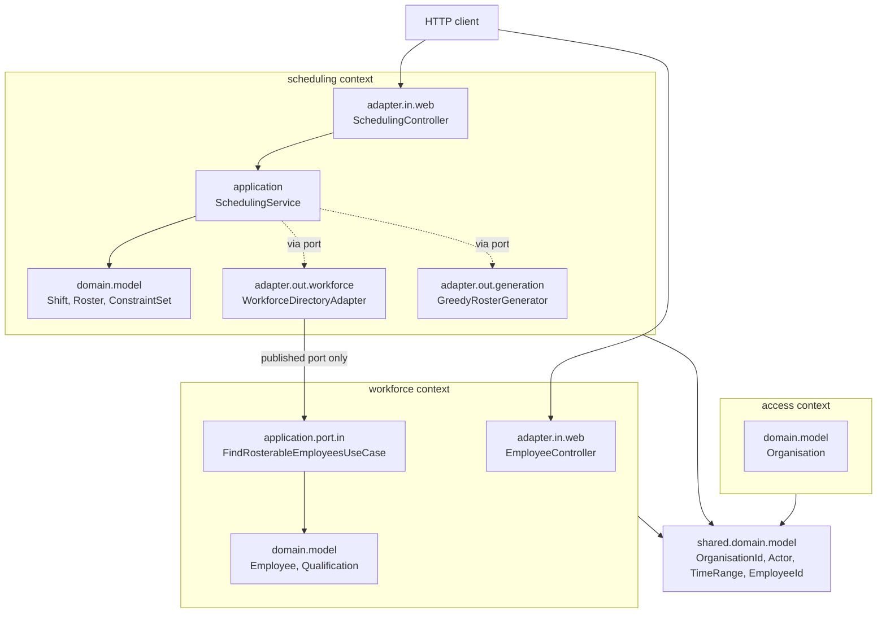
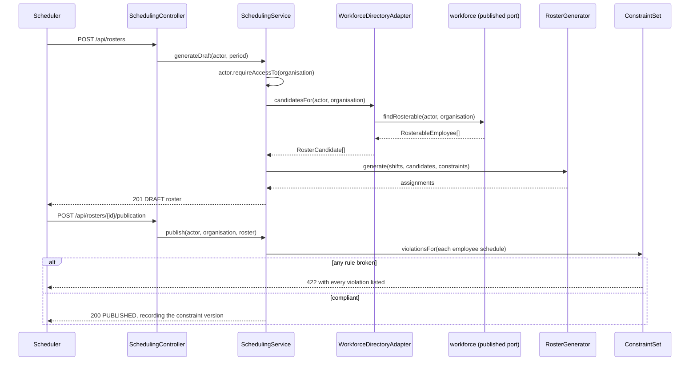

# Architecture — HrSched

This document records the system **as it actually is**. It is descriptive, never aspirational:
a plan for something not yet built belongs in an [ADR](../ADRs/) as a *Proposed* decision.

For *what the system must do*, see [requirements.md](../requirements/requirements.md); for *why*
these choices were made, see the [ADRs](../ADRs/).

> **Current state:** the domain is modelled and works end to end — define people and shifts,
> configure rules, generate a roster, publish it — but **generation is greedy, not optimised**
> (see [ADR-005](../ADRs/ADR-005-roster-generation-behind-a-port.md)), **nothing survives a
> restart**, and **there is no authentication**: the acting identity comes from request headers
> and any caller can claim any role.

---

## Architecture overview

The repository holds `backend/` and, once a framework is chosen, `frontend/` as siblings
([ADR-007](../ADRs/ADR-007-monorepo-backend-and-frontend.md)). Only the backend exists.

The backend is a single Spring Boot process serving HTTP on 8080. Its code is organised **by
bounded context**, each context a top-level package holding its own complete **hexagon**
([ADR-006](../ADRs/ADR-006-organise-packages-by-bounded-context.md)).

Three rules hold this together, and each fails the build when broken:

1. Inside a context, dependencies point inward. The domain imports nothing but the JDK.
2. A context may reference another context's `application.port.in` package and nothing else.
3. The shared kernel depends on no context.

## Components

| Component | Responsibility |
| --- | --- |
| `shared.domain.model` | The kernel: `OrganisationId`, `UserId`, `EmployeeId`, `QualificationId`, `Role`, `TimeRange`, and the sealed `Actor` (`TenantActor`, `Operator`). Identities and pure values that cross contexts, with no behaviour of their own. |
| `access.domain.model` | `Organisation` — the tenant itself. Deliberately small: the tenancy *types* live in the kernel because every context needs them. |
| `workforce.domain.model` | `Employee` (aggregate root: qualifications, unavailability, preferences, contract terms), `Qualification`, `ShiftPreference`, `ContractTerms`. |
| `workforce.application` | Employee and qualification use cases. `FindRosterableEmployeesUseCase` is this context's **published API**, returning `RosterableEmployee` rather than the aggregate. |
| `scheduling.domain.model` | `Shift`, `Roster` (aggregate root), `Assignment`, `ConstraintSet` and the sealed `WorkingTimeConstraint` family, `EmployeeSchedule`. |
| `scheduling.application` | Shift definition, constraint configuration, roster generation and publication. Assembles the evidence constraints are judged against. |
| `scheduling.adapter.out.workforce` | The anti-corruption layer: the **only** class in scheduling permitted to name another context, and only its published port. |
| `scheduling.adapter.out.generation` | `GreedyRosterGenerator` — a placeholder implementation of the generation port. |
| `*.adapter.out.persistence` | In-memory repositories, every read scoped by organisation. Placeholders until ADR-004. |
| `configuration` | Spring wiring. The only place permitted to see more than one context, which is why the rules exempt `@Configuration`-annotated classes and nothing else. |

## Communication

Inbound HTTP only; nothing calls out. Contexts talk in-process, through published driving ports,
by direct method call. There are no events and no queues.

## Data flow

Generating and publishing a roster:

Nothing is persisted beyond process lifetime.

## External dependencies and integration points

**At runtime: none.** No database, broker, or third-party API.

| Dependency | Used for | Justification |
| --- | --- | --- |
| `spring-boot-starter-webmvc` | HTTP boundary, embedded Tomcat | ADR-001. Boot 4.x renamed this from `spring-boot-starter-web`. |
| `spring-boot-starter-actuator` | Health and readiness probes | Required of every service by the project baseline. |
| `archunit-junit5` | Enforcing the hexagon and the context boundaries | Nothing else can fail a build on a dependency direction. |
| `spotless-maven-plugin` + `google-java-format` | Format check bound to `validate` | ADR-002. |

## Structural decisions not visible from the file layout

- **No working-time threshold is hardcoded anywhere.** A minimum rest period is a value in a
  `ConstraintSet`, never a constant. A jurisdiction is a *preset*: a named set of values loaded
  as data, whose numbers must be sourced from the statute. This is the single most important
  property of the model, and the reason the constraint types carry their own thresholds.
- **Constraints are hard; objectives do not exist yet.** `ConstraintSet` holds only rules that
  must never be broken. Fairness, preferences and disruption — what makes one legal roster better
  than another — are a separate concept that is not modelled.
- **Tenancy is in every signature, on purpose.** Repository lookups take an `OrganisationId`, so
  a cross-tenant read cannot be written by forgetting a filter. See
  [ADR-009](../ADRs/ADR-009-tenant-isolation-in-the-domain.md).
- **A cross-tenant attempt returns 404, never 403.** A 403 would confirm the resource exists in
  another organisation.
- **`Actor` is sealed.** The set of things that can cross a tenant boundary is closed and lives
  in one file; `Operator` is the only member that can, and it is a named type rather than an
  implicit privilege.
- **Aggregates are immutable.** Every change returns a new instance, so nothing is ever observed
  half-updated and invariants are checked in exactly one place.
- **Entities are classes, value objects are records.** `Shift`, `Roster`, `Employee`,
  `Organisation` and `Qualification` compare by identity alone; `TimeRange`, `ShiftId`,
  `ContractTerms` and the constraints are their values.
- **Constraint checking lives in the application layer**, not in `Roster`. It needs when each
  shift runs and who is available — data the aggregate cannot reach. The judgement itself is
  still the domain's.
- **`EmployeeSchedule.workingDays()` counts days in UTC**, because `TimeRange` carries no zone.
  For shifts crossing local midnight this miscounts, and it is one more reason the zone question
  must be answered before production.
- **`MaximumWeeklyWorkingTime` treats the roster period as the reference period.** Jurisdictions
  that average over a longer window cannot be expressed; that needs history beyond the roster.
- **The header-based actor is insecure by design** and must be deleted when authentication
  arrives. It exists so the use cases can be exercised, not as a step towards a real one.
- **The constraint store keeps only the current version**, while a published roster records the
  version that approved it. Historical versions must be retrievable before that record means
  anything — owed alongside ADR-004.
