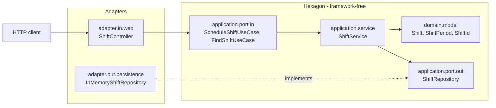
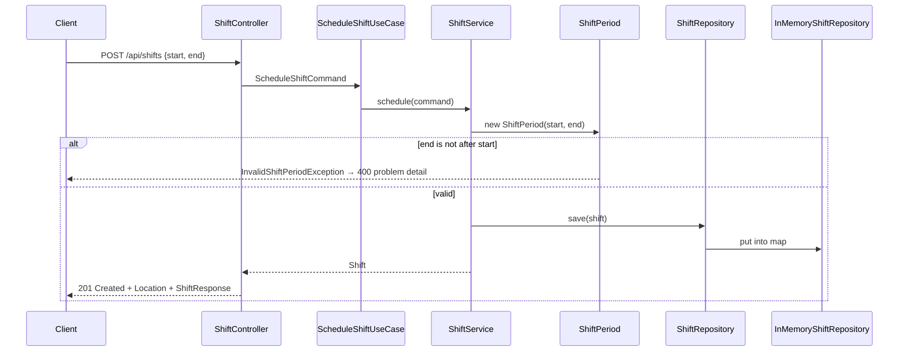

# Architecture — HrSched

This document records the system **as it actually is**. It is descriptive, never
aspirational: a plan for something not yet built belongs in an [ADR](../ADRs/) as a
*Proposed* decision, not here.

For *what the system must do*, see [requirements.md](../requirements/requirements.md); for
*why* these choices were made, see [ADR-001](../ADRs/ADR-001-java-spring-boot-maven.md),
[ADR-002](../ADRs/ADR-002-single-command-build-gate.md), and
[ADR-003](../ADRs/ADR-003-hexagonal-architecture-with-ddd.md).

> **Current state:** the hexagon is in place and enforced, but it is nearly empty. One
> walking-skeleton use case exists — schedule a shift, read it back — which satisfies **no
> stated functional requirement**. It is scaffolding that keeps the architecture rules
> honest, not a delivered capability.

---

## Architecture overview

A single Spring Boot process, packaged as an executable JAR, serving HTTP on port 8080 via
embedded Tomcat. Inside it, the code is a **hexagon**: a framework-free core surrounded by
adapters that translate between the outside world and the core's ports.

Dependencies point inward only. The domain knows nothing about the application layer, the
application layer knows nothing about adapters or Spring, and only `adapter` and
`configuration` import framework types.

## Components

| Component | Responsibility |
| --- | --- |
| `domain.model` | `Shift` (entity, identity equality), `ShiftPeriod` and `ShiftId` (value objects), `InvalidShiftPeriodException`. Enforces the one invariant that exists: a period must end after it starts. JDK imports only. |
| `application.port.in` | Driving ports — `ScheduleShiftUseCase`, `FindShiftUseCase` — plus the transport-independent `ScheduleShiftCommand`. |
| `application.port.out` | Driven ports. `ShiftRepository` states what the application needs from storage; storage conforms to it, never the reverse. |
| `application.service` | `ShiftService` orchestrates: turns a command into domain objects, lets the domain reject what is invalid, hands the result to a port. Holds no rules and no annotations. |
| `adapter.in.web` | `ShiftController`, its request/response DTOs, and `ShiftExceptionHandler`, which translates a domain rule violation into an RFC 9457 problem with status 400. |
| `adapter.out.persistence` | `InMemoryShiftRepository`, a `ConcurrentHashMap`. A placeholder until ADR-004. |
| `configuration` | `UseCaseConfiguration` constructs application services as beans, so they need no Spring annotation. |
| `HrSchedApplication` | Composition root. Starts Spring and nothing else. |
| Spring Boot Actuator | `/actuator/health`, `/health/liveness`, `/health/readiness`. Probes are enabled explicitly because Spring defaults them off outside Kubernetes. |

## Communication

Inbound HTTP only. Nothing calls out. Within the process, components talk by direct method
call through interfaces — there are no events, queues, or shared storage.

## Data flow

Scheduling a shift, end to end:

Nothing survives a restart: the only store is in memory.

## External dependencies and integration points

**At runtime: none.** No database, broker, or third-party API.

At build time:

| Dependency | Used for | Justification |
| --- | --- | --- |
| `spring-boot-starter-webmvc` | HTTP boundary and embedded servlet container | The framework chosen in ADR-001. **Boot 4.x renamed this** from `spring-boot-starter-web`. |
| `spring-boot-starter-actuator` | Health and readiness endpoints | The project baseline requires every service to expose them. |
| `spring-boot-starter-webmvc-test`, `spring-boot-starter-actuator-test` | Test scope | Boot 4.x splits the former single `spring-boot-starter-test` into per-concern starters. |
| `archunit-junit5` | Enforcing the hexagon in the build | Nothing in the JDK, Maven, or Spring can fail a build when the domain imports a framework type. Without it, ADR-003 is a comment. Apache-2.0, actively maintained. |
| `spotless-maven-plugin` + `google-java-format` | Format check bound to `validate` | See ADR-002. |

## Structural decisions not visible from the file layout

- **`domain` and `application` are both framework-free.** Application services carry no
  `@Service`; `configuration.UseCaseConfiguration` constructs them. Only `adapter` and
  `configuration` may import Spring.
- **The dependency rule is enforced, not merely documented.** `HexagonalArchitectureTest`
  runs in `./mvnw verify` with four rules: domain depends on nothing but the JDK, application
  is free of the framework, dependencies point inward, packages are free of cycles. Both the
  domain rule and the layered rule were confirmed to fail when a violation is introduced.
- **`Shift` is an entity, not a record.** Equality is by `ShiftId` alone, because two shifts
  with identical periods are still different shifts. `ShiftId` and `ShiftPeriod` are records,
  because they *are* their values.
- **`ShiftPeriod` makes an illegal state unrepresentable.** An instance cannot exist unless it
  ends after it starts, so no caller has to check.
- **`Shift` is not yet an aggregate root.** It will guard headcount, qualifications, and
  assignments once Q2 and Q4 are answered. Modelling them now would encode invented policy.
- **Persistence is deliberately absent.** No JPA or JDBC starter is on the classpath, so
  ADR-004 has not been made by accident. Replacing `InMemoryShiftRepository` is the whole of
  the change when it is.
- **Time is modelled as `Instant`.** Rosters are usually read in a site's local time, so this
  is likely to change once Q3 and Q5 are answered.
- **Jackson 3.** Boot 4.1.1 ships `tools.jackson.databind`, not `com.fasterxml.jackson.databind`.
