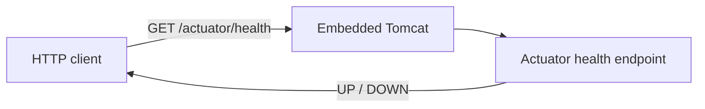

# Architecture — HrSched

This document records the system **as it actually is**. It is descriptive, never
aspirational: a plan for something not yet built belongs in an [ADR](../ADRs/) as a
*Proposed* decision, not here.

For *what the system must do*, see [requirements.md](../requirements/requirements.md); for
*why* these choices were made, see [ADR-001](../ADRs/ADR-001-java-spring-boot-maven.md) and
[ADR-002](../ADRs/ADR-002-single-command-build-gate.md).

> **Current state:** a runnable Spring Boot application with **no domain logic**. It starts,
> serves health and readiness endpoints, and does nothing else. The rostering domain
> described in the requirements does not exist yet.

---

## Architecture overview

A single Spring Boot process, packaged as an executable JAR, serving HTTP on port 8080 via
embedded Tomcat. There is no database, no message broker, no external service, and no second
deployable. Everything runs in one JVM.

## Components

| Component | Responsibility |
| --- | --- |
| `HrSchedApplication` | Composition root. Starts the Spring context and nothing else — it holds no logic, so the domain stays testable without booting the framework. |
| Spring Boot Actuator | Exposes `/actuator/health`, `/actuator/health/liveness`, and `/actuator/health/readiness`. Configured in `src/main/resources/application.properties`; probes are enabled explicitly because they are off by default outside Kubernetes. |
| Embedded Tomcat | HTTP listener, supplied by `spring-boot-starter-webmvc`. Not configured beyond defaults. |

No domain, application-service, or persistence component exists yet.

## Communication

Inbound HTTP only. Nothing calls out, and there is no communication *between* components,
because there is exactly one process with no collaborators.

## Data flow

The only path through the system today:

No data is read, written, or persisted. Nothing survives a restart, because nothing is
stored.

## External dependencies and integration points

**At runtime: none.** The application depends on no database, broker, or third-party API.

At build time:

| Dependency | Used for | Justification |
| --- | --- | --- |
| `spring-boot-starter-webmvc` | HTTP boundary and embedded servlet container | The framework chosen in ADR-001; supplies the transport layer the service will need. |
| `spring-boot-starter-actuator` | Health and readiness endpoints | The project baseline requires every service to expose them; Actuator supplies them as configuration rather than code. |
| `spring-boot-starter-webmvc-test`, `spring-boot-starter-actuator-test` | Test scope | Boot 4.x splits the former single `spring-boot-starter-test` into per-concern starters. |
| `spotless-maven-plugin` + `google-java-format` | Format check bound to `validate` | See ADR-002. |

## Structural decisions not visible from the file layout

- **Package root** is `io.github.naimelijah.hrsched`. Only the composition root lives there
  today.
- **Dependency direction is intended but not yet enforced.** The domain must not import
  Spring, I/O, or transport types; adapters depend on the core and never the reverse. Right
  now there is no domain to violate this, and *nothing in the build enforces it* — no
  ArchUnit test, no module boundary. That enforcement is owed, and belongs with ADR-003.
- **The persistence decision is deliberately absent.** No JPA or JDBC starter is on the
  classpath, so no storage choice has been made by accident. See ADR-004 (unwritten).
- **The build is the boundary for style and correctness.** Spotless runs in `validate`, so a
  formatting violation fails the build before tests execute. There is no separate lint step
  to forget.
