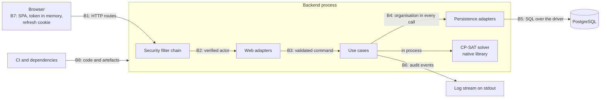

# Threat model — HrSched

**Status: code level.** This models the backend, the single-page application and CI, as they stand
with the fixes of the first full-system scan ([#250](https://github.com/NaimElijah/HrSched/issues/250))
merged. It does not model the public deployment: nothing is deployed yet (milestone M3), and
[#171](https://github.com/NaimElijah/HrSched/issues/171) extends this document with the AWS
topology, which is out of scope here. What only the edge can provide appears below as a residual
risk and nowhere else.

Checked against `dev` at `5949451`, with the fixes of #250 merged.

This document states **threats and what stops them**. *What* the system must do is in
[requirements.md](../requirements/requirements.md), *how* it is built in
[architecture.md](../architecture/architecture.md), and *why* in the [ADRs](../ADRs/). None is
restated here.

---

## Scope and how to use it

**In scope:** the Spring Boot process and everything it loads, including the native CP-SAT library;
`frontend/src`; `.github/workflows/ci.yml`, `.github/dependabot.yml`, `osv-scanner.toml` and
`backend/compose.yaml`; the dependencies of both projects.

**Out of scope:** CloudFront, WAF, TLS termination, the load balancer, RDS, Secrets Manager and the
deploy path ([#171](https://github.com/NaimElijah/HrSched/issues/171)); the organisations' own
devices and networks; the people who administer a future deployment.

**ADRs cited:**
[009](../ADRs/ADR-009-tenant-isolation-in-the-domain.md),
[010](../ADRs/ADR-010-score-a-roster-by-three-objectives-each-organisation-weights.md),
[011](../ADRs/ADR-011-issue-our-own-access-tokens.md),
[012](../ADRs/ADR-012-acting-identity-carries-its-employee-record.md),
[016](../ADRs/ADR-016-structured-logs-and-a-propagated-trace-id.md),
[018](../ADRs/ADR-018-audit-through-a-port-not-a-queryable-trail.md),
[024](../ADRs/ADR-024-answer-unbindable-requests-with-a-problem-detail.md),
[027](../ADRs/ADR-027-take-turns-publishing-within-an-organisation.md),
[028](../ADRs/ADR-028-keep-the-session-in-memory-and-a-rotating-refresh-cookie.md),
[029](../ADRs/ADR-029-provision-accounts-from-the-top-down.md),
[030](../ADRs/ADR-030-confine-the-operator-to-the-register-of-organisations.md),
[031](../ADRs/ADR-031-take-the-organisation-from-the-account.md),
[032](../ADRs/ADR-032-close-the-security-chain-by-default.md),
[041](../ADRs/ADR-041-make-concurrent-changes-take-turns-on-the-row.md),
[045](../ADRs/ADR-045-generate-outside-the-use-cases-transaction.md),
[046](../ADRs/ADR-046-generate-in-the-background-and-keep-the-job-in-postgresql.md),
[047](../ADRs/ADR-047-audit-dependencies-in-ci-with-osv-scanner.md),
[048](../ADRs/ADR-048-keep-a-browsers-tabs-on-one-session.md),
[049](../ADRs/ADR-049-refuse-the-metrics-to-every-caller-until-a-scraper-exists.md),
[050](../ADRs/ADR-050-reject-the-protected-resource-metadata-endpoint.md).

**Reading it.** Each control names the class or test that enforces it, so you can check it rather
than trust it, as `requirements.md` does. `convention`
means nothing fails if the control is removed, and *none* means there is no control. Threats are
written by consequence; they never say how to exploit anything, and an edit must keep it so.

**Update it in the same change** when:

- an **entry point** appears: a route, a startup input, a background thread;
- a **trust boundary** appears: a store, a client, an outbound call, another process;
- an **asset** appears: a new kind of personal data or credential;
- a residual risk's issue closes or its decision is made: delete or rewrite its row;
- a later scan of epic [#261](https://github.com/NaimElijah/HrSched/issues/261) finishes. Each scan
  reads this first, then adds what it found: a control with its test, or a residual risk with its
  issue.

---

## Assets

Ordered by the consequence of exposure or loss.

| ID | Asset | If exposed or lost | Held in |
| --- | --- | --- | --- |
| A1 | Personal and health-adjacent data: names, contracted hours, declared absence, stated preferences, and who works when | Harm to a person, since absence and hours say things about health and household; and to the organisation that trusted HrSched as its processor ([#113](https://github.com/NaimElijah/HrSched/issues/113)) | `employee` and its child tables, rosters; responses to an Admin or Scheduler (R12); never a log |
| A2 | Credentials and tokens: password hashes, refresh-token digests, the token signing key, the bootstrap operator's password, temporary passwords, live access tokens | Account takeover. The signing key forges any actor in any organisation; a first Admin's password is the whole organisation | `account`, `sign_in_session`; the deployment's environment (`.env.example`); process and browser memory |
| A3 | Account existence: which sign-in names exist on the platform (R13) | Tells a stranger who uses HrSched, and, once names are email addresses (R38), which people | The answers sign-in, account creation and the metrics give |
| A4 | Tenant separation | A cross-tenant read is a security incident, not a bug | `organisation_id` on every root, and in every repository signature of the tenant contexts but a save's (ADR-009), which `repository_methods_take_an_organisation` holds. The reads of `access` that run before an organisation is known are listed in B4 |
| A5 | Availability shared by every organisation: one JVM, one connection pool, the generation threads, one database | One organisation's load slows or stops all of them | One process, one pool |
| A6 | Integrity of published rosters | A roster that looks authoritative while breaking its constraint set; hours nobody counted ([R10](../requirements/requirements.md#rules-that-hold-regardless-of-configuration) and [constraints are invariants](../requirements/requirements.md#constraints-are-invariants-not-warnings); R37 keeps the history append-only) | `roster` tables; the publication lock |
| A7 | The record of what happened | After an incident nobody can say who did what in which organisation | The log stream (ADR-018) |

---

## Actors

| Actor | Reaches | Bounded by |
| --- | --- | --- |
| Anonymous caller | Sign-in, refresh, sign-out, health and info | The chain refuses everything else (ADR-032) |
| Employee | Their own record, declarations and schedule; their inbox; swaps they are party to; the organisation's shifts, qualifications, rules and weights | Roles in the use cases; `TenantActor.isThemself` (ADR-012). Beyond role: colleagues' data, rosters |
| Scheduler | Shifts, rosters, generation, publication, swap decisions; reading people; declaring and withdrawing unavailability and stating preferences for any employee of their organisation (`EmployeeService.authoriseSelfOrManager`) | Cannot change rules, add people or administer accounts. Beyond role: the constraint set |
| Admin | People, qualifications, accounts, the constraint set and weights | Cannot define shifts, generate or publish. Beyond role: building rosters |
| Operator | The register of organisations; sets the temporary password of each first Admin | Refused inside every organisation (ADR-030). Knows a temporary password until it is changed |
| Member of another organisation | A valid token of their own | The organisation comes from their account, never the request (ADR-031) |
| Whoever reads the logs | Every log line, and the counters if they are ever read | Identifiers only, no names (ADR-018) |
| A future developer | A new route, query or log line | Build-failing architecture rules; the closed chain |
| A compromised dependency or CI action | The build, the test run, or the production JVM | Pinned versions and the audit job; no isolation inside the JVM |

---

## Entry points and trust boundaries

The route-by-role table is in [architecture.md](../architecture/architecture.md#authentication).
Grouped by what a caller gains:

| ID | Entry point | Who may reach it | Decided by |
| --- | --- | --- | --- |
| E1 | Signing in, renewing and signing out | Anybody. Renewing needs the refresh cookie and `X-Requested-With`; signing out needs the header | The credential presented, in `SessionService` |
| E2 | Reading one's own session, and changing one's own password | Any authenticated account, a pending password change included | The chain |
| E3 | People, qualifications and declarations (workforce) | Any tenant role | The use case: organisation, role, `isThemself` |
| E4 | Shifts, rules, weights, rosters, swaps and one's own schedule (scheduling) | Any tenant role | The use case |
| E5 | One's own inbox (notifications) | Any tenant role | The use case, from the actor's employee record |
| E6 | Administering the accounts of the caller's own organisation | `ADMIN` | The chain, then `AccountService` |
| E7 | The register of organisations, and one organisation by identity | The register: `OPERATOR`. One organisation: any role, the use case deciding whose. The only route naming an organisation in its path | The chain, then `OrganisationService` |
| E8 | `/actuator/**` | Health and info: anybody. `metrics` and `prometheus`: nobody. Nothing else is exposed | The chain and the exposure list |
| E9 | Anything else | Nobody | `denyAll` |
| E10 | Not HTTP: the environment (signing key, database credentials, bootstrap operator), and Flyway migrations on startup | Whoever deploys | Startup refuses to run without a key (`AccessTokenKeyTest`) |

---

## Threats and controls

STRIDE per boundary: **S**poofing, **T**ampering, **R**epudiation, **I**nformation disclosure,
**D**enial of service, **E**levation of privilege. A row whose *Enforced by* is *none* is a threat
with no control yet; the issue that owns it is linked, and [Residual risks](#residual-risks)
states its consequence.

### B1: the routes

| | Threat | Control | Enforced by |
| --- | --- | --- | --- |
| D | A request body makes the server hold what it is sent, before any use case runs | JSON over `hrsched.web.max-json-document-bytes` is refused with 413, a body that is not UTF-8 JSON with 415 (`JsonCharsetFilter`), multipart is off, and Boot's form-content filter, which would read a form body whole ahead of the chain, is off (`spring.mvc.formcontent.filter.enabled`); a form posted to a route that takes JSON is held to the same limit (`server.tomcat.max-http-form-post-size`); a limit of zero or less fails startup (`RequestBodyLimitProperties`). A body Jackson detects as UTF-16 or UTF-32 is counted in characters, not bytes (#278) | `RequestBodyLimitHttpTest`, `RequestBodyCharsetHttpTest`, `MultipartRequestHttpTest`, `JsonDocumentLimitStartupTest`, `RequestBodyReadingFiltersTest`, `FormPostLimitHttpTest` |
| D | One organisation's generations keep every other from generating | `hrsched.generation.concurrent-runs` caps solves per instance; one more is refused with a 503, never queued (ADR-046) | `GenerationRefusalsTest` (the 503), `SchedulingServiceTest`, `GenerationRunnerTest` |
| D | Sign-in is flooded, tying up the database connections every organisation needs, or is used to keep a person locked out or from changing their password | Lockout bounds guessing, not floods or concurrent sign-ins | none: [#142](https://github.com/NaimElijah/HrSched/issues/142) |
| I | The metrics tell a stranger whether a sign-in name is real, or whether their probing was seen | `metrics` and `prometheus` are refused to every caller, token or not, by endpoint id and on every path beneath ([ADR-049](../ADRs/ADR-049-refuse-the-metrics-to-every-caller-until-a-scraper-exists.md)), a signed-in tenant Admin and the Operator included; `loggers`, `env`, `heapdump` and the actuator discovery page are not exposed | `MetricsHttpTest`, which also pins that the actuator index lists no metrics endpoint, with or without a token |
| E | A browser renders or frames an API response as a page | Every response the security chain writes carries `Content-Security-Policy: default-src 'none'; frame-ancestors 'none'` and `Referrer-Policy: no-referrer`. The request firewall's own 400, written before the chain, carries neither ([architecture.md](../architecture/architecture.md#authentication)) | `ResponseSecurityHeadersHttpTest` |
| I | Credentials and tokens cross the network in clear | None in this repository: TLS is the edge's | none: [#162](https://github.com/NaimElijah/HrSched/issues/162), [#171](https://github.com/NaimElijah/HrSched/issues/171) |
| D | A crafted `tracestate` header, from anybody and on any path, holds a request thread before the security chain runs | OpenTelemetry is held at 1.67.0 or later, ahead of the Boot BOM, because earlier versions parse `tracestate` in quadratic time ([GHSA-ccrj-gw8r-854m](https://osv.dev/GHSA-ccrj-gw8r-854m), [#285](https://github.com/NaimElijah/HrSched/issues/285)). Tomcat's header size limit bounds each request; the edge stripping inbound trace headers ([#162](https://github.com/NaimElijah/HrSched/issues/162)) would remove the input | `opentelemetry.version` in `backend/pom.xml`, and CI's dependency audit (ADR-047); `TraceIdHttpTest` (such a header neither fails the request nor loses the trace) |

### B2: the security filter chain

| | Threat | Control | Enforced by |
| --- | --- | --- | --- |
| S | A caller acts as an account they do not hold | Tokens are HrSched's own: RS256 pinned, with type, issuer, audience, expiry, issued-at, subject and session all required. The account and session are then read from the database on every request, so disabling, demoting and signing out bite at once (ADR-011) | `AccessTokenDecoderTest`, `ActorAuthenticationConverterTest`, `SessionHttpTest`, `AccountHttpTest` |
| S | Passwords are guessed, or the refusal reveals whether a name exists | bcrypt at the configured strength; lockout after consecutive failures (R29), a locked account refused its password change too; one identical 401 for every sign-in refusal; a password comparison even for an unknown name. Whether a real and an unknown name take the same time to refuse is unmeasured ([#142](https://github.com/NaimElijah/HrSched/issues/142)) | `AuthHttpTest`, `SessionServiceTest`, `LockedAccountPasswordChangeHttpTest` |
| S | Another site makes a browser renew or end a session | The refresh cookie is `__Secure-`, `HttpOnly`, `Secure`, `SameSite=Strict`, scoped to `/api/auth`, and renewing and signing out require `X-Requested-With`. No CORS is configured, which is what makes the header a lock (ADR-028) | `AuthHttpTest`, `SessionRefreshHttpTest`. The absence of CORS: *none* |
| T | A stolen refresh token is used beside its owner | Rotation on every use; a token presented twice ends the whole session, and the revocation commits though the request is refused | `SessionRefreshHttpTest` |
| T | An identity is taken from a header | No code reads `X-User`, `X-Role`, `X-Organisation` or `X-Employee`; a request sending them is answered as its token says | `OrganisationHttpTest`, `EmployeeHttpTest` |
| I | A refusal says why: expired, signed with another key, missing a claim | One fixed challenge and body for every refused token, and none points at a metadata document ([ADR-050](../ADRs/ADR-050-reject-the-protected-resource-metadata-endpoint.md)) | `RefusedTokenChallengeHttpTest`, `ProtectedResourceMetadataHttpTest` |
| E | A route is open by oversight | The chain ends in `denyAll`; the filter Spring Security adds that served a route no rule names is removed from the built chain; a test pins the chain's filter list | `SecurityConfigurationTest`, `SecurityFilterChainTest`, `ProtectedResourceMetadataHttpTest` |
| E | The Operator, or an account with a pending password change, reaches tenant data | Tenant routes require a tenant role; the Operator holds none, and a pending account holds no role at all | `ActorAuthenticationConverterTest`, `EmployeeHttpTest`, `AccountHttpTest` |

### B3: the web adapters' validation

| | Threat | Control | Enforced by |
| --- | --- | --- | --- |
| T | A value the store or the solver cannot hold is stored changed, answers 500, or breaks every later generation of an organisation | A 400 that repeats no value: spans the store cannot hold (on `GET /api/shifts` too), working-time values too large to count, and a shift too long to count in nanoseconds | `StorableSpans` and `UnrepresentableValueHttpTest` (workforce); `StorableSpans`, `UnstorableInstantHttpTest`, `UncountableSpanHttpTest` and `UnrepresentableConstraintHttpTest` (scheduling) |
| T | An employee's or a qualification's name the store cannot hold answers 500 or is stored changed | A 400 that repeats no name: a NUL, half of a surrogate pair, or more UTF-8 bytes than a name index entry holds with room to spare | `StorableNames` and `UnrepresentableValueHttpTest` (workforce) |
| I | An error body or log line repeats what was sent, a span or hours among it | Messages are constants; a body that cannot be bound is answered by one fallback handler that names the parameter and not the value (ADR-024) | `RequestBindingHttpTest`, `UnrepresentableValueHttpTest`, `AuthHttpTest` |
| E | Somebody acts on a colleague's record | `TenantActor.isThemself` carries the link; an Admin or Scheduler may act on behalf, an Employee only on themself | `EmployeeHttpTest`, `EmployeeServiceTest` |
| E | Code builds an actor, or reads the caller from the thread, instead of taking it from the token | `SecurityContextHolder` is forbidden outside `configuration.security`; only `access.domain.model` may construct an actor, constructor references included, and only the access use cases may ask an account for its actor | `HexagonalArchitectureTest`: `only_an_account_makes_an_actor`, `only_the_access_use_cases_ask_an_account_for_its_actor` |

### B4: the use cases to persistence

| | Threat | Control | Enforced by |
| --- | --- | --- | --- |
| I, T | A member reads or changes another organisation's row | Every lookup in the tenant contexts takes an `OrganisationId`; every upsert by identity refuses to store over another organisation's row; the answer is a 404, never a 403 (ADR-009, R19). Over HTTP the repositories' filtering is the control, because the organisation comes from the account | `HexagonalArchitectureTest` (`repository_methods_take_an_organisation`), `CrossTenantEmployeeWriteHttpTest`, `CrossTenantSchedulingWriteHttpTest`, `EmployeeHttpTest`, `RosteringHttpTest`, `NotificationHttpTest`, `AccountHttpTest`, and each `Jdbc*RepositoryTest` |
| I | A read that takes no organisation returns the wrong row | The reads and writes that run without an organisation are the ones ADR-055 lists: `AccountRepository.findBySignInName` and `findForAuthentication`, `SessionRepository.findRefreshToken`, `findAuthenticatedSession` and the session writes, and `OrganisationRepository.findAll` and `findById`, the register itself. Each is bounded by what it is given: the submitted sign-in name, the verified token's `sub` and `sid`, the refresh token's digest, for the register the actor's guard (ADR-031), and for `revokeEverySessionOf` the scoped `findForUpdate` earlier in its use case | `HexagonalArchitectureTest` (`repository_methods_take_an_organisation`, whose `UNSCOPED_METHODS` names each of these but `findById`, which takes an `OrganisationId`), `SessionServiceTest`, `ActorAuthenticationConverterTest`, `JdbcAccountRepositoryTest`, `JdbcSessionRepositoryTest`, `OrganisationServiceTest` |
| T | A notification is moved to another inbox, or back to unread | The upsert keeps the recipient, sets only `read`, and refuses a change to the content | `JdbcNotificationRepositoryTest`, `NotificationHttpTest` |
| E | An actor does what its role may not | Every use case calls `requireAccessTo` first, and `requireRoleIn` wherever a role is required. That is convention: no rule checks the call, and a refusal test per service catches its absence | `ActorTest` (the guard itself); refusal tests in `SchedulingServiceTest`, `SwapServiceTest`, `EmployeeServiceTest`, `QualificationServiceTest`, `NotificationServiceTest`, `AccountAdministrationTest`, `OrganisationServiceTest` |
| T | A roster breaking its constraint set is published, or is judged on evidence that could not be loaded | One judgement for publication and the draft check, every breach listed, no override; an assignment naming a shift that cannot be resolved refuses publication | `SchedulingServiceTest`, `RosteringHttpTest` |
| T | Two writers interleave and one change is lost, or two rosters both govern a day | `findForUpdate` row locks, a per-organisation advisory lock on publication, and the `roster_one_published_per_moment` exclusion constraint (ADR-027, ADR-041) | `RosteringHttpTest`, `JdbcRosterRepositoryTest` |
| D | A solve holds a pooled connection for minutes | The generator refuses to run inside a transaction (ADR-045) | `CpSatRosterGeneratorTest`, `TransactionalUseCasesTest` |
| D | Listing fails past what a statement can bind, or reads the whole history | Rosters and shifts load their children by the parent's tenant-scoped predicate, not by a list of ids. Workforce still binds one parameter per employee (`JdbcEmployeeRepository`) | `JdbcRosterRepositoryTest`, `JdbcShiftRepositoryTest`. The history read: *none*, [#34](https://github.com/NaimElijah/HrSched/issues/34) |

### B5: the JVM to the database

| | Threat | Control | Enforced by |
| --- | --- | --- | --- |
| T | SQL is built from input | Hand-written SQL with named parameters through `JdbcClient`; the only concatenation joins constant fragments | convention |
| I | A refused write's exception quotes the whole row, names and hours included | The driver's `logServerErrorDetail` is off, so a message names the constraint and not the row | `DatabaseErrorDetailTest` |
| I | The database server's own log quotes the same row | None in this repository | none: [#159](https://github.com/NaimElijah/HrSched/issues/159) |
| E | The serving role can alter the schema, because it also runs the migrations | None today | none: [#160](https://github.com/NaimElijah/HrSched/issues/160) |
| E | The local database is reachable from the network with a public password | Published on `127.0.0.1` only; the credential is local and the repository is public | `backend/compose.yaml`: *none* |
| E | `spring-boot:run` bootstraps a well-known local operator password and an ephemeral signing key, and is pointed at a database that is not local | The settings are bound to `default-cli` in `backend/pom.xml`, so the packaged jar carries neither, and the password must be changed at first sign-in (ADR-029). Nothing enforces that the goal runs only against a local database, and the password is in a public repository | `backend/pom.xml`: *none* |

### B6: the process to the log stream

| | Threat | Control | Enforced by |
| --- | --- | --- | --- |
| I | A name, an absence, hours, a password or a token reaches a log | `AuditedChange` carries a bare `UUID`, so a name has nowhere to go; messages are constants and variables are key-value fields; domain exceptions over personal data carry constant messages, and a generator defect over a declared absence reports a count and names nobody; nothing prints (ADR-016, ADR-018) | `SchedulingAuditLogTest`, `SchedulingServiceTest`, `WorkforceAuditLogTest`, `AccessAuditLogTest`, `NotificationAuditLogTest`, `AuthHttpTest`, `SignInNameTakenRefusalHttpTest`, `PasswordChangeRefusalLogHttpTest`, `HexagonalArchitectureTest` |
| R | A change cannot later be attributed, or a recorded change never happened | Every change and refusal is recorded after the save, with the actor, the organisation and the trace id. A log line cannot be rolled back and is not durable | `SchedulingAuditLogTest`, `SchedulingServiceTest`; durability: *none*, [#31](https://github.com/NaimElijah/HrSched/issues/31) |
| T | Input forges a log line | Structured ECS JSON, one object per line, with a constant message and every variable a field (ADR-016, ADR-018) | convention |
| T | A caller chooses the trace id its request is logged and answered under | An id sent with the request becomes its trace id and returns on `X-Trace-Id`. Its format is constrained, so nothing arbitrary reaches a log line. The edge should strip inbound trace headers ([#162](https://github.com/NaimElijah/HrSched/issues/162)) | `TraceIdHttpTest` (an inbound `traceparent` is honoured) |

### B7: the browser

| | Threat | Control | Enforced by |
| --- | --- | --- | --- |
| I, E | A script on the page takes the session | The access token lives in a module variable and in no storage; the refresh cookie is `HttpOnly`; React renders text escaped and no source file uses `dangerouslySetInnerHTML` (ADR-028). ADR-028 understates what a script that does run could do: it cannot read the refresh cookie, but it can renew through it, so it holds the session until the session's absolute lifetime ends (`hrsched.security.session.absolute-lifetime`, fixed when the session begins and never extended by `SessionService`), not only for the access token's lifetime. The preventive control is a Content-Security-Policy on the SPA's document, which the edge has to set ([#162](https://github.com/NaimElijah/HrSched/issues/162)) | `client.test.ts`. The absence of an unescaped sink: convention |
| S | A renewal quietly adopts another account's session, since every tab shares one cookie jar | A renewal answering for a different account ends the session | `renewalIdentity.test.ts` |
| I | A sign-out that failed looks successful, or other tabs keep showing personal data | An unconfirmed sign-out warns and offers a retry; tabs tell each other that a session ended, as one of two fixed values, `ended` or `sign-out-unconfirmed`, and never a token (ADR-048) | `signOutFailure.test.tsx`, `sessionAcrossTabs.test.tsx` |
| I | A colleague's temporary password is offered to the browser's password manager | `autocomplete` hints on those fields | `AccountsPage.test.tsx`, `OrganisationsPage.test.tsx` |
| I | The next person on a shared computer is signed in | None beyond the session's idle and absolute lifetimes (`hrsched.security.session.idle-lifetime`, `absolute-lifetime`) | none: [#265](https://github.com/NaimElijah/HrSched/issues/265) |
| E | The SPA's own page has no Content-Security-Policy or transport security | None in the repository: they belong to what serves the SPA | none: [#162](https://github.com/NaimElijah/HrSched/issues/162) |

The interface enforces nothing; every rule is the backend's, so a tampered SPA gains only what a
token already allowed.

### B8: CI and dependencies

| | Threat | Control | Enforced by |
| --- | --- | --- | --- |
| T | A dependency with a published advisory is merged | A job fails on any advisory in `backend/pom.xml`, Maven's transitive tree included, or `frontend/package-lock.json`; ignores need a date and a reason (ADR-047). It finds known advisories only | `dependency-audit` in `.github/workflows/ci.yml`, `osv-scanner.toml` |
| T | An action or the Maven distribution is replaced after it was trusted | Every action is pinned by commit SHA, Dependabot keeps the pins current, and Maven is checked against `distributionSha256Sum` after the cached copy is removed | `.github/workflows/ci.yml`, `backend/.mvn/wrapper/maven-wrapper.properties`: *none* |
| E | A build step reads a credential | Jobs run with `contents: read`, the checkout keeps no token, the workflow runs on `push` and `pull_request` and never `pull_request_target`, and it uses no secrets | `.github/workflows/ci.yml`: *none* |
| T | A red job does not stop a merge | None: none of the three CI jobs, `backend`, `frontend` and `dependency-audit`, is a required check | none: [#217](https://github.com/NaimElijah/HrSched/issues/217) |
| I | A key or password is committed | `.env` is ignored and `.env.example` holds no values; nothing scans for a secret | none: [#150](https://github.com/NaimElijah/HrSched/issues/150) |
| E | A compromised runtime dependency, the native solver included | It runs with the process's privileges: the signing key, the database credential and every organisation's data in memory. Nothing isolates it | none beyond the audit above |

---

## Residual risks

Stated by consequence. Each names who could do what to whom, what bounds it today, and the issue
that owns the decision or the fix.

| Issue | Consequence | Bounded today by |
| --- | --- | --- |
| [#262](https://github.com/NaimElijah/HrSched/issues/262) | A member of one organisation, acting within their role, could store or ask for enough to slow or stop HrSched for every organisation, or leave their own unable to generate. The open limits include shift length and count and the size of a generation | The request-body limit; refusal of values the store or solver cannot represent; the cap on concurrent solves. No business limit is decided |
| [#262](https://github.com/NaimElijah/HrSched/issues/262) (shift spread) | A generation can fail because it cannot count its shifts, and every generation burdens the solver threads that all organisations share | A single shift longer than generation can count is refused (`UncountableSpanHttpTest`). Whether to bound a shift's length, a generation's period or both is the owner's call |
| [#263](https://github.com/NaimElijah/HrSched/issues/263) | Generation capacity is one pool for all. One organisation's solves can keep every other's Scheduler refused as busy, and slow interactive requests while they hold the CPU; at the stated scale it needs no malice | `concurrent-runs` and the time limit per search |
| [#142](https://github.com/NaimElijah/HrSched/issues/142) | Anonymous callers could tie up the database connections that every organisation's requests need, since a sign-in holds a pooled connection for its whole transaction and nothing limits concurrent sign-ins. Anyone who knows a sign-in name could keep its holder locked out, and from changing their password, because a locked account cannot change it from a session it holds. A flood costs the server more than the sender. Whether a real and an unknown name take the same time to refuse is unmeasured | Lockout (`hrsched.security.sign-in.lockout-threshold`, `lockout-duration`; R29); the body limit. No throttle by source and no limit on concurrent sign-ins |
| [#141](https://github.com/NaimElijah/HrSched/issues/141) | An Admin creating an account, or the Operator onboarding an organisation, learns whether the name is held somewhere on the platform, in any organisation | A constant 409 detail; the refusal is logged and counted (`SignInNameTakenRefusalHttpTest`, `OnboardingSignInNameTakenHttpTest`); only an Admin or the Operator reaches it |
| [#214](https://github.com/NaimElijah/HrSched/issues/214) | Credential stuffing and tenant probing are refused one request at a time but never detected as a pattern, and a cross-tenant attempt over HTTP is not counted as one | Each refused sign-in is logged and counted; lockout; the counters cannot be read over HTTP (ADR-049). Nothing alerts |
| [#265](https://github.com/NaimElijah/HrSched/issues/265) | A temporary password never expires, so whoever obtains an unused one takes the account, a first Admin's being the organisation. A remembered sign-in outlives the browser, so the next user of a shared computer inherits it | A temporary password must be changed at first sign-in (R16); sessions end after `hrsched.security.session.idle-lifetime` idle and `absolute-lifetime` in all |
| [#266](https://github.com/NaimElijah/HrSched/issues/266) | A long but well-known password is accepted, and lockout limits guesses per account, not across accounts | Minimum length (`hrsched.security.password.minimum-length`); lockout per account; bcrypt strength (`hrsched.security.password.bcrypt-strength`) |
| [#267](https://github.com/NaimElijah/HrSched/issues/267) | A swap request may name an identifier that belongs to nobody here. An Employee's typo leaves a request nobody can see, holding the assignment's one pending slot, and the trail says somebody was told | A Scheduler rejects it |
| [#264](https://github.com/NaimElijah/HrSched/issues/264) | One person's stated preferences can outweigh a colleague's in the solver's score | Identical spans count once (`StatedPreferences`, `StatedPreferencesTest`); distinct overlapping ones are not merged. A Scheduler sees the preference total of a draft; each organisation weights the objective (ADR-010) |
| [#275](https://github.com/NaimElijah/HrSched/issues/275) | Some refusals Spring makes on its own, before a controller runs, such as a multipart request or a content type a route does not take, carry no problem-detail body. A client, the SPA included, can show nothing useful for them | Every refusal the API writes itself carries a problem detail; these answer with a status alone |
| [#278](https://github.com/NaimElijah/HrSched/issues/278) | A JSON body that declares no charset, but that Jackson reads as UTF-16 or UTF-32, can run to a few times the configured limit in bytes before it is refused, sign-in's included. The cost is bandwidth and decoding per request, not memory | The limit still holds in characters, so the heap held stays near it |
| [#34](https://github.com/NaimElijah/HrSched/issues/34) | Every use case that reads rosters loads the organisation's whole roster history, and publishing holds that organisation's publication lock meanwhile. A long history slows its own organisation and takes shared database time | Nothing; unmeasured against the stated scale ([#143](https://github.com/NaimElijah/HrSched/issues/143)) |
| [#31](https://github.com/NaimElijah/HrSched/issues/31), ADR-018 | The audit trail is a log stream. Where stdout is not collected it is lost, an Admin cannot read it, and a line survives the rollback of a change that did not happen | Lines carry identifiers only and the trace id; a use case refuses before it records, so a recorded change that did not happen needs a failure after the save (`backend/CLAUDE.md`) |
| [#159](https://github.com/NaimElijah/HrSched/issues/159) | The database server's own log quotes a refused row under default settings, so names and hours reach wherever that log is exported | The driver's setting (B5). A deployment must also set terse error verbosity |
| [#162](https://github.com/NaimElijah/HrSched/issues/162), [#171](https://github.com/NaimElijah/HrSched/issues/171) | The edge does not exist: no TLS, no transport-security header, no policy for the SPA's page, no web application firewall. Anyone on the path to a deployment that lacks them reads tokens and credentials | Nothing is deployed. The API sets its own CSP and Referrer-Policy; the `__Secure-` cookie prefix makes a browser refuse the cookie over plain HTTP |
| [#150](https://github.com/NaimElijah/HrSched/issues/150) | A committed signing key, database credential or bootstrap password goes unnoticed | Review; `.env` ignored |
| [#217](https://github.com/NaimElijah/HrSched/issues/217) | A change with a red build, test or audit can be merged, since none of the three CI jobs is a required check | The ruleset requires a pull request, and the owner merges it |
| [#78](https://github.com/NaimElijah/HrSched/issues/78), ADR-049 | The metrics are refused to everyone until a scrape path is decided, so nothing outside the process can read saturation or error rate, and alerting built on them cannot exist yet. Reopening them must not bring back the signal that a sign-in name is real | The refusal itself; `MetricsHttpTest` |
| [#160](https://github.com/NaimElijah/HrSched/issues/160) | A compromise of the request path could change the schema of every organisation, not only its data, because the serving database role also runs the migrations | Nothing is deployed; the SQL is parameterised by convention (B5) |
| [#109](https://github.com/NaimElijah/HrSched/issues/109), R39 | Operators and Admins sign in with a password alone, so whoever obtains an Admin's password acts as that organisation's Admin, and an Operator's as the register's | Lockout; a temporary password must be changed at first sign-in; session lifetimes. R39 is `not yet` |
| [#41](https://github.com/NaimElijah/HrSched/issues/41), Q23 | `sign_in_session` and `refresh_token` rows are never purged, so the database records when each person signed in, and the tables grow without bound. How long each record is kept, and what is erased on request, is undecided | They are held only in the database |

---

## Questions for the owner

1. **Controls with no test.** ADR-028's `X-Requested-With` lock rests on no CORS configuration
   existing, and nothing fails if one is added. Nothing fails either if SQL is built from input, or
   if a use case omits its `requireAccessTo` call. Should any become an architecture rule or a
   test, and under which issue?
2. **The Operator knows each first Admin's temporary password** until it is changed (ADR-029).
   [#265](https://github.com/NaimElijah/HrSched/issues/265) decides how long it lasts, not who
   knows it. Accept that in writing, or leave it?
